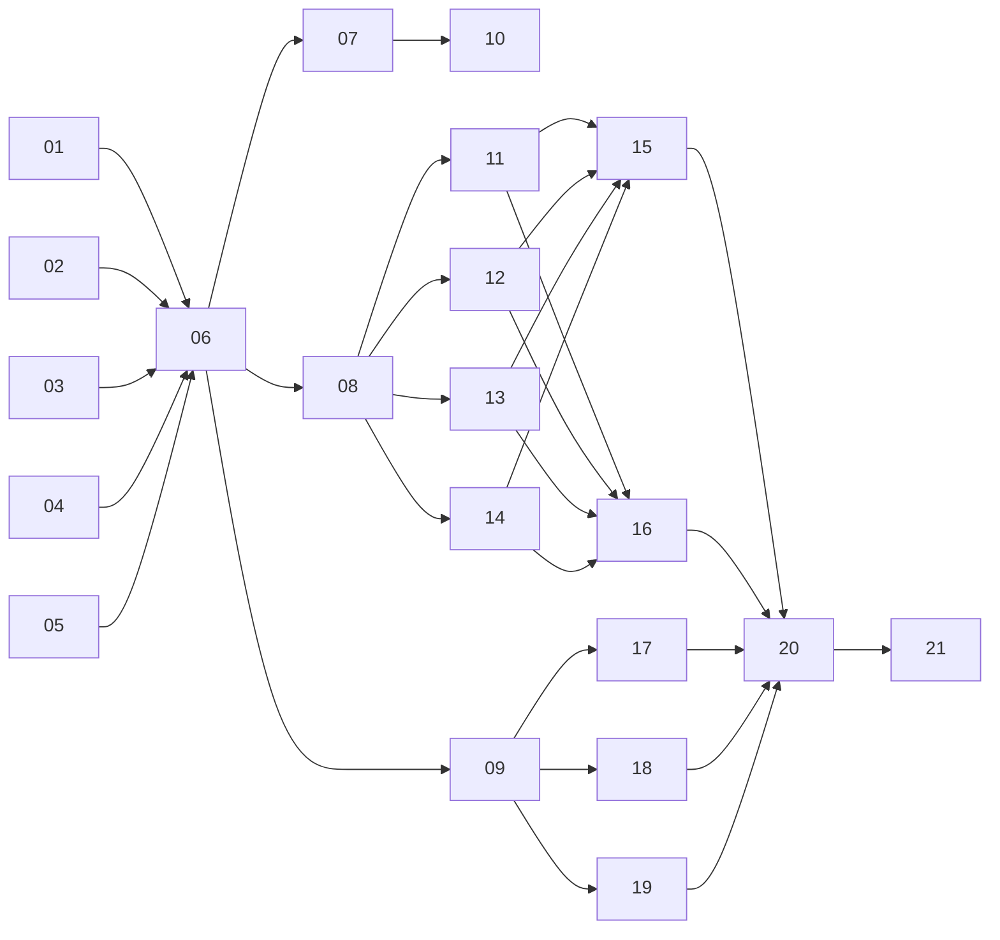

# AI Coding Agent 上下文管理教程：任务包

- `spec.md`：总规格（需求的唯一来源）
- `orchestrator-prompt.md`：主控 agent 提示词
- `issues/`：21 张任务票（按 to-tickets 规则拆分，一票一个文件）

## 依赖关系

## 三个阶段
- 阶段 1（01–09）：定方向。完成骨架、调研、大纲和 3 份样章，然后停下请作者确认。
- 阶段 2（10–14）：写主体。完成入门部分和主线 16 章，然后停下请作者确认。
- 阶段 3（15–21）：进阶与交付。完成进阶、源码解读、附录、集成和检查。

## 使用前请替换
spec.md 和 orchestrator-prompt.md 中的 `[[参考样例 1]]`、`[[参考样例 2]]`、`[[head first式写作方式]]`。
