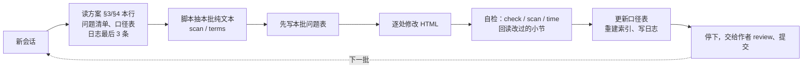

# 第三版教程 · 文案修订方案（2026-10-24 起）

## 速览

- **目标**：把剩下的章节改得好懂、自然、完整。去掉英文直译、谜语式标题、没解释的行话，以及让中文读者别扭的说法；读到事实错误也一并修掉。
- **范围**：第 1–6 章已经改过，这次不重写，只在最后一批按新规则轻扫一遍。剩下 54 页约 31 万字（含弹窗），分 **33 批**。
- **防 context rot**：一批开一个新会话；跨批次要记住的东西只写进文件（口径表、进度日志），不靠对话记忆；每批只读本批页面的纯文本。
- **建议的起步**：先做第 0 批（准备）和第 1 批（第 7 章 + 导读），看过效果再往下做。比较不同 agent 时，用第 1 批和第 14 批（第 20 章，里面有一处已知的公式错误）当考题。

配套文件（都在 `review/` 下）：

| 文件 | 作用 | 什么时候读 |
|---|---|---|
| `问题清单.md` | 已发现的问题类型、例子、改法、自检清单 | 每批开工前 |
| `口径表.md` | 跨批次必须一致的说法：比喻、五个动作、缓存成本算法、术语白话、已核实的事实 | 每批开工前读，收工时更新 |
| `tools/prose_check.py` | 抽正文纯文本、找可疑措辞、算阅读时长、检查标签 | 每批都用 |
| 本文件 §6 进度日志 | 每批做了什么、留给后面的问题 | 每批开工读最后 3 条，收工追加 1 条 |

---

## 1. 改到什么程度算完成

站在读者的角度，一章改完要做到四点：

1. **顺着能读下去**：懂软件工程、但没读过这些源码的读者，每个新词第一次出现时都知道它是什么意思，小节之间接得上。
2. **像中文母语者写的**：没有英文直译、生硬的比喻、对联式标题，也没有给模型安上情绪。
3. **说法对**：与源码、文档、口径表一致；推断明确标成推断。
4. **不丢信息**：来源链接、参数、【订正】注、测验、弹窗都保留。

修订深度分两档：

| 档位 | 适用 | 做什么 | 不做什么 |
|---|---|---|---|
| **精修** | 第 7 章、导读、主线 16 章、进阶 5 章 | 问题清单 A、B、C、D 全做；可以调整小节内部的段落顺序、重写 h2 标题、补上缺的台阶 | 不增删小节；不动弹窗、对比表、测验的组件结构；不改 h1 章名（确实需要改时写进日志，由作者决定） |
| **语言修** | 源码 26 章、附录 5 页 | 做 C 和 D；A 类只抽查涉及口径表的说法 | 不动六节结构、代码摘录和提交链接 |

所有批次都**不做**的事：

- 不按词表批量替换文字。2026-10-21 按词表改了 20 处「不是……而是」，作者读后觉得更不顺，已经全部回退。
- 不新增 class，不改 `toc.js`、`app.js`、`main.css`（CONVENTIONS §18）。
- 篇幅一般不超过原来的 +15%；超过时在日志里写明原因。
- 不提交 git。每批改完由作者看 diff，确认后自己提交。

---

## 2. 为什么这样分批

一个会话读进去的内容越多，开头读到的规则就越容易被后面的内容冲淡。到后半程，常见的情况是：忘了规则，把上一章的说法带进这一章，改得越来越机械。针对这些情况，定了五条做法：

1. **一批一个新会话**。同一个会话里不连着做两批。
2. **跨批次的记忆只放在文件里**。统一的说法写进口径表，做过的事和遗留问题写进进度日志。下一批只从这些文件接手。
3. **控制读入量**。每批开工读三份文档，大约 1.5 万 token；本批页面先用脚本抽成纯文本来读，比直接读 HTML 省大约三分之二；动手改某一处时，再按行号读那一段 HTML。不通读全书，跨章核对用 grep。
4. **控制每批的体量**。精修每批不超过约 1.3 万字（含弹窗），也就是 1 个主线章或 2 个进阶章；语言修每批最多 3 个源码章，约 1.2–1.8 万字。
5. **做完就停**。写好交接记录后停下，等作者看过再开下一批。



---

## 3. 每批流程

在 `第三版/` 目录下执行。下文的 `T` 指 `python3 -I review/tools/prose_check.py`。

1. **开工前**：`git status` 确认工作区干净。如果不干净，先问作者，不要在别人没提交的改动上继续改。
2. **读**：本文件 §1–§3、§4 里本批那一行、§6 最后 3 条；`问题清单.md`；`口径表.md`；CONVENTIONS 只读 §3（小节衔接、篇幅、阅读时长）、§4、§9、§10，不要整份读。
3. **抽文本**：`T text <id>` 读正文，`T text <id> --modals` 读弹窗；`T scan <id>` 和 `T terms <id>` 找出可疑的地方。
4. **先列问题，再动手**：在 §6 本批记录下写「问题表」，每条写上类别编号（A1、C5 等）、位置和打算怎么改。A 类先核实：对照页面里的源码链接和 `research/` 笔记；核实不了的标【待核实】，不要猜。
5. **改**：直接改 HTML，一处一处用 Edit 改，不用脚本批量替换文字（第 0 批换栏目标签除外）。
6. **自检**：
   - `T check <id>`：标签配对、h1、重复 id
   - `T scan <id>`：直译词、直译标签、粗俗口语、工序泄漏应为 0，剩下的逐条在日志里写明理由
   - `T time <id>`：按公式算阅读时长，并更新页头
   - `T hedge <id>`：限定语密度和改前比（问题清单 C11、CONVENTIONS §4「限定语」），超出时逐句处理
   - 按问题清单末尾的自检清单逐条确认，并把改过的每个小节回读一遍
7. **收尾**：
   - 更新口径表：补上新解释的术语和新核实的事实
   - 重建搜索索引：在 `tutorial/` 下运行 `node assets/js/build-search-index.js .`。没有 node 时见 §7
   - 本批改了正文时，在导读的修订记录里加一行，也可以按阶段合并成一行
   - 在 §6 写交接记录
8. **停下**：用中文向作者汇报，第一句说做完了什么、没做什么。

---

## 4. 批次表

「已知问题」是 2026-10-24 抽查时发现的，开工时先处理这些，但不限于这些。体量指含弹窗的汉字数。

### 阶段一：读者主线（精修，第 0–20 批）

| 批 | 范围 | 体量 | 已知问题 |
|---|---|---|---|
| **0** | 全站规则与工具 | — | 见 §5 |
| **1** | 第 7 章 `intro-07` + 导读 `index` | 4.0k | 「投影」没解释就用（B1）；「替它擦屁股」（C3）；动动脑没给答案（B5）；「这一段直接跳过」「第一个格子和最后一个格子」指代不清（B8）；减量顺序写成了定律（A5）；Claude Code 重附细节打断主线（B3）；「最近修改的 5 个文件」待核（口径表 §6）；「收口」「没有傻问题」（C6）；时长与公式不符（D2）。导读能力分级里「知道什么时候该 /compact、/clear」可补上回退（口径表 §2） |
| 2 | 第 8 章 `main-01` | 8.6k | 「Responses API 形状」等 3 处（C1）；标题「同一张底图，七种画法」（C5） |
| 3 | 第 9 章 `main-02` | 8.3k | 规则文件「同时到场、按什么顺序说话」「兜住循环」「已知护栏」（C1） |
| 4 | 第 10 章 `main-03` | 7.9k | 「渐进披露的第一性原理」（C1） |
| 5 | 第 11 章 `main-04` | 8.6k | 无已知问题，按清单做 |
| 6 | 第 12 章 `main-05` | 9.1k | 口头禅 8 处、「不是……而是」7 处，逐句判断（C7、C8） |
| 7 | 第 13 章 `main-06` | 7.4k | 「截断形状」等 9 处，改成「截断方式」（C1）；口头禅 8 处 |
| 8 | 第 14 章 `main-07` | 8.3k | 「投影」全章用了 22 次，开头就用却没解释（B1，白话见口径表 §4）；裁剪导致缓存失效的说法，按口径表 §3 复核（A3）；标题「四道闸门，七种默认」（C5） |
| 9 | 第 15 章 `main-08` | 9.3k | 「旋钮」2 处（C1）；全书最长的主线章，注意 B3 |
| 10 | 第 16 章 `main-09` | 8.5k | 「它觉得『我记得大概长什么样』」（C2）；长句 10 句 |
| 11 | 第 17 章 `main-10` | 7.6k | 「两把闸」「旋钮」「默认面」「任务形状」（C1） |
| 12 | 第 18 章 `main-11` | 8.0k | 行话最密集（rollout、检查点、叶子），首次出现补白话（B1）；回退的说法与口径表 §2 对齐 |
| 13 | 第 19 章 `main-12` | 7.8k | 「复利」2 处（C1）；「热情地记录，不擅长怀疑自己」（C2） |
| **14** | 第 20 章 `main-13` | 8.0k | **§2.4 公式算错**（A3，见问题清单）；标题「发键，认账」（C5）；「积木」改成第 5 章的「方块」（C3）；「KV 页」「水位」「滞回」没解释（B1）；时长不符 |
| 15 | 第 21 章 `main-14` | 8.6k | 标题「五个决策，三种绝境」「七种收场」（C5） |
| 16 | 第 22 章 `main-15` | 7.9k | 「缝、开法、选缝」比喻贯穿全章（C1、C5） |
| 17 | 第 23 章 `main-16` | 10.5k | 「护栏」第一次出现要解释；「找不到杠杆」（C1） |
| 18 | 第 24–25 章 `adv-01`、`adv-02` | 11.9k | adv-01：写作工序漏进正文（B7，第 0 批已删则跳过）、「买确定性/保真度」「复利」（C1）、章节引用夹在句中（B4）、压缩成本粗算按口径表 §3 复核（A3）、时长不符 |
| 19 | 第 26–27 章 `adv-03`、`adv-04` | 13.3k | 「旋钮」「落点」（C1）；「护栏」出现很多次，第一次要解释 |
| 20 | 第 28 章 `adv-05` | 6.5k | 无已知问题，按清单做 |

### 阶段二：源码与附录（语言修，第 21–31 批）

| 批 | 范围 | 体量 | 已知问题 |
|---|---|---|---|
| 21 | 第 29–30 章 `src-codex-01/02` | 9.9k | 「线上形状」8 处（C1） |
| 22 | 第 31–32 章 `src-codex-03/04` | 11.3k | 「四个分支，三种语义」一节「不是……而是」最密集（C8） |
| 23 | 第 33–34 章 `src-claude-code-01/02` | 11.6k | 「失效的爆炸半径」（C1） |
| 24 | 第 35–36 章 `src-claude-code-03/04` | 11.9k | 无已知问题 |
| 25 | 第 37–39 章 pi | 13.7k | 第 38 章是「投影」的首见章节，白话要和口径表 §4 一致 |
| 26 | 第 40–42 章 oh-my-pi | 12.4k | 「帧形状」16 处：`resolveShape` 是代码名，保留不改；正文可以写成「帧规格」 |
| 27 | 第 43–45 章 opencode v1 | 12.1k | 「旋钮」3 处 |
| 28 | 第 46–48 章 opencode v2 | 12.0k | 无已知问题 |
| 29 | 第 49–51 章 Grok Build | 17.6k | 「钉住」（C1）；体量偏大，后半程如果出现漂移就拆成两批 |
| 30 | 第 52–54 章 DeepSeek Harness | 17.4k | 破折号最密集，每章 14–15 处；体量偏大，处理同上 |
| 31 | 附录 A–E | 12.9k | 术语表与口径表 §4 对齐；附录 E 的「形状」3 处 |

### 收尾

| 批 | 范围 | 做什么 |
|---|---|---|
| 32 | 全书回归 | 见 §5 |

---

## 5. 第 0 批和第 32 批做什么

**第 0 批：准备**（不改正文的意思）

1. 在 CONVENTIONS 里加一节「中文表达」，内容从问题清单 C 类提炼：直译词替换表、拟人、比喻、标题、术语首次出现要有白话、引号。
2. 把栏目标签「没有傻问题」改成「你可能会问」，CONVENTIONS §10 的模板一并改（11 页，可以用脚本替换，改完逐页 `check`）。第 6、7 章的「收口」改成这一节实际讲的内容。
3. 删掉第 24 章「本页以第 1 级（文字）和第 2 级（图表）为主……」这句工序泄漏。
4. 第 5 章页脚改成第 6 章的五个动作：继续、回退、压缩、清空、派子代理。
5. 在 §6 记录全站 `scan` 基线（下面已经记了一份；第 0 批执行时复核一遍）。

**第 32 批：全书回归**

1. 全站 `scan`，与基线对比。直译词、直译标签、粗俗口语、工序泄漏应为 0，或者每处都写明理由。
2. 拿口径表逐条 grep 全书，查还有没有章节在用旧说法。
3. 第 1–6 章按新规则轻扫一遍。已知的有：第 3 章「关键在于」；第 6 章小结标题里的「脏活外包」；演示里的「撞上软线」。
4. 全站跑 `time` 和 `check`，重建搜索索引，写修订记录。
5. 作者读导读和随机 3 个小节，做最后验收。

---

## 6. 进度日志

每批收工时在最后追加一条，格式如下：

```
### 第 n 批 · 范围 · 日期 · 执行者（哪个 agent / 模型）
- 问题表：A×n、B×n、C×n、D×n（逐条列在下面）
- 改了什么：3–5 行
- 口径表更新：新增/修改了哪几条
- 留给后面的：章号 + 问题（其他章节里发现、本批没有改的）
- 没做或没验证的：例如「索引未重建：没有 node」
- scan 前后：直译词 x→y、口头禅 x→y ……
```

### 基线 · 2026-10-24 · Claude Opus 5.5（只做统计，正文未改）

`T scan` 全站合计（含弹窗）：直译词 91、拟人 4、口头禅 142、「不是……而是」168、直译标签 13、粗俗口语 1、工序泄漏 2（同一句）、破折号 338、长句（>60 字）424；15 页混用两种引号。

| 部分 | 页 | 汉字 | 直译词 | 口头禅 | 不是而是 | 直译标签 | 破折号 | 长句 |
|---|---|---|---|---|---|---|---|---|
| 第 1–6 章（已改） | 6 | 18,323 | 2 | 7 | 7 | 4 | 5 | 20 |
| 导读 + 第 7 章 | 2 | 3,976 | 0 | 1 | 3 | 2 | 5 | 5 |
| 主线 | 16 | 133,317 | 40 | 62 | 67 | 7 | 125 | 182 |
| 进阶 | 5 | 31,149 | 5 | 9 | 10 | 0 | 20 | 23 |
| 源码 | 26 | 124,768 | 40 | 62 | 78 | 0 | 178 | 180 |
| 附录 | 5 | 12,761 | 4 | 1 | 3 | 0 | 5 | 14 |

口头禅、「不是……而是」、破折号、长句这四项没有数量目标，只用来对比前后变化。

### 基线复核 · 2026-10-24 · 第 0 批 · Claude Sonnet 5.5（Claude Code）

开工前重新跑了一遍全站 `scan`：除直译词外，各项都与上面的基线一致（拟人 4、口头禅 142、「不是……而是」168、直译标签 13、粗俗口语 1、工序泄漏 2、破折号 338、长句 424、混用引号 15 页）。**直译词是 82，不是 91**，差在主线部分（实测 31，上表记 40）；其余部分都对得上。原因没有查（可能是当时用的正则不同），以后以 82 为准。

### 第 0 批 · 全站规则与工具 · 2026-10-24 · Claude Sonnet 5.5（Claude Code）

- 问题表：准备批，没有 A–D 问题表，按 §5 的五项做。
- 改了什么：
  1. `CONVENTIONS.md` §4 新增「中文表达」小节（直译词替换表、拟人、比喻、标题、栏目标签、术语、「每轮」、口头禅与长句、引号共 9 行）。放在 §4 里，是因为 §3 规定每批都要读 §4，不用另加读取步骤。
  2. 栏目标签「没有傻问题」→「你可能会问」：11 页（intro-04/05/06/07，main-01/04/08/13/14/15/16）、`CONVENTIONS` §3 §10（含模板）、`tutorial-authoring/components.html`（示例和 h2）。用精确匹配的 `sed`，改前先数过命中数，改后全站 `check` 通过。
  3. 节标签「收口」：第 6 章 §07 → 「一句话记住」，第 7 章 §06 → 「复习与衔接」。h2 没动，第 6 章 h2 里的「脏活外包」留给第 32 批。
  4. 删掉 adv-01 的工序泄漏句「本页以第 1 级……」。整句删除，句中指向第 25 章的链接也一起没了；该页时长没动（见下）。
  5. 第 5 章页脚改为「继续、回退、压缩、清空，或者派子代理」。
- 口径表更新：无。
- 留给后面的：
  - `spec.md:96`、`issues/07-sample-intro-01.md:5` 仍写「没有傻问题」。这两份是早期的规格和任务单，没改。`prose_check.py` 的「直译标签」正则保留了「没有傻问题|收口」，用来防止回潮。
  - adv-01 页头写 27 分钟，公式算出 23 分钟，留给第 18 批重算。
- 没做或没验证的：没有做浏览器渲染（只改了文字和一个标签）。
- scan 前后：直译标签 13→0，工序泄漏 2→0，其余不变。

### 第 1 批 · 第 7 章 `intro-07` + 导读 `index` · 2026-10-24 · Claude Sonnet 5.5（Claude Code）

- 问题表：A×5、B×4、C×5、D×1，另有导读 2 处。
  - A5：减量写成「按代价从低到高，越靠前越便宜」。改成：前两种（输出控制、裁剪）是本地改写，压缩要再发一次模型请求，所以通常先用便宜的办法；并写明这不是固定顺序。要点小结同步改。
  - A4：压缩后重附「最近修改的最多 5 个文件」。对照 `compact.ts#L1415-L1462` 的原文，文件来自 `readFileState`，按 `timestamp` 倒序取 5 个，读过或写过都算；第 35 章已有同样的【注意】。改成「最近读过或写过的」。
  - A4/C4：被动压缩「每轮只允许尝试一次，成功后用专门的状态重跑本轮」。对照 `query.ts`，`hasAttemptedReactiveCompact` 每次循环后重置，即每次模型请求一次。改成「对同一次请求只试一次，压缩成功就重发这次请求」。
  - A1：「你已经付了一次被拒绝的请求」，被拒绝的请求是否计费没有查证。改成「先白白发了一次被拒绝的请求」，不涉及计费。
  - A（范围）：「第 3 章那条增长曲线上的每次回落，背后都是模型调用」。第 3 章曲线只有软线处压缩的一次回落，限定为这一截。
  - B1：「投影」去掉，改成直接说「把已有内容换成占位符」；「切点」「可分叉」加一句白话；「缓存打点」改成「标记缓存断点」；「服务端 usage 加本地增量」改成「服务端返回的 usage 加上之后新增内容的本地粗估」。
  - B3：Claude Code 重附清单的数字移到段尾，主线先给结论（压缩后是「摘要 + 一批必需品」）。
  - B5：动动脑补了「对照答案」，写法与第 4、5 章一致；问题改成「哪些环节会产生失效点」（原问法「立刻失效」与第 5 章的说法对不上）。
  - B8：「这一段直接跳过」「第一个格子和最后一个格子」改为点名各段。顺手改了一处内在矛盾：原文说「中间三段都在待命」，可是同一段里计量明明在算 41k，现在写成「每次请求都在工作的是组装和计量，减量和隔离待命」。
  - C3：「替它擦屁股」→「得替它补救」。C6：「收口」和「没有傻问题」已在第 0 批处理。
  - C8：导读「分级不是为了考试，而是……」读者不会那样想，改成直接陈述。C9：拆开自己新写的一处分号长句。C10：第 7 章 2 处「」改 “”，导读 1 处 “” 改「」。
  - 其他：「Agent」→「agent」；「从组装到回收」→「从组装到质量兜底」（回收不是一个阶段）；「一次请求有它的一生」改成直陈；「真正动手」随重写删除。
  - D2：第 7 章时长 9→10 分钟（按脚本公式）。
  - 导读：能力分级 L1 补上回退（`/rewind`）；「固定到提交」两处改成「标明/指向提交」；修订记录加一行。
- 改了什么：以上全部。组件结构、弹窗（本页没有）、SVG、测验、来源链接都没动；新增了一个来源链接 `compact.ts#L1415-L1462`（第 35 章已在用）。
- 口径表更新：§4 新增软线/硬线、可分叉、标记缓存断点，修改投影（第 7 章已不用）和切点的首见说明；§5 新增压缩后重附文件的规则和被动压缩的规则；§6 改为「待核与待改」。
- 留给后面的：
  - 第 15 章 `main-08` 约第 833 行、附录 B `appendix-params` 约第 235 行仍写「最近修改的文件」，分别由第 9 批、第 31 批改。
  - 第 14 章（第 8 批）仍要在开头解释「投影」。
  - 导读能力分级里 L3 的章号标着「第 23 章」，第 23 章是评估，和「能实现」对不上。我没有核实，留给第 32 批看一眼。
- 没做或没验证的：
  - 没有做浏览器渲染。
  - 对照答案没有第二个人读过。
  - 源码核对是用 WebFetch 读原始文件，摘要由小模型生成：重附规则另有第 35 章的【注意】互证，可信度高；被动压缩那条只有这一个来源，行号没有逐行核对。
  - 篇幅：第 7 章正文 2290→2700 字（+18%，超过 +15%）。其中新增的对照答案约 230 字，扣除后约 +8%。导读 1685→1750 字。
- 索引：已重建（517 条），变化只落在 index、intro-05、intro-06、intro-07、adv-01 五页。重建用的是临时下载的 Node v22.11.0（对照官方 SHASUMS256 校验过，放在会话临时目录，没有装进系统）。
- scan 前后：第 7 章 口头禅 1→0、「不是……而是」1→0、直译标签 2→0、粗俗口语 1→0、破折号 5→3、长句 3→3；导读 「不是……而是」2→1、长句 2→3（多出来的是修订记录那一行，脚本把标题和列表项连在一起算了，不是正文长句）。全站混用引号 15→13 页。

### 第 2 批 · 第 8 章 `main-01` · 2026-10-25 · Claude Sonnet 5.5（Claude Code）

- 问题表：A×10、B×5、C×6、D×2（含 §4 已知的 C1×3、C5×1）。A 类对照的源码都是下载到本地后读的：Codex 在 `76ed3b4`（页面固定的提交），Claude Code 在 `988438a`（第 8 章已有的 v2.1.88 链接）。
  - A1：2.2 末句「把稳定性换成可维护性」方向说反了。片段放进历史，换来的是前缀稳定，付出的是可维护性。
  - A2：开头段「作为 instructions 下发」不对。`ResponsesApiRequest` 没有 `instructions` 字段（`codex-api/common.rs#L278-L304`），`base_instructions` 被包成 developer 消息放在 `input` 最前面（`client.rs#L975-L1012`）。第 30 章已有同样的【注意】。
  - A3：规范化的时机。正文说「写入时」，源码是每次生成请求时，在 `clone_history()` 的副本上做（`history.rs#L603-L617`、`turn.rs#L1749-L1751`；写入路径 `record_items` 里没有规范化）。所以「不可逆」「活历史才是投影」都不成立；补上的结果内容是 `"aborted"`，不是「空结果」（`normalize.rs#L53-L66`）。涉及 2.1、2.3 全节、要点小结、对比表 Codex 行。
  - A4：`incremental_tools`。(a) 脚注的【待核实】可以关掉：开关由 `Session::current_window_uses_incremental_tools` 算出（`world_state.rs#L44-L56`）：模型须 `use_responses_lite`；窗口刚开始看功能开关 `IncrementalTools`（`Stage::UnderDevelopment`，默认关闭，`features/src/lib.rs#L1592-L1596`）；窗口内看历史里有没有 `additional_tools` 条目。(b)「发一次就不再发」「前缀变短」没有依据：声明变成 `input` 里的一条 `additional_tools` 条目（`models.rs#L1037`），仍随历史发送；源码没有写动机，改标推断，并与第 30 章对齐。(c)「压缩或裁剪弄丢增量条目，模型就说没有这个能力」与源码不符：`has_tool_declarations()` 找不到声明时，下一次请求退回完整下发。涉及学习目标、2.1、2.4 全节、要点小结、取舍三、测验 Q2。
  - A5：顺序「instructions → tools → input」。Responses Lite 下实际是 工具声明 → 指令 → 历史（`client.rs#L975-L1012`），Anthropic 文档是 tools → system → messages；图 01-1 把指令画在工具前面。涉及图、图注、2.5、对比表、测验 Q1（改系统提示第一段，排在它前面的工具定义不受影响）。
  - A6：取舍二与测验 Q3。Claude Code 的 CLAUDE.md 不存进历史，每次请求时由 `prependUserContext` 前插，发生在压缩之后（`query.ts#L660`，压缩在 L453–L535；`api.ts#L449-L474`），所以「会被压缩成摘要」「压缩后重新注入」只适用于 Codex。另外「原因有三点」是设计动机，源码没写，改标推断。
  - A7：取舍五把 omp 的日期/cwd 提醒归为「放尾部」，而弹窗和第 11 章都写它插在首个用户轮之前（靠近开头）；「时间每轮都在变」「差距可能是几十倍」「尾部注意力更弱」没有依据。
  - A8：以偏概全。2.5「几乎所有 agent 都把当前时间做成独立提醒」、图后「大多数实现里环境信息是合成消息」、取舍三「唯一一种贵但不会错」「大多数 agent 默认全量」。
  - A9：`parallel_tool_calls` 在 `build_prompt` 里固定为 true，序列化时 Responses Lite 模型会被改成 false（`client.rs#L1083`）。
  - A10：图注「实际断点由服务端决定」混用了口径表 §4 的「缓存断点」，这里说的是失效点。
  - B1：活历史（2.1 首见）、片段（2.2）、回放（2.2）、投影（第 3 节首见，口径表要求首见补白话）、会话树和叶子（取舍四）、tst（取舍三）、checkpoint（取舍四）、guardian / basic 会话（2.1）、本快照（2.4）、合成消息（图后）、增量（学习目标）。
  - B4：2.5 第三段「出处标签」后面还接着「第 11 章会专门讲这类注入」。
  - B5：动动脑没有答案。
  - B6：场景里 A 仓库「有 read、grep、bash」，B 仓库「只暴露了三个工具」，两边数量看着一样，对不上。
  - B8：学习目标写「四块」，图是「五层」，没说两者关系；「这张底图」指代不清。
  - C1：「Responses API 形状」「返回形状」「合法形状」3 处（已知）；「底图」；「岗位说明书」保留（代码注释里也在用）。
  - C4：「每轮」「本轮」逐处判断：多数指「每次请求」，改写；`本轮可见` 对应源码里 `StepContext` 的注释「this exact sampling request」，改成「这次请求」。
  - C5：sec-no「先看清这张账单」；h2「同一个问题，两个仓库，两种答案」「四块拼装，和一个“不发”的开关」「同一张底图，七种画法」「三道题，检验你是否真的会拼」；h3「写进历史之前，先修一遍」。
  - C7、C8、C9：口头禅正文 4 处、弹窗 2 处，「不是……而是」正文 4 处、弹窗 2 处，长句 11 个，逐句判断，不按词表改。
  - D2：时长按公式重算。D4：重建索引、写修订记录。
- 改了什么：
  1. **A 类订正是本批的主体**，原因：第 8 章讲 Codex 的几处说法来自 `research/codex.md` 的转述，和 `76ed3b4` 的源码不符（见上面 A2–A5），且和第 30 章已核实的内容直接冲突。改了开头段、2.1、2.3、2.4、2.5、对比表 Codex 行、要点小结、取舍二、取舍三、测验 Q1/Q2/Q3；图 01-1 把工具定义和指令两层互换（文字和样式类一起换，几何不变）。2.4 因为源码没写动机、也确认请求里的 token 并没有减少，按第 30 章的口径改成「推断」并重写；脚注里的【待核实】已经查清，按 CONVENTIONS §13「脚注仅限待核实」整块移除。
  2. 其余按问题表：动动脑补了对照答案；§03 首次用到「投影」时给了白话；活历史、片段、WorldState、叶子、tst、guardian 都在首次出现处补了一句；标题改写 7 处（节标签 1、h2 4、h3 2）；「每轮」「本轮」逐处判断，多数改成「每次请求」「这次请求」；弹窗里改了 8 处措辞（打缓存标记→标记缓存断点、劫持→接管、中和→一并处理掉等）和 3 处破折号，没有动弹窗结构。
  3. 没动：h1 章名、除脚注块和图 01-1 以外的组件结构、7 个弹窗的结论和来源链接（只改措辞）、对比表（只改了 Codex 行，以及 Claude Code 行的一个词）、测验题干。
- 口径表更新：§4 修改「投影」的首见（第 14 章→第 8 章，附白话），新增 6 行（活历史、上下文片段、WorldState、Lite 模型、增量工具、会话树/叶子）；§5 新增 4 条已核实的事实（Codex 请求的实际结构〔含规范化时机、增量工具的开关条件〕、Claude Code 的 CLAUDE.md 每次请求前插且发生在压缩之后、Anthropic 缓存前缀顺序、omp 日期提醒的位置）；§6 把「最近修改的文件」从两处改成三处，并新增 4 条待改。改「投影」首见的原因：第 8 章第 03 节才是全书第一次用到这个词（第 7 章已不用）。
- 问题清单更新：A 类新增 A8（以偏概全）、A9（研究笔记转述与源码不符）。
- 留给后面的：
  - 第 14 章（批 8）：「投影」首见已经是第 8 章，开头沿用口径表 §4 的白话即可。
  - 第 30 章（批 21）：第 6 段「省了什么」两处说法互相矛盾（见口径表 §6）。
  - 第 33 章（批 23）：两处「omp 把易变内容移到尾部」。
  - 第 49 章（批 29）：一处「最近改过的 5 个文件」。
  - 附录 C（批 31）：请求组装行补「仅 Lite 模型，默认关闭」。
  - 取舍一、取舍四、取舍五里的「代价」（比如「首 token 延迟更高」「cwd 一天可能变十次」）是设计推断，只在章首加了一句说明，没有逐条核对。
- 没做或没验证的：
  - **没有做浏览器渲染**。改了图 01-1（两层互换），375px 与深浅色没看；只做了 `check`。
  - Codex 部分我下载了 `76ed3b4` 的 `history.rs`、`normalize.rs`、`turn.rs`、`client.rs`、`codex-api/common.rs`、`world_state.rs`、`step_context.rs`、`features/lib.rs`、`protocol/models.rs` 读相关片段，没有通读。`client.rs` 里用 `previous_response_id` 续发的路径（约 L2120 起）没读，所以正文只写「进入模型的 token 没有减少」，没有写「请求体没有变短」。
  - 「guardian / basic 会话」只对照了 `guardian/mod.rs` 的模块注释（“Hosts approval decisions and the isolated synchronous reviewer”），`is_basic_session_source` 的具体判断没读，正文只写「做审批审查的内部会话」。
  - Q2 里「会话中途追加过一条『该工具已移除』的更新」依据只有 `IncrementalToolMessages` 的字段名和功能开关的注释，已标推断。
  - 其他 6 个 agent 的弹窗只改措辞，结论没有逐条重新核对；Claude Code 的结论仍是非官方源码 v2.1.88。
  - 对照答案、取舍二的改写、Q1–Q3 的新解析，没有第二个人读过。
  - 篇幅：正文 5786→7056 字（+22%，超过 +15%），含弹窗 8432→9727（+15%）。增加主要来自三块：订正 Codex 请求结构和增量工具的条件（约 700 字）、取舍二把两家压缩时的差别分开讲（约 200 字）、对照答案和行话白话（约 350 字）。这些都不是风格润色，删了会回到错误或不好懂的状态。时长因此从 21 分钟改为 25 分钟（脚本公式）。
- 索引：已重建（517 条），变化只落在 main-01 和 index 两页。node 用的是临时下载的 v22.11.0（对照官方 `SHASUMS256.txt` 校验过，放在会话临时目录，没有装进系统）。
- scan 前后（main-01，含弹窗）：直译词 3→0、口头禅 6→0、「不是……而是」6→5、破折号 6→0、长句 13→16。剩下的 5 处「不是……而是」都是单次出现，被否定的说法读者确实会那样想（比如「以为它是个字段」「以为它是建议」），按 C8 保留。长句增加是因为新写的解释和白话，已把其中的枚举和括号解释拆成两句；剩余的都在 60–85 字、只说一件事。全站合计（本批收工时）：直译词 79、拟人 4、口头禅 132、「不是……而是」164、直译标签 0、粗俗口语 0、工序泄漏 0、破折号 320、长句 419、混用引号 13 页；基线复核值是 82 / 4 / 142 / 168 / 13 / 1 / 2 / 338 / 424 / 15 页，差值包含第 0、1 批的改动。

---

## 7. 环境说明

- **Python 3** 是系统自带的，自检脚本只用到标准库。
- **node**：本机没有安装系统级 node，而重建搜索索引需要它。可以临时下载 Node 官方便携包，放到临时目录里运行，不用改系统。没有 node 时，这一批就不重建索引，在日志里写「索引未重建」，第 32 批统一重建。索引旧了只会影响搜索结果，不影响阅读。
- **浏览器检查**可以不做。要装 Playwright 和一堆系统库，代价大。只改文字时，`check` 通过再回读一遍就够了；改了图（SVG）或演示脚本时才需要渲染检查，375px 宽度、浅色和深色都要看。

---

## 8. 开工提示词（复制到新会话）

```
执行教程修订第 <n> 批。
先读：第三版/review/修订方案-2026-10-24.md（§1–§3、§4 里第 <n> 批那一行、§6 最后三条记录）、
第三版/review/问题清单.md、第三版/review/口径表.md。
只改第 <n> 批范围内的页面。按 §3 的流程做完自检，更新口径表和进度日志后停下，用中文汇报。不要提交 git。
```

**用来比较不同 agent 时**：

- **第 20 章已经备好现成的考题**：提示词和测试环境的搭法见 `评测-第20章-改写提示词.md`，标准答案和打分见 `评测-第20章-评分表.md`。准备脚本会在测试目录里删掉写了答案的文档。
- **限定语堆积时改用两步法**（2026-10-25 起试行）：第一轮 GPT 改写第 20 章后，限定语从每千字 0.9 处涨到 7.3 处。先核查出清单、再在新会话里按清单改写，提示词和环境见 `评测-第20章-两步改写提示词.md`。第 20 章试过有效，再推广到后面的批次。
- 每个 agent 在单独的分支或 git worktree 上跑同一批，互不影响。
- 如果还想加考第 1 批（第 7 章），照第 20 章的做法办：问题清单、口径表和本方案里都写了第 7 章的答案，要在测试目录里删掉这些文件。然后看 agent 能不能自己找出问题。
- 比较四点：
  1. 已知问题修好了几条
  2. 有没有改出新的错误（`git diff` 逐段看）
  3. 你随机读两节，是不是比原来好懂
  4. 有没有违反「不按词表批量替换」「不动组件结构」

**作者每批要做的事**：读改过的两三节；遇到还别扭的句子，像 `docs/上下文教程修订.md` 那样截图标出来，交给下一批的 agent，让它补进问题清单。规则要靠这样一批批校准。
