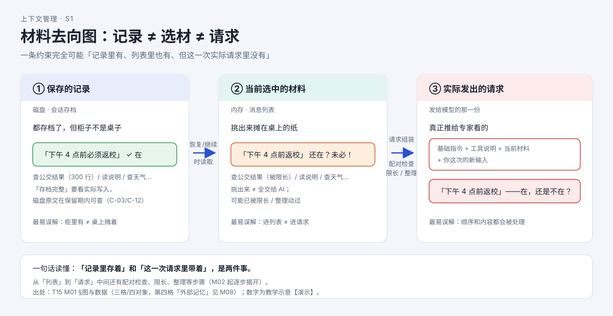

# AI 明明"记得"，为什么这次回答没用上？

> 系列：AI 编程助手的上下文管理（第 1 篇 · 建立直觉）
> 本篇主问题：**一条约束明明被记下来了，为什么这一次回答却没有带上它？**

---

## 一、场景：两句话，怎么花了这么多钱

小林第一次用 AI 编程助手（本文以 Codex CLI 作代表实现）。他敲了一句话：

> 帮我安排下周五的班级郊游，两个班 60 人，**下午 4 点前必须回到学校**。顺便看看操场集合点怎么安排。

然后他去泡了杯茶。回来时屏幕上滚过了十几个条目：查地图、查公交、读了一份"研学地点说明.txt"、又查了天气……最后 AI 给出了一份行程。

月底账单来了，小林懵了：**我就说了两句话，为什么像聊了半小时？**

## 二、例子：约束还在，为什么没生效

更让他费解的是另一件事。行程改到第三版时，他明明在第一句里说过"**下午 4 点前必须返校**"，AI 这一版却把返校时间排到了 16:40。他去翻聊天记录——那句话**还在**，白纸黑字。

"你不是记得吗？"

答案不在"记不记得"，而在"**这一次请求里到底带了什么**"。

## 三、机制解释

**【人话先给】** 说白了，AI 不是"聊着聊着就记住"，而是每走一小步，就**回头把所有资料重新摊开在桌上**，再问一次模型"现在该怎么办"。它每次能"记得"的，只是**这一次请求实际带上**的那份材料。

这背后有两件你平时看不见的事实：

1. **"一句话"触发的是一串请求，而不是一次。** AI 每读一个文件、跑一条命令，都要带着当前材料再问一次模型。
2. **每次请求带的材料，远比你输入的文字多。** 系统指令、工具说明、之前的全部对话、工具查回来的结果，都在里面。

**【再上术语】** 这里有三个必须分开的东西：

- **保存的记录**（磁盘上的会话存档）：都存档了，但**柜子不是桌子**。
- **当前选中的材料**（内存里的消息列表，message list）：从柜里挑出来摊在桌上的纸；**挑出来 ≠ 全交给 AI**。
- **实际请求**（发给模型的那一份，model request）：真正推给模型看的；**柜里有，不代表这份有**。

一条约束完全可能**记录里有、当前列表里也有、但这一次实际请求里没有**——因为从"列表"到"请求"中间还有配对检查、限长、整理等步骤（后续篇目逐步揭开）。

## 四、图解

**图注（S1 · 材料去向图）**：资料柜（保存的记录）里的约束"下午 4 点前返校"确实存在；摊到工作桌（当前选中的材料）上时可能还在；但真正递进"请求"这一关、被缩短或整理之后，它**未必在这一次里**。**柜里有 ≠ 桌上摊着 ≠ 这次带上了。**

## 五、自测

**① 顺序题**：小林看到"AI 停下来等工具结果"的那段时间里，模型被调用了几次？

A. 0 次，工具是本地跑的
B. 1 次：发出"调用工具"那次
C. 2 次：发出调用的那次 + 拿到结果后让它继续的那次
D. 不确定

**② 判断题**：工具结果出现在消息列表里，就说明它一定会出现在下一次请求里。（对 / 错）

**③ 配对题**：请用"记录 / 选材 / 请求"三格，解释"下午 4 点前返校"为什么可能被记下来了、这一次却没生效。

参考答案

**① C。** 模型先被问一次"现在做什么"（它要求调工具），工具执行完，模型再被问一次"接下来做什么"。工具执行本身不调模型，但**两侧各要一次模型请求**——这就是"一句话"变成"一串请求"的最小例子。

**② 错。** "进入列表"和"出现在下一次请求"之间还有处理步骤：配对与内容检查、限长、窗口紧张时的整理。材料可能被裁剪或摘要替代。

**③** 分三格看：**记录**（磁盘存档）里有这条约束 ✓；**选材**（内存列表）里它可能还在，也可能已被限长/整理动过；到**请求**（真正发给模型的那份）这一关，还要过配对、限长、整理——**任何一步都可能让它在"这一次"里缺席**。所以"记录里有"不等于"这一次用上了"。

## 六、来源

- 三格直觉图（保存的记录 / 当前选中的材料 / 实际请求）：对应研究工作区"数据地图与机制辨析"的数据对象口径。
- 场景与最小消息列表：课程第 1 单元（发布时替换为链接）。
- 相关结论：信息流骨架（任务 / 模型请求 / 工具 / 消息列表）为各工具共有；差异从第 2 篇起逐项对照。

## 七、上下篇

- 上：—（本系列第 1 篇）
- 下：**第 2 篇《一次回答，AI 到底看了哪些材料？》**——把"带着什么去问"具体化成一次请求的组成清单。

## 八、边界提示

- 本篇是**机制推演**，不涉及阈值与配置；文中的"300 行结果""十几个条目"为示意数字，**不是实测阈值**。
- 本篇**不**回答"某条约束一定会在哪一步丢"——那需要后续篇目的定位方法 + 真实实验（见第 5~8 篇）。
- 本篇**不**覆盖"外部记忆"（第四个对象），它在第 11 篇展开。
