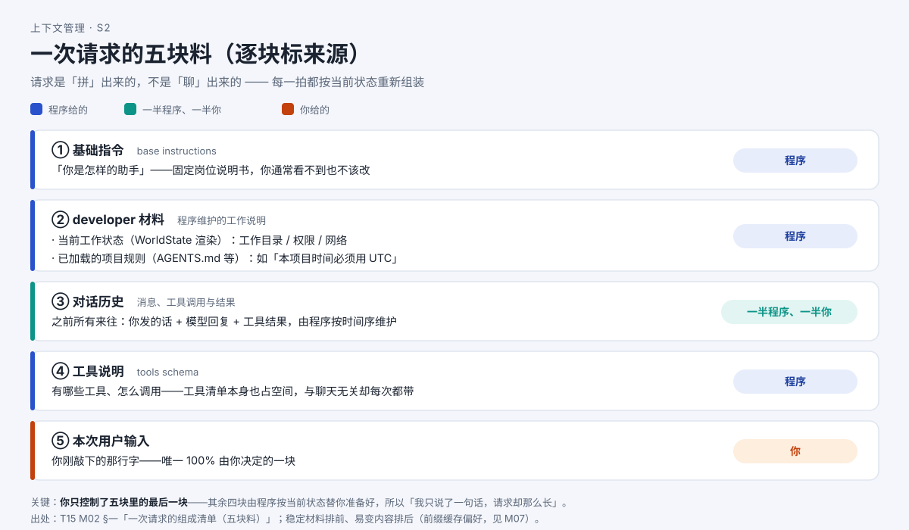

# 一次回答，AI 到底看了哪些材料？

> 系列：AI 编程助手的上下文管理（第 2 篇 · 一次请求的组成）
> 本篇主问题：**AI 每走一步都要"重新问一次模型"，那这一次请求里到底装了哪几块东西？**

---

## 一、场景：模型不是"聊着聊着就记住了"

上一篇里，小林明白了：他的一句话触发的是**一串**模型请求。但他还是想不通——

> 模型不是"聊着聊着就记住了"吗？为什么每做一步都要把全部材料**重新摊开**问一次？这一次请求里到底装了什么？

他的困惑里藏着本篇的全部内容：**请求是"拼"出来的，不是"聊"出来的。**

## 二、例子：同一句话，请求里多了四块料

小林在原会话里什么都没改，直接再问一句"接着改登录页"。

他以为这次请求就是"接着改登录页"这几个字。实际上，程序在发出前把下面这些东西**重新组装**了一遍：

| 块 | 谁给的 | 为什么 |
|---|---|---|
| ① 基础指令（base instructions） | **程序** | 固定"岗位说明书"，你通常看不到也不该改 |
| ② developer 材料 | **程序** | 按当前状态渲染的工作说明（工作目录、权限、项目规则） |
| ③ 对话历史 | **一半程序、一半你** | 你发的话 + 模型回复 + 工具结果，按时间序维护 |
| ④ 工具说明（tools schema） | **程序** | 有哪些工具、怎么调用——**本身也占空间，每次都带** |
| ⑤ 本次用户输入 | **你** | 唯一 100% 由你决定的一块 |

**【人话】** 说白了：**你只控制了五块里的最后一块。** 其余四块是程序按当前状态替你准备好的。所以"我明明只说了一句话，请求却那么长"——那四块才是大头。

## 三、机制解释

### 五块料，四拍循环

小林看到屏幕上"AI 停了一下，然后接着干"。那一下里，程序走了**四拍**：

```
【第 1 拍】问模型："现在该做什么？"（带全部五块料）
            ↓
【第 2 拍】模型回复：要求调用工具（带一个调用编号 call_id）
            ↓
【第 3 拍】工具执行 → 返回结果；程序把"调用记录 + 结果"写进消息列表
            ↓
【第 4 拍】再问模型："现在该做什么？"（带上前面全部 + 刚才的调用与结果）
```

**要点**：工具执行本身**不调用模型**，但它**两侧各要一次模型请求**。这就是上一篇那道顺序题的答案来源。

### 配对不变量：调用与结果必须成对

第 2 拍模型说"调用工具 X"（带 `call_id`），第 3 拍必然产生一条对应结果。程序**强制检查**这种配对是否完整：

- **每个调用都有结果**（缺了要补占位）；
- **每个结果都能对回调用**（对不上的"野结果"要移除）。

程序宁可**在本地补齐占位或移除孤立条目**，也不发送结构非法的请求。这不是礼貌问题，是**不变量**。

**【当心】** 初学最容易立的错误认知：以为"AI 记得我们所有的聊天"。不。它每次能"记得"的，只是这次请求**实际带上**的那份材料。

## 四、图解



**图注（S2 · 五块料 + 来源标注）**：左侧"程序准备"框住①基础指令、②developer 材料、④工具说明，③历史由程序维护（含你的话），右侧"你"只贡献⑤本次输入。稳定不变的材料排在前面、易变的内容排在后面——这对"前缀缓存"有利（第 10 篇专讲）。

> 现成截图（来自交互教材 T17）：`` —— 请求组装生长的时间线视图。

## 五、自测

**① 预测题**：你在原会话里什么都没改，直接再问一句。下一次请求的组成清单里，哪几块会变、哪几块大概率不变？

**② 来源标注题**：把五块分别标上"程序 / 你"：基础指令、developer 材料、对话历史、工具说明、本次输入。

**③ 配对题**：如果历史里冒出一条"孤儿结果"（结果对不回任何调用），程序怎么处理？

<details>
<summary>参考答案</summary>

**①** **变**：⑤本次用户输入（新的一句）；③对话历史（追加了你的新消息）。**大概率不变**：①基础指令、④工具说明；②developer 材料通常不变（规则没变不重发完整副本）。注意"不变"指内容，是否重发要看各工具的差分/投影实现。

**②** 基础指令=**程序**；developer 材料=**程序**；对话历史=**一半程序、一半你**；工具说明=**程序**；本次输入=**你**。**五块里你只控制最后一块。**

**③** 服务端按"调用—结果"配对读取。缺调用的"野结果"无法归属，程序**在进入历史时移除孤立条目**，也不发送结构非法的请求。

</details>

## 六、来源

- 五块料与四拍循环：课程第 2 单元（发布时替换为链接）。
- 配对不变量（`ensure_call_outputs_present` / `remove_orphan_outputs`）：Codex 代表实现，结论 ID `codex-retain-01` 所在章节；快照 `a07c8eb`（样章基线）。
- 各工具组装形状差异：研究工作区九工具比较矩阵"请求组装"行（`codex-diff-01`、`claude-assembly-01`、`pi-assembly-01/02`、`ocv1-assembly-01/02`、`ocv2-assembly-01/02`、`grok-assembly-01/02`、`dsh-assembly-01/02` 等）。

## 七、上下篇

- 上：**第 1 篇《AI 明明"记得"，为什么这次回答没用上？》**
- 下：**第 3 篇《AI 的"容量"怎么算？三条线，到线才整理》**——既然每拍都要重新拼全部材料，这张桌子就有容量上限，下一篇开始算。

## 八、边界提示

- "system 在哪"各家不同：有的工具是**一条合成 system**，有的是 **2 段**，有的（dsh，deepseek-harness 的命令行工具）**根本没有 `system` 字段**（提示词塞进 `system/message` 节点）。**"所有工具都有 system 提示词"不成立。**
- 本系列**不排名次**：九种组装形状是**形态差异**，不是优劣。
- "稳定前缀排前面是否真带来缓存命中收益"→ **服务端命中率不可观测**，本系列**不承诺命中率**（第 10 篇展开）。
