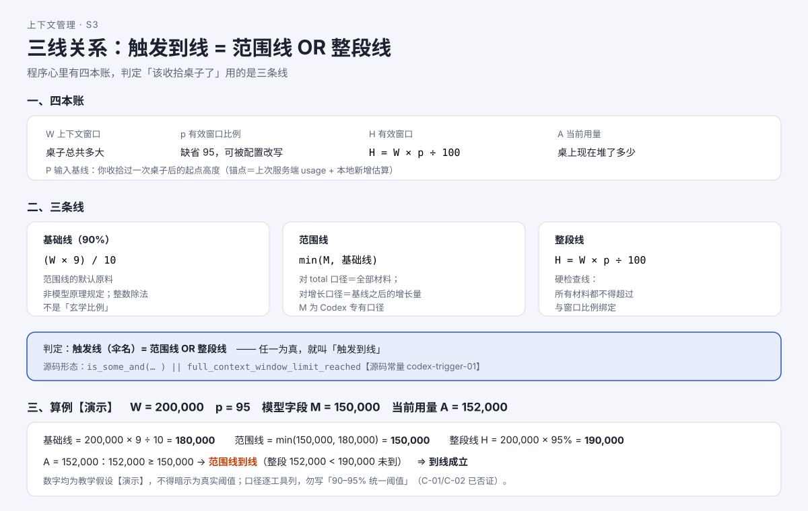
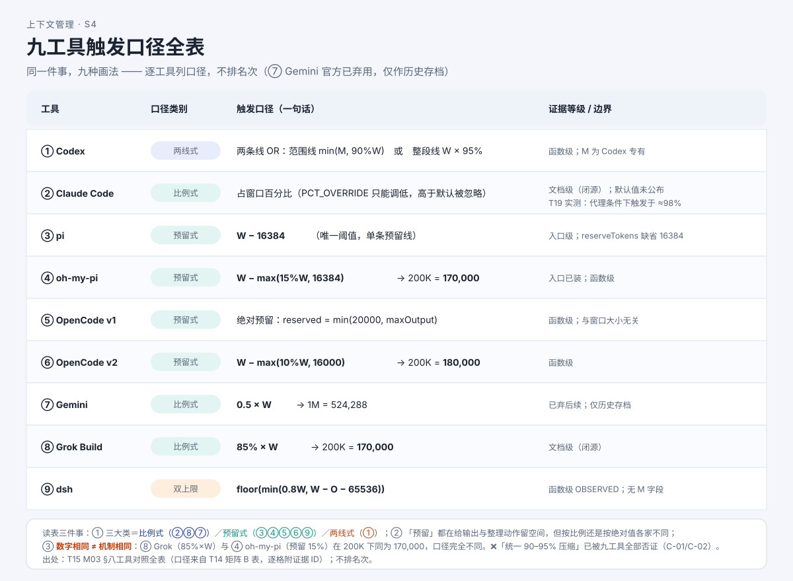

# AI 的"容量"怎么算？三条线，到线才整理

> 系列：AI 编程助手的上下文管理（第 3 篇 · 预算与触发）
> 本篇主问题：**程序怎么知道"桌子快装不下了"？它心里有几本账、几条线？**

---

## 一、场景：没人操作，屏幕却冒出"正在压缩上下文……"

小林的会话聊了两个小时：行程改了四版、工具查了十几次。忽然屏幕上滚过一行提示：**"正在压缩上下文……"**

他**没做任何操作**。他盯着这行字犯嘀咕：

> 它怎么知道"该收拾桌子了"？是我哪一步点错了，还是它自己算的？

答案：**程序自己算的**。它一直维护着几条数字，每拍都对着**几条线**比一比——**到线了就动手**。

## 二、例子：同一段话，三家估出三个数字

要谈"空间"，先认丈量单位——**token（令牌）**。模型不是按"字"处理文字的，而是把文字切碎成小块。同一段 **400 个汉字**（UTF-8 共 1,200 字节），三家本地估算给出的数字完全不同：

| 口径 | 算法 | 结果 |
|---|---|---|
| dsh（deepseek-harness 的命令行工具，按**字符**） | `ceil(400 ÷ 4)` | **100**（实测 108，低估） |
| Codex（按**字节**） | `ceil(1,200 ÷ 4)` | **300** |
| Gemini（历史存档，非 ASCII 1.5/字符） | `400 × 1.5` | **600**（对中文高估） |

**【人话】** 同一段话，估出的 token 数能差三档。所以**本地估算只能当粗估**，真实值以服务端返回的 usage 为准。

## 三、机制解释

### 四本账 + 三条线

程序不是"每拍把所有字重数一遍"，而是**以服务端上次的实测为锚点**，加上本地刚加进来的材料，得到"当前用量"，再拿去和几条**预先算好的线**比。

**四本账**：

| 变量 | 含义 | 通俗理解 |
|---|---|---|
| **W** | 上下文窗口（context window） | 这张桌子**总共**多大 |
| **p** | 有效窗口比例（字段缺省 **95**） | 桌子**实际允许用**多大比例 |
| **H = W × p ÷ 100** | 有效窗口 | 桌子**真正的可用上限** |
| **A** | 当前活动上下文用量 | 桌上**现在堆了多少** |

**三条线**：

| 线名 | 口径 | 说明 |
|---|---|---|
| **基础线（90%）** | `(W × 9) / 10` | 范围线的**默认原料**，**非模型原理规定** |
| **范围线** | `min(M, 基础线)` | 对总量口径是**全部材料**；对增长口径是**基线之后的增长量** |
| **整段线** | `H = W × p ÷ 100` | **所有材料都不得超过**的硬检查线 |

> **本篇最重要的一句话**：**触发线（伞名）= 范围线 OR 整段线**；任一为真，就叫"到线"。

**为什么是 90% 和 95%，不是 100%？** 两个原因都指向同一件事——**要给"输出"和"整理动作本身"留空间**：模型回复也吃同一个池子；整理本身也要调用模型生成摘要。

**【当心】别写"90–95% 是统一压缩阈值"这类总括句。** 该说法已被**九工具全部否证**：各家口径从 50% 到"窗口减固定值"都有，只能**逐工具列**。

## 四、图解

**图注（S3 · 三线关系）**：桌子总容量 W 乘上比例 p 得到有效窗口 H（整段线，硬检查）；基础线 = 90%×W 与模型字段 M **取小**得到范围线；当前用量 A 与两条线比较，**任一为真即到线**。

**图注（S4 · 九工具触发口径全表）**：口径分**三大类**——**比例式**（按窗口的百分之几）、**预留式**（窗口减固定值/比例值）、**两线式**（范围线 OR 整段线）。**同一件事，九种画法。** 只讲形状差异，**不排名次**。

> 现成截图（来自交互教材 T17）：``、`` —— 可调参数的演算器与逐步演算结论。

**同窗口（W = 200,000）三例**：pi `W − 16384` = **183,616**；oh-my-pi `W − max(15%W, 16384)` = **170,000**；Grok（Grok Build）`85% × W` = **170,000**。注意最后两个**数字一样，口径完全不同**（一个"预留 15%"，一个"85% 触发"）——**数字相同 ≠ 机制相同**。

## 五、自测

**① 演算题**：W = 200,000，p = 95，模型字段 M = 150,000。求基础线 / 范围线 / H，并回答 A = 152,000 到线吗？

**② 判断题（陷阱）**：某模型元数据**没给**限额字段 M。有同学说"那就等于限额为 0，永远不压缩"。错在哪？

**③ 判断题**：轮前检查把"用户马上要发的这条巨大粘贴"也算进去了。（对 / 错）

**④ 口径题**：把三个工具各归到"比例式 / 预留式 / 双上限"一类：Grok（`85%×W`）、oh-my-pi（`W − max(15%W,16384)`）、dsh（`min(0.8W, W−O−65536)`）。

参考答案

**①** 基础线 = 200,000 × 9 ÷ 10 = **180,000**；范围线 = min(150,000, 180,000) = **150,000**；H = 200,000 × 95% = **190,000**。A = 152,000：**152,000 ≥ 150,000 → 范围线到线**（整段 152,000 < 190,000 未到）。**到线成立。**

**② 错在"把 None 当 0"。** 字段缺失时程序**回退到 90% 基础线**：**没有专门值 = 用默认线**，不是"限额为零"。这是读 `Option` 类型最常见的错误。

**③ 错。** 源码留了 TODO：轮前检查发生在**新输入写入之前**，尚未把即将到来的内容估算进去。**巨大输入仍可能一步超限。**

**④** Grok = **比例式**；oh-my-pi = **预留式**；dsh = **双上限**（比例上限与"留输出余量"上限取更小者）。

## 六、来源

- 四本账与三条线：课程第 3 单元（发布时替换为链接）；结论 ID `codex-trigger-01/02`（90% 是范围线原料而非统一阈值）。
- 八工具触发口径：`pi-trigger-01`、`ohmy-trigger-01`、`ocv1-trigger-01/02`、`ocv2-trigger-01`、`grok-trigger-02`、`dsh-trigger-01/02`。
- 估算口径分列：**C-06 裁决**——"`len//4` 对中文保守"**不成立**，多口径**低估**。

## 七、上下篇

- 上：**第 2 篇《一次回答，AI 到底看了哪些材料？》**
- 下：**第 4 篇（实测篇①）《压缩阈值到底在哪？八个工具实测一遍》**——理论口径讲完了，真到线时读数是多少？下一篇用真实实验回答。

## 八、边界提示

- **Claude Code 默认触发百分比未公布**；【T19 实测：代理条件下它触发于 **≈98%**（98,014 / 98,202 / 98,015 ÷ 100k 窗口），但覆盖参数语义**不可观测**，默认百分比仍未公布】。
- 源码常量类结论（如 `codex-trigger-01/02`）为**固定快照**的常量与公式，**不是"当前所有发布版本"的承诺**。
- 服务端缓存命中 / TTL **九工具全部不可观测**——本篇**不承诺**任何"省了多少"。
- 本系列**不排名次**：九种口径是**形态差异**，优劣须待统一条件实测。
