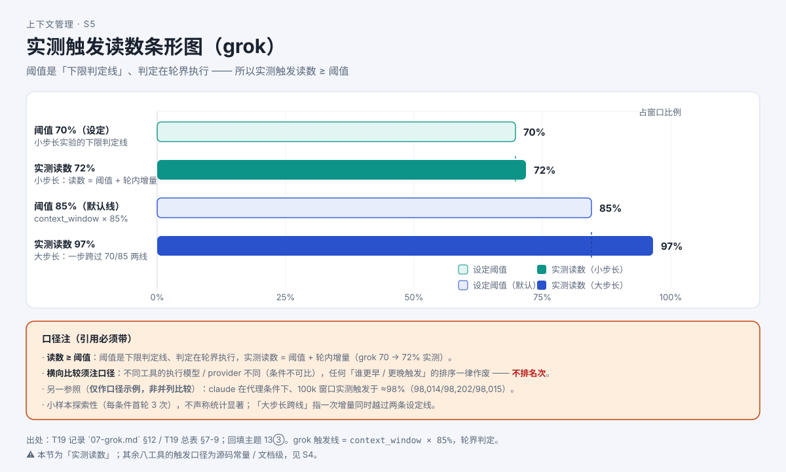

# 实测篇①：压缩阈值到底在哪？八个工具实测一遍

> 系列：AI 编程助手的上下文管理（第 4 篇 · 实测篇①）
> 本篇主问题：**文档上写的触发阈值，真跑起来读数是多少？**
>
> 上篇：**第 3 篇《AI 的"容量"怎么算？三条线，到线才整理》**
> 下篇：**第 5 篇《旧历史被压成一段摘要：丢了什么？》**

---

## 一、场景：文档写 85%，实测跑出 72%

上一篇我们把"三条线"讲清楚了。但小林追问了一个更实的问题：

> 你们说各家口径不同——那**真跑起来**，到底在多少百分比触发？

这是个**只能靠实测回答**的问题。本文汇总了一批**统一条件下的真实实验**（每可运行条件首轮 3 次，小样本探索性，**不声称统计显著**）。

## 二、例子：一个"读数比阈值小"的实测

Grok 文档写明：自动压缩阈值默认 **85%**。研究者用**小步长**逐步填窗（把阈值临时调到 70），结果——

**实测触发读数 ≈ 72%。**

第一次看到这个数字的人会问："72% 比 70% 大，那不是很正常吗？可如果阈值是 85%，读数怎么会只有 72%？"

答案在"**阈值是下限判定线**"这件事上。

## 三、机制解释

**【人话先给】** 程序不是"连续盯着百分比、一到线就立刻刹车"。它是在**特定时机**（比如一轮结束的"轮界"）才检查一次。所以：

- **阈值是"下限判定线"**：读数**只要 ≥ 阈值**就算到线；
- **判定发生在"轮界"**：一次轮内可能又灌进了新内容，所以**实测触发读数 = 阈值 + 轮内增量**；
- 因此，"读数比阈值略大"是**正常**的；"读数 ≥ 阈值"才是正确的表述口径。

**【再上术语】** 本文两个关键实测值：

| 工具 | 触发口径（文档级） | 实测触发读数 |
|---|---|---|
| Claude Code（闭源，代理条件） | 占窗口百分比（默认值未公布） | **≈98%**（98,014 / 98,202 / 98,015 ÷ 100k 窗口，3 轮一致） |
| Grok（闭源） | `85% × 窗口`，**轮界判定** | 小步长（阈值调 70）实测 **72%**；大步长跨线时 70 / 85 同为 **97%** |

**关于第一行**：研究者还试了 `--autocompact 100k` + 覆盖参数 50，**未能复现文档口径**（仍 ≈98k）→ **该覆盖参数语义不可观测**（闭源 + 代理条件），默认百分比**仍未公布**。

**关于第二行**：小步长实验（threshold=70）跑出 **72%**，**证明阈值确实生效**；读数 ≥ 阈值，符合"下限判定线 + 轮界判定"的口径。

## 四、图解

**图注（S5 · 实测触发读数条形图）**：横轴为触发读数百分比，每条标出**该工具自己的口径**。**横向比较必须注明口径**——"读数 ≥ 阈值"是正确读法；**本图不排名次**（各工具执行模型与 provider 不同，条件不可比）。

## 五、自测

**① 判断题**：Grok 阈值写 85%，实测读数 72%，说明阈值没生效。（对 / 错）

**② 解释题**：为什么"实测读数 ≥ 阈值"不矛盾？

**③ 边界题**：能不能用这张图说"Grok 比 Claude Code 更晚压缩、更省"？

参考答案

**① 错。** Grok 的阈值是"下限判定线"，判定在**轮界**执行；读数 = 阈值 + 轮内增量。**阈值确实生效**（小步长实验 threshold=70 跑出 72%，正是证据）。

**②** 因为阈值不是"连续盯着的刹车点"，而是**特定时机（轮界）的下限判定**。一次轮内灌入的新内容会让读数比阈值略大——所以正确表述是"**读数 ≥ 阈值**"，而不是"读数等于阈值"。

**③ 不能。** 各工具**执行模型与 provider 不同**（条件不可比），且"读数高低"还受**各自口径**（比例式 / 预留式 / 双上限）影响。**横向比较须注口径，本系列不排名次。**

## 六、来源

- 实验总表 §1（版本与条件）、§2.1（核心机制）、§2.2（E1 场景）。
- 记录：claude 记录 §3（触发读数与覆盖参数语义）；grok 记录 §1 / §12（触发线口径与阈值生效实验）；codex 记录 §A-3。
- 回填主题 6（claude 默认百分比）与主题 13③（grok 触发线 = 下限判定线）。

## 七、上下篇

- 上：**第 3 篇《AI 的"容量"怎么算？三条线，到线才整理》**
- 下：**第 5 篇《旧历史被压成一段摘要：丢了什么？》**——到线之后，整理做了什么、留下了什么。

## 八、边界提示

- **不可观测**：Claude Code 覆盖参数语义（闭源 + 代理），其默认百分比**未公布**。
- **口径纪律**：横向比较一律写"**读数 ≥ 阈值**"并注明口径；**不排名次**（各工具执行模型/provider 不同，条件不可比）。
- 本实验为**小样本探索性**（每条件首轮 3 次），**不声称统计显著**。
