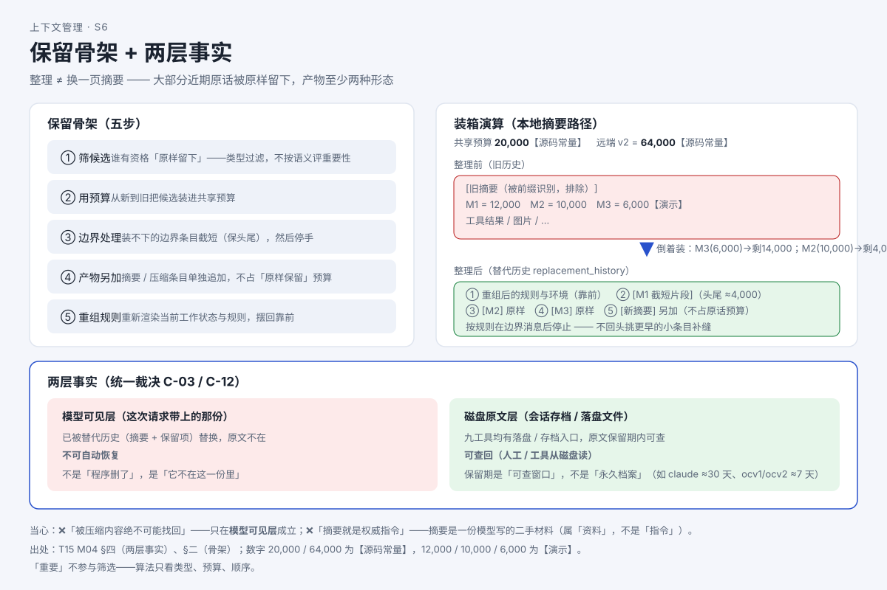

# 旧历史被压成一段摘要：丢了什么？

> 系列：AI 编程助手的上下文管理（第 5 篇 · 压缩与摘要）
> 本篇主问题：**桌子满了要"整理"，整理之后桌上的材料变成了什么？原来那些东西去哪了？**

---

## 一、场景：小林的两句担心

小林看完上一篇已会算"到线"，现在担心两件事：

> **担心一**："它整理时，是不是把聊过的东西**全扔了**，只留一小段总结？"
>
> **担心二**："被扔掉的东西，我**还能找回来吗**？"

答案分两半，正是本篇两条主线。

## 二、例子：整理后，近期原话大多被原样留下

先破除最大的误解：**整理 ≠ 把全部对话换成一页摘要**。

真实产物至少两种形态，而且**大部分近期原话会被原样留下**。以某代表实现为例，一个完整的装箱演算（预算 20,000 token）：

```
从旧到新的用户消息：M1 = 12,000、M2 = 10,000、M3 = 6,000
倒着装（从新到旧）：
  装 M3（6,000）     → 剩 14,000
  装 M2（10,000）    → 剩 4,000
  看 M1（12,000 > 4,000）→ 边界截短：头、尾各留一部分（约 4,000），然后停手
最终顺序：[M1 截短片段] → [M2] → [M3] → [新摘要]
```

**【人话】** 整理像**装箱**：**最近的用户原话优先装箱**（从新到旧），装到预算用完；装不下的边界那条砍成"头一段 + 尾一段"塞进去，然后**收手**；摘要**另外贴**在箱尾，**不占**装原话的额度；最后把"当前规则与环境"重新摆回箱首。

## 三、机制解释

### 两种产物形态：先看你的服务商是谁

整理有**两条实现路径**，由**提供方（provider）的能力**决定——不是随机选，也不是用户开关：

| 路径 | 谁来写"交接材料" | 产物形态 |
|---|---|---|
| **本地摘要路径** | 客户端编排：程序挑好材料，让模型写一份**文字摘要** | 你能读懂的一段文字 |
| **远端压缩 v2** | 服务端完成压缩 | 一个**压缩条目**（加密内容，客户端只见形状） |

**【人话】** 整理后"交接材料"长什么样，取决于你把请求发给了谁：发给官方服务商，拿到的是**服务端生成的加密压缩块**；发给其他提供方，拿到的是**能读的文字摘要**。

### 保留算法的五步骨架

无论哪条路径，保留遵循同一副骨架：**①筛候选 → ②用预算（从新到旧）→ ③边界截短（保头尾、就停手）→ ④摘要另加（不占原话预算）→ ⑤重组规则**。

**【当心】** 两条重要边界：

1. **"重要"不参与筛选**——算法不判断"某条里有没有关键约束"，只看**类型、预算、顺序**。摘要能否保住它，客户端代码**无法保证**。
2. **预算数字不是"触发线"，也不是"最终请求大小"**——它只是"给旧原话留的共享预算"。

### 被压缩的内容去哪了：两层事实

这是最容易被写错的一点，统一裁决钉死为**两事实并存**：

| 层 | 被压缩的内容在哪 | 能不能自动恢复 |
|---|---|---|
| **模型可见层**（这次请求带上的那份） | 已被**替代历史**（摘要 + 保留项）替换，原文不在 | **不可自动恢复** |
| **磁盘原文层**（会话存档 / 落盘文件） | 多数工具有落盘/存档入口，原文**保留期内可查** | **可查回**（人工/工具从磁盘读，而非模型自动想起） |

## 四、图解



**图注（S6 · 保留骨架 + 两层事实）**：上半部分是"保留骨架"——近期原话优先装箱、边界截短、摘要另加；下半部分是"两层事实"——模型可见层不可自动恢复，磁盘原文层保留期内可查。

> 现成截图（来自交互教材 T17）：`` —— 压缩四幕演示。

## 五、自测

**① 判断题**："整理就是把所有对话换成一页摘要。"（对 / 错，说明理由）

**② 演算题**：本地摘要路径，预算 20,000；用户消息从旧到新为 **9,000 / 16,000 / 7,000**。写出选取过程与最终顺序。旧的 9,000 会被"补缝"装进来吗？

**③ 分层题**：小林想知道"被压缩掉的一条约束还能不能找回"。请分**模型可见层**与**磁盘原文层**分别回答。

**④ 设计意图题**：为什么两条路径都"**从新到旧**"，而不是"按重要程度排"？

<details>
<summary>参考答案</summary>

**① 错。** 整理**大部分**旧材料确实不再逐条带上，但产物至少两种形态，且**近期用户原话会被原样保留**、**当前规则与环境会被重组摆回**。"全部换成一页摘要"漏掉了"保留"和"重组"。

**②** 倒着装：先装 7,000（剩 13,000）；看 16,000 > 13,000 → **边界截短**：保留头尾合计约 13,000 token 片段，然后**收尾停止**。最终顺序：**[16,000 截短片段] → [7,000] → [摘要]**。**更旧的 9,000 不会被"补缝"**——算法在边界消息后停止。

**③** **模型可见层**：不可自动恢复——它已被替代历史替换，**不在这一次请求里**。**磁盘原文层**：会话存档里**通常可查**（保留期内）——但要**人工/工具去磁盘读**，模型不会自动想起。

**④** "重要程度"无法在客户端**廉价又可靠**地评估：读懂语义再挑等于又跑一次模型（成本、延迟都不可接受）。**时间新近性是可用、稳定、便宜的代理信号**；深层语义保全被交给摘要产物的**生成环节**（模型来做）。

</details>

## 六、来源

- 摘要机制与保留预算：课程第 4 单元（发布时替换为链接）；结论 ID `codex-retain-01/02`（本地 20,000 / 远端 64,000）、`pi-summary-02`、`dsh-summary-01/02`、`ocv1-summary-01/02/03`。
- 两层事实：统一裁决 **C-03 / C-12**（被压缩内容两事实并存）。
- 单次压缩后约束保留：【T19 实测：单次压缩后约束**基本未丢**（E1 判据全 PASS，人工复核"复活"0；证据：各工具 E1 节）】。

## 七、上下篇

- 上：**第 4 篇（实测篇①）《压缩阈值到底在哪？八个工具实测一遍》**
- 下：**第 6 篇（实测篇②）《连续压三次，约束还在吗？》**——单次压缩没丢，那连压三次呢？

## 八、边界提示

- **保留期是"可查窗口"，不是"永久档案"**：有的工具约 **30 天**，有的截断目录约 **7 天**；**其余工具文档未给保留期**——未知保留未知。
- **远端压缩条目内容不可读**（加密），客户端只见形状——不得声称知道里面写了什么。
- 摘要是一份**模型写的二手材料**（属"资料"，不是"指令"），可能漏、可能错。**别把摘要当用户指令照做。**
- 本篇讲的是"单次整理"；**连续压缩是否失真**见下一篇，**程度仍未量化**。
