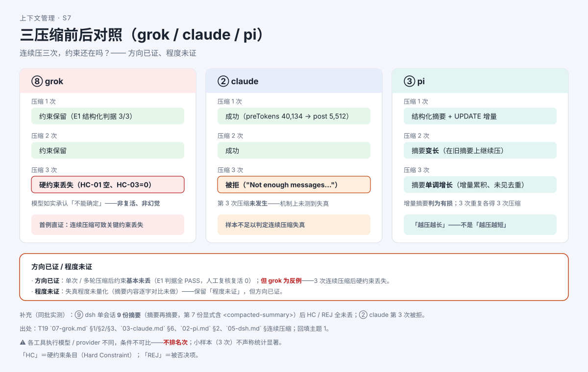

# 实测篇②：连续压三次，约束还在吗？

> 系列：AI 编程助手的上下文管理（第 6 篇 · 实测篇②）
> 本篇主问题：**只压一次没丢，那连续压三次呢？关键约束还在不在？**
>
> 上篇：**第 5 篇《旧历史被压成一段摘要：丢了什么？》**
> 下篇：**第 7 篇《AI 读了大文件，为什么只看到一小段？》**

---

## 一、场景：压一次没事，压三次呢？

上一篇我们看到：**单次压缩后，关键约束基本没丢**（多工具 E1 判据全部通过）。

但小林追问了一个更尖锐的问题：

> 那我这个会话要是很长、被压了好几次呢？**摘要再摘要**，约束会不会"漂"没了？

这同样是**只能靠实测回答**的问题。本文汇总一批**专设连续压缩条件**的真实实验。

## 二、例子：首例直证——压三次后，硬约束丢了

Grok（Grok Build，闭源）的实验结果，是全研究里**第一次直接抓到**的证据：

- 连续压缩 **3 次**之后，一条**硬约束丢失**（判据字段为空、计数为 0）；
- 更关键的是：模型在被问到时，**如实承认"不能确定"**——它没有编造一条约束（**非复活、非幻觉**），而是**承认自己不确定**。

这个细节很重要：它说明丢失**不是模型瞎编**，而是材料**真的没带过来**。

## 三、机制解释

**【人话先给】** 单次压缩是"把旧历史装箱、贴一张摘要"；连续压缩是"**在新摘要的基础上再压一次**"。每一次都可能丢一点，**累积**起来就可能把关键约束磨没。

**【再上术语】** 实测把八工具分成了几类表现：

| 工具 | 连续压缩下的表现 |
|---|---|
| Grok | **3 次连续压缩后硬约束丢失**（首例直证；模型如实承认"不能确定"） |
| Claude Code | 前 2 次成功，**第 3 次被拒绝**（提示"没有足够消息可压缩"） |
| pi | 摘要**单调增长**（增量累积、**未见去重**） |
| dsh（deepseek-harness 的命令行工具） | 单会话 **9 份摘要**（摘要再摘要）后，约束**仍保留** |

**【当心】最要紧的一句口径**：这批实验证到的是**"方向"**，不是**"程度"**——

> **方向已证、程度未证。**

也就是说：我们**已经**证明"连续压缩可致关键约束丢失"（有正面证据）；但**丢多少、什么条件下丢、能不能量化**——**摘要内容的逐字对比还没做**，**程度仍未量化**。

## 四、图解

**图注（S7 · 三压缩前后对照）**：多工具并排，横轴为压缩次数，标出各自的约束保留情况。图内**显式标注"方向已证、程度未证"**——提醒读者不要从这张图读出"谁更耐压"的排名（各工具执行条件不同）。

## 五、自测

**① 判断题**：既然有工具压三次丢了硬约束，就说明"连续压缩一定会丢约束"。（对 / 错）

**② 解释题**：请解释"方向已证、程度未证"这句话的含义。

**③ 观察题**：模型在丢失约束后"如实承认不能确定"，这说明了什么？

参考答案

**① 错。** 实测同时看到**多种表现**：有的工具压三次丢了约束（首例直证），有的压三次被拒，有的 9 份摘要后仍保留。**"一定会丢"是过度外推**；正确表述是"**连续压缩可致关键约束丢失已有正面证据**"。

**②** **方向已证**：有正面证据证明"连续压缩可能导致关键约束丢失"。**程度未证**：丢多少、在什么条件下丢、能否量化——**摘要逐字对比未做**，因此**失真程度未量化**，不能给"丢了多少"的数字。

**③** 说明丢失**不是模型编造**（非复活、非幻觉），而是**材料真的没被带过来**——模型如实地承认了自己"不能确定"。这排除了"模型瞎编一条约束"的干扰解释。

## 六、来源

- 实验总表 §2.2（E3 连续三次压缩）、§5 结论修正表 #9 / #13。
- 记录：grok 记录 §3（连续压缩丢失首例）、claude 记录 §6（第 3 次被拒）、pi 记录 §2（摘要单调增长）、dsh 记录 §连续压缩（9 份摘要）。
- 回填主题 1（连续压缩失真 C-04 / LQ-09）。

## 七、上下篇

- 上：**第 5 篇《旧历史被压成一段摘要：丢了什么？》**
- 下：**第 7 篇《AI 读了大文件，为什么只看到一小段？》**——压缩之外，工具输出进列表**之前**还有一道限长关。

## 八、边界提示

- **程度未证**：失真程度**未量化**（摘要逐字对比未做）；**不得**把"方向已证"写成"程度已知"。
- **不作"已修"断言**：本篇只描述实测**现象**，不推断任何版本"修好了没有"。
- **不排名次**：各工具执行模型 / provider 不同，**条件不可比**；并排只是呈现**形态差异**。
- 本实验为**小样本探索性**，**不声称统计显著**。
