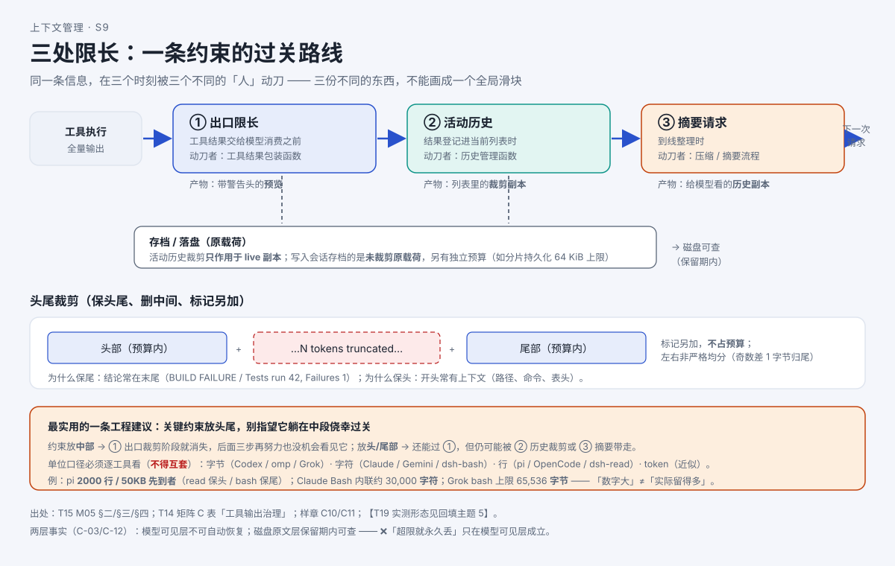

# AI 读了大文件，为什么只看到一小段？

> 系列：AI 编程助手的上下文管理（第 7 篇 · 工具输出治理）
> 本篇主问题：**为什么一条工具结果进请求之前，会先被"砍一刀"？砍的是头、尾、还是中间？**

---

## 一、场景：一条 300 行的日志，怎么吃掉半个窗口

小林的工具查回了一段 **300 行**的公交时刻表。其中一行写着：`"测试提醒：集合点东门，14:30 前必须到达。"`

后来 AI 安排行程时，**16:00 返校它记得牢牢的，14:30 却像从没出现过**。

小林的第一反应是："肯定是压缩把它弄丢了。"——**但这个判断太早了**。在"压缩"之前，这段日志其实还要过**两道关卡**。

## 二、例子：约束放在中段，第一关就没了

把那条 `14:30 集合点东门` 放在 300 行的**不同位置**，它最坏情况下的命运完全不同：

```
约束放『中部』    → ①出口裁剪阶段就消失，后面三步再努力也没机会看见它
约束放『头部/尾部』→ 还能过①，但仍可能被②历史裁剪或③摘要带走
约束放『用户消息里』→ 不进工具输出，走的是另一条路
```

**【人话】** 这条约束**原本在中段** → **出口限长（保头尾）阶段，中段被删**，只剩一个 `…N tokens truncated…` 标记。**它在①处就丢了，根本轮不到摘要。**

## 三、机制解释

### 三处限长：一条约束要过几道关

同一条信息，在三个不同时刻、被三个不同的"人"动了刀：

| 关卡 | 什么时候动刀 | 动刀的是谁 | 典型手段 |
|---|---|---|---|
| **① 出口限长** | 工具结果**交给模型消费之前** | 工具结果包装函数 | 保头尾裁剪、加说明头、超限落盘 |
| **② 活动历史** | 结果**登记进当前列表**时 | 历史管理函数 | 独立预算再裁一次；**存档另存原载荷** |
| **③ 摘要请求** | 到线**整理**时 | 压缩/摘要流程 | 副本自身超限时再移除最早条目 |

**记住一句话**：**出口是"给模型的预览"，活动历史是"列表里的副本"，摘要是"整理用的副本"。** 三者是**三份不同的东西**。

### 头尾裁剪：保头、保尾、删中间、加标记

最常见的一刀叫**头尾裁剪（truncate middle）**：

```
   原文：[ 头部 …… 中段(被删) …… 尾部 ]
   结果：[ 头部 ] + "…N tokens truncated…" + [ 尾部 ]
```

为什么保尾？因为很多输出的**结论在末尾**（`BUILD FAILURE`、汇总行）；为什么保头？因为**开头常有上下文**（文件路径、命令、表头）。

**【当心】单位必须逐工具看**（全篇最容易混的地方）：

| 单位 | 说明 |
|---|---|
| **字节** | 按 UTF-8 字节；中文 3 字节/字 |
| **字符** | 按字符计，中文 1 字符/字 |
| **行** | 与字节上限**取先到者** |

**单位不同，数字不能互套**：Claude Code 限 **30,000 字符**、Grok（Grok Build）限 **65,536 字节**、pi 限 **50KB 且与 2000 行取先到者**——"谁更宽"**没有统一答案**，必须写明单位。

### 落盘：预览 + 路径范式

限长不是"删掉"。多数工具的套路是：**全量原文写磁盘 → 请求里只留一小段预览 + 一个路径**。模型看到的是"这是一段被截断的内容，全文在 X 文件里"，需要时可以再读回来。

## 四、图解



**图注（S9 · 三处限长链）**：工具执行 → ①出口限长（预览 + 警告头）→ ②活动历史（裁剪副本）→ ③摘要请求（历史副本）→ 下一次请求；下方另有一条"存档/落盘"支线。**出口是预览、活动历史是副本、摘要是整理副本——三份不同的东西。**

> 现成截图（来自交互教材 T17）：`` —— 头尾裁剪条带，滑动预算直观看到"消失的位置"。

## 五、自测

**① 定位题**：用户报告"AI 忘了 4 点前返校"。请给出四问排查顺序，并判断最可能落在三处限长的哪一处。

**② 判断题（陷阱）**：工具结果被活动历史裁剪了，说明存档里也少了。（对 / 错）

**③ 口径题**：Claude Code 限 30,000、Grok 限 65,536、pi 限 50KB——**单位各是什么**？为什么**不能直接比大小**？

<details>
<summary>参考答案</summary>

**①** 四问：①**从未读进来？**（规则文件位置、项目可信状态、预算）②**进过历史，但被裁了？**（看有没有 `Warning: truncated` 头、关键行是否在**中段**）③**进过历史，但摘要漏了？**（本地路径可查文本；远端读不到明文）④**都在，但旧决定没作废？**（搜同一决定名，看是否新旧并存）。**最可能落在第②处（出口/活动历史）**——若关键行在工具输出中段。

**② 错。** 活动历史裁剪**只作用于进入活动历史的副本**；存档写入的是**未裁剪原载荷**。不过要追问："存档有"≠"以后一定读回到模型"，且存档自身还有独立预算。

**③** Claude Code 是**字符**；Grok 是**字节**；pi 是**字节**且与**行数取先到者**。**不能直接比大小**：单位不同（字符 vs 字节），且有的是**双上限取先到者**——**"数字大"不等于"实际留得多"**。

</details>

## 六、来源

- 三处限长与裁剪算法：课程第 5 单元（发布时替换为链接）。
- 结论 ID：`codex-trunc-01/03`、`ohmy-trunc-01`、`ocv1-trunc-01`、`ocv2-trunc-01/02`、`dsh-trunc-01..04`、`grok-toolout-01/03`、`claude-toolout-01/02`。
- 端到端形态：【T19 实测：各工具形态已录（codex 保头尾+标记，模型可见 32,046 字符；pi **50KB 字节阈值**，bash 保尾 / read 保头；claude `<persisted-output>` + 2KB 预览；omp **保头尾掐中间**；dsh（deepseek-harness 的命令行工具）read 51200B / bash 64000B；ocv1 bash **纯 tail**；ocv2 shell **纯 tail**；grok **头/尾各 10,000 字符** + 全文落盘；证据：各工具对应记录）】。

## 七、上下篇

- 上：**第 6 篇（实测篇②）《连续压三次，约束还在吗？》**
- 下：**第 8 篇（实测篇③）《落盘的文件，真能一个字不差找回来吗？》**——既然超限会落盘，那落盘就等于原文完整吗？

## 八、边界提示

- **"超限就永久丢"不成立**——只在**模型可见层**成立；磁盘原文**保留期内可查**（但"落盘"≠"全量"，见第 8 篇）。
- **"所有工具都保头尾"不成立**——反例：OpenCode v1 / v2 的 shell 路径**纯 tail**（无 head）。
- **"30k / 64KiB 谁更宽"不成立**——**单位不同（字符 vs 字节），不得互套**。
- **清理时机未实测**（各工具截断目录保留期多为文档级）——**保留未决**。
