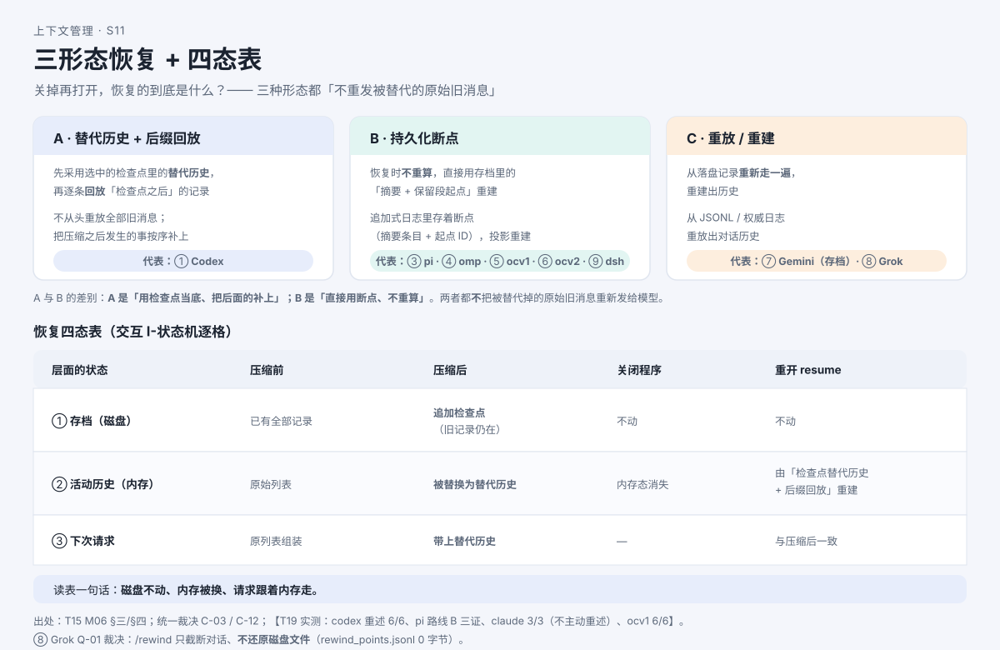

# 关掉再打开，AI 还记得多少？

> 系列：AI 编程助手的上下文管理（第 9 篇 · 恢复与持久化）
> 本篇主问题：**关掉程序再打开、续上昨天的会话，它恢复的到底是哪一份材料——昨天的原始记录，还是那一小段摘要？被压掉的原话还能不能找回来？**

---

## 一、场景：昨天的会话，今天续上

小林合上电脑。今天打开终端，选中昨天的会话，继续问："把行程再压缩一版。"

AI 接得上话。他好奇两件事：

> **疑问一**：昨天压缩过一次，今天恢复的**到底是什么**？是完整的原始记录，还是那一小段摘要？
>
> **疑问二**：那被压缩掉的原话，**还在不在**？我**还能不能**找回来？

两个疑问各对应一条主线：**疑问一** → 恢复采用什么（三种形态）；**疑问二** → 被压内容能不能找回（两层事实）。而它们都建立在一个前提上——**你得先把"三层"分清**。

## 二、例子：三层记录，别当成一层

同一个会话，程序里其实有**三份不同的东西**，它们不是一份的三个名字：

```
第③层 下一次模型请求        ← 真正影响模型行为的，只有这一层
     ↑ 组装自
第②层 当前活动历史（内存）   ← 可能已被裁剪/压缩/恢复改写
     ↑ 加载自；压缩时又被写回
第①层 会话存档（磁盘记录）   ← 事件逐个追加写入，压缩不删除旧记录
```

**【人话】** 主结论四句，背下来：**磁盘上有 ≠ 活动历史里有**；**活动历史里有 ≠ 下次请求带上**（还要过组装与裁剪）；**下次请求带上 ≠ 模型一定照做**；再补一句——**磁盘上有原文 ≠ 模型此刻看得见原文**。

## 三、机制解释

### 整理完成时，程序写了两处

压缩（整理）完成时，程序做**两件事**：

1. **替换当前活动历史**——用"**替代历史**"（重组后的规则 + 直接保留的旧消息 + 新摘要）替换内存里的历史；
2. **向磁盘追加一条"压缩检查点"**——里面装着这次替代历史的**完整副本**、窗口编号、用量摘要、恢复元数据等。

关键点：检查点保存的**不是"被删掉了什么"，而是"替代后是什么"**；旧记录仍留在**之前已写入的存档行**里——**追加式写入，不覆盖**。

### 三种恢复路线形态

恢复时要"重建当前工作材料"，业界做法可归为**三种形态**：

| 形态 | 一句话 | 恢复时做什么 |
|---|---|---|
| **A · 替代历史 + 后缀回放** | 先采用检查点里的替代历史，再逐条回放"检查点之后"的记录 | 不从头重放全部旧消息，把压缩之后发生的事按序补上 |
| **B · 持久化断点** | 恢复时**不重算**，直接用存档里的"摘要 + 保留段起点"重建 | 追加式日志里存着断点，投影重建 |
| **C · 重放 / 重建** | 从落盘记录**重新走一遍**，重建出历史 | 从权威日志重放出对话历史 |

**A 与 B 的差别**（一句话记住）：**A 是"用检查点当底、把后面的补上"；B 是"直接用断点、不重算"。** 两者都**不**把被替代掉的原始旧消息重新发给模型——这正是"**恢复 ≠ 重发全历史**"的实现含义。

### 核心裁决：两个事实并存

"压缩不可逆"与"历史物理保留"这两个说法**同时为真**，只是**层不同**：

- **模型可见层**：被压缩内容**不可自动恢复**（替代历史/断点里不含它）；
- **磁盘原文层**：被压缩内容**在保留期内可查**（原条目/存档不删）。

所以"**绝不可能找回**"这句话，**只对模型可见层成立**；一旦外推到"磁盘也没有、任何方式都取不回"，**就被否证**。

## 四、图解



**图注（S11 · 三形态恢复 + 四态表）**：上层是三种恢复形态（替代历史+后缀回放 / 持久化断点 / 重放·重建），下层是四态对照表。**读表一句话：磁盘不动、内存被换、请求跟着内存走。**

> 现成截图（来自交互教材）：`` —— 压缩前 / 压缩后 / 关闭 / 重开 四态 × 磁盘 / 活动历史 / 下次请求 三层。

## 五、自测

**① 三层判断题**：以下三句分别说的是哪一层？（a）"文件里还存着"（b）"这段不在当前列表里"（c）"这次请求带着它"。

**② 恢复题**：昨天压缩后你又聊了三轮，今天恢复。走"替代历史 + 后缀回放"路线时，恢复后的初始历史由哪**两部分**组成？

**③ 裁决题**：同学说"压缩过的内容绝不可能找回"。这句话**哪一部分成立、哪一部分被否证**？

<details>
<summary>参考答案</summary>

**①** （a）第①层**存档**（磁盘）；（b）第②层**活动历史**（内存）；（c）第③层**请求**。注意（c）才是**影响模型行为**的层面。

**②** 最新可用**检查点的替代历史**（含重组规则、保留的消息、摘要条目）+ **该检查点之后的记录后缀**（那三轮的条目按序回放）。**不包括**更早的、已被替代历史覆盖的原始旧消息。

**③ 成立的部分**：对**模型可见层**成立——被压缩内容**不可自动恢复**。**被否证的部分**：外推成"磁盘也没有、任何方式都取不回"——**磁盘原文在保留期内可查**。两事实并存、层不同。

</details>

## 六、来源

- 三层记录、整理写两处、恢复三形态：课程第 6 单元（发布时替换为链接）。
- 结论 ID：`codex-recover-01`、`codex-persist-01`、`pi-recover-01`、`claude-resume-05`、`ocv1-recover-01`、`dsh-persist-01`、`grok-recover-01`、`gemini-recover-01`（Gemini 仅历史存档）。
- 端到端形态：【T19 实测：恢复后主动重述约束——Codex 6/6、Claude Code 3/3（**不主动重述**、问才列）、OpenCode v1 6/6；Grok（Grok Build）`/rewind` **不还原磁盘文件**（`rewind_points.jsonl` 0 字节、磁盘与 git 未变、对话截断）；**恢复后幂等/重复执行保留未决**（专门副作用注入未做）】。

## 七、上下篇

- 上：**第 8 篇（实测篇③）《落盘的文件，真能一个字不差找回来吗？》**
- 下：**第 10 篇《为什么第二次问同样的问题更便宜？》**——材料没变的时候，模型又是怎么省下"重新计算"的钱的？

## 八、边界提示

- **"绝不可能找回"不成立**（只对**模型可见层**成立）；**磁盘原文在保留期内可查**。
- **"恢复 = 精确还原昨天那一刻"不成立**——**双向差异都会出现**：被替换掉的部分不会回来；后缀里新发生的变化会补上。
- **恢复后是否重复执行工具，保留未决**：实测条件下**未见重复执行**，但**专门副作用注入未做**——**不得宣称**"恢复一定不会重跑"。
- **不排名次**：三种恢复形态是**形态差异**，不是"谁更好"的排序。
