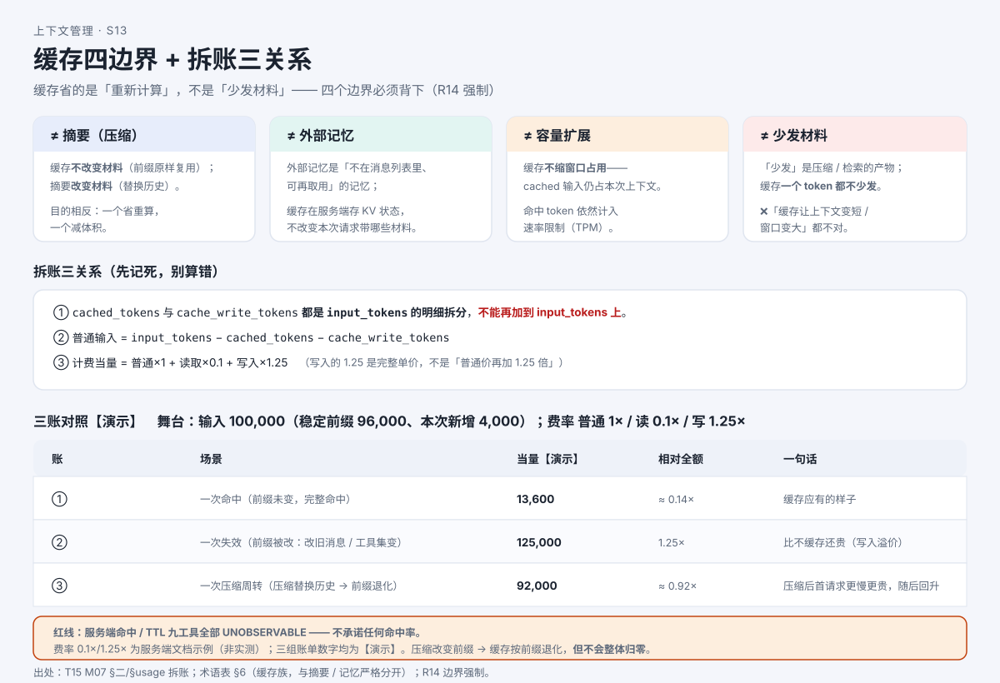

# 为什么第二次问同样的问题更便宜？

> 系列：AI 编程助手的上下文管理（第 10 篇 · 缓存专题）
> 本篇主问题：**两次请求开头一样，第二次为什么更快更便宜？它到底省了什么、又没省什么？为什么一压缩就"白省"？**

---

## 一、场景：同样的开头，第二次为什么更便宜

小林连着问了两句：

> ① 帮我把行程里的**公交段**列出来。
> ② 把行程里的**午饭段**列出来。

两句的**开头部分**——系统指令、工具说明、全部对话历史——几乎**一字不差**。每次都从头算，是不是太亏了？

有一类专门"复用相同开头"的优化，官方叫 **Prompt Caching（提示词缓存）**。但它**不是"把材料存起来、下次少发"**——这个直觉是**错的**，正是本篇要拆的第一个坑。

## 二、例子：一次请求的输入，拆成三份账

模型读你的材料时，会给每个 token 算一份"中间状态"（官方叫 **KV 状态**）。**缓存就是把这份中间状态存下来**——下次请求如果**开头部分（前缀）一字不差**，模型可以直接拿回这份状态，**跳过大半重新计算**。

所以 `usage` 里的输入 token，其实分**三份**：

```
普通输入 = input_tokens − cached_tokens − cache_write_tokens
计费当量 = 普通×1 + 读取×0.1 + 写入×1.25   （费率示例，非实测）
```

**【人话】** 一次**完整命中**的请求，大头是"读取"（便宜）；一次**前缀被改**的请求，大头是"写入"（**比不缓存还贵一点**，因为在为后续命中铺路）。**同一个输入，账可能差好几倍。**

## 三、机制解释

### 缓存省了什么、没省什么

| 缓存**省**的 | 缓存**不省**的 |
|---|---|
| **重新计算**（算力、钱、首字延迟方向） | **本次上下文的总长度**——命中的 token 依然是本次输入的一部分 |
| 稳定前缀那一段的"重算成本" | **速率限制（TPM）**——cached 输入**依然计入** |
| （服务端命中时）首字更快 | **上下文窗口占用**——**缓存不缩窗口** |

**【当心】最容易写错的一句**：❌ "缓存让上下文变短了 / 窗口变大了"。**都不对**。缓存省的是**重算**；"少发材料"是**压缩/摘要**干的事，**两者不是一回事**。

### 匹配单位是"完整渲染后的前缀"

缓存匹配的是**完整渲染后的上下文**（含系统指令、工具定义、历史），**不只是你可见的那几句文字**；**没有"按文件缓存"，也没有"按消息段缓存"**——若把某个文件插到前缀中间，**它之后的内容全部失配**。

### 边界四问（必须背下）

| 边界 | 一句话 |
|---|---|
| **缓存 ≠ 摘要（压缩）** | 缓存**不改变材料**（前缀原样复用）；摘要**改变材料**（替换历史）——一个"省重算"，一个"减体积" |
| **缓存 ≠ 外部记忆** | 缓存在**服务端**存 KV 状态，**不改变本次请求带哪些材料** |
| **缓存 ≠ 容量扩展** | 缓存**不缩窗口占用**（cached 输入仍占本次上下文、仍计 TPM） |
| **缓存 ≠ 少发材料** | "少发"是压缩/检索的产物；缓存**一个 token 都不少发** |

### 为什么一压缩就"白省"

压缩**替换了历史**，前缀**从第一个变化的 token 起**不再匹配——**这是设计后果，不是 bug**：

```
压缩前  [基础指令 | 工具说明 | 旧历史………… | 你的输入]   ← 缓存按此前缀建立
压缩后  [基础指令 | 工具说明 | 替代历史(摘要)… | 你的输入]   ← 从"第一个变化 token"起失配
              └── 变化点之前：仍可能命中 ──┘└──── 变化点之后：全部重建 ────┘
```

**一句话**：**压缩改变前缀 → 缓存按前缀退化，但不会整体归零。** 变化点**之前**的稳定段若未变，**仍可能命中**；新前缀随后续追加相处稳定，命中会**回升**。

## 四、图解



**图注（S13 · 缓存四边界 + 拆账三关系）**：上半区是四条边界（≠摘要 / ≠外部记忆 / ≠容量扩展 / ≠少发材料）；下半区是三组账单的关系——**读/写是输入 token 的明细拆分，别重复相加**。

> 现成截图（来自交互教材）：``、`` —— 前缀对齐与三组账目，深色图可作封面候选。

## 五、自测

**① 拆账题**：某请求 `input_tokens = 50,000`、`cached_tokens = 40,000`、`cache_write_tokens = 2,000`。求**普通输入**与**计费当量**（用本篇演示费率），并回答"`cached_tokens` 要不要从 50,000 里**再**减一次"。

**② 判断题（陷阱）**：命中缓存后，这次的**上下文窗口占用**会变小，**速率限制**也会更宽松。（对 / 错）

**③ 边界题**：把下面四句里**错的**挑出来，各用一句话纠正：A. 缓存就是"把材料存起来，下次少发"；B. 缓存和摘要是一回事；C. 缓存能让窗口变大；D. 缓存能替代外部记忆。

<details>
<summary>参考答案</summary>

**①** 普通输入 = 50,000 − 40,000 − 2,000 = **8,000**；当量 = 8,000×1 + 40,000×0.1 + 2,000×1.25 = 8,000 + 4,000 + 2,500 = **14,500**。**不能再减一次**：`cached_tokens` 是 `input_tokens` 的**明细拆分**，已经在 50,000 里了——把缓存 token 重复相加是常见错误。

**② 错。** 两者都**不变**：缓存省的是**重新计算**；命中的 token **依然是本次输入的一部分**（**不缩窗口占用**），且 cached 输入**依然计入 TPM**。

**③ 全错。** A. 缓存**不改变材料**，省的是**重算**；B. **缓存 ≠ 摘要**——缓存复用前缀，摘要**替换**历史；C. 缓存**不缩窗口占用**；D. 缓存是**服务端 KV 状态**，不改变本次请求带哪些材料，**外部记忆**是"消息列表外可再取用的记忆"。

</details>

## 六、来源

- 缓存省什么、前缀匹配、边界四问、前缀退化：课程第 7 单元（发布时替换为链接）。
- 结论 ID：`codex-cache-01`、`claude-cache-01..05`、`pi-cache-01`、`ocv1-cache-01`、`ocv2-cache-01`、`grok-cache-01/02`、`dsh-cache-01/02`。
- 【T19 实测：**CLI 侧** cacheRead 可观测且 >0（各工具读数已录）；**服务端命中率 / TTL 仍不可观测**（九工具一致）。**缓存 ≠ 摘要 ≠ 外部记忆 ≠ 容量扩展**。Grok（Grok Build）实测"硬清旧输出 → 缓存击穿 → 成本 ×2.9"（cache_read 由 61,824 降至 17,792）】。

## 七、上下篇

- 上：**第 9 篇《关掉再打开，AI 还记得多少？》**
- 下：**第 11 篇《AI 的"记忆""子代理""交接"：它到底记不记得住？》**——缓存之外，还有一类会"跨会话想起你"的东西，它又是另一回事。

## 八、边界提示

- **服务端命中 / TTL 九工具全部不可观测**——本篇**不承诺**任何命中率；能说的只有 **CLI 侧可观测字段**。
- **费率（0.1× / 1.25×）为服务端文档示例，非实测**，且随 provider 不同；三组账单数字均为**【演示】**，**不得当作真实费率或真实命中**。
- **"未发现 CLI 缓存键" ≠ "没有做缓存"**——只能写"未发现"。
- **不排名次**：各家缓存动作是**形态差异**（发键 / 认账 / 放断点各不同），不是"谁更省"。
