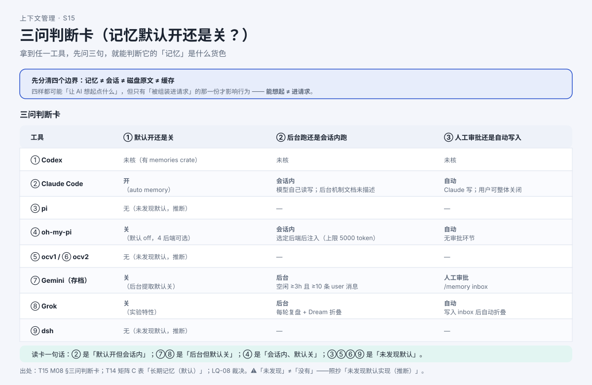

# AI 的"记忆""子代理""交接"：它到底记不记得住？

> 系列：AI 编程助手的上下文管理（第 11 篇 · 记忆、子代理与交接）
> 本篇主问题：**AI 关掉再开，为什么有时还记得上周的偏好？那份"记忆"是谁写的、默认开还是关？派一个"子代理"去干活，它看到什么、又回传什么？**

---

## 一、场景：下周一，换了目录，它还认得我

周一早上，小林在**另一个项目目录**打开 AI：

> **疑问一**：上周我让它"这个仓库的时间统一用 UTC"，它**今天还记得**。这条"记忆"是谁写的？我昨天没提过它啊。
>
> **疑问二**：有个任务太大——让它读完一份 **8 万字日志**再给结论。它没有直接塞进主对话，而是**派了一个"子代理"**去读。那个子代理**看到了什么**？回来的又是什么？

**疑问一** → **长期记忆**：跨会话保存、下次重新提供的那份"笔记"。**疑问二** → **子代理交接**：它**有独立窗口**，干完**只回摘要**。而这两条都建立在一个前提上——**先把"四样东西"分清**。

## 二、例子：四个东西，四种边界

这四样都可能"让 AI 想起点什么"，但它们是**四种不同的对象**，不能互相顶替：

| 对象 | 存在哪 | 谁写 | 什么时候进请求 |
|---|---|---|---|
| **记忆**（长期记忆） | 独立记忆目录 / 记忆文件 | 模型自己写、或后台提取、或人工审批 | **下次会话启动时注入**（部分） |
| **会话**（存档） | 磁盘会话文件 | 程序逐条追加 | 恢复时读回 |
| **磁盘原文** | 落盘的工具输出 | 程序落盘 | **不自动进请求**，要用时才读 |
| **缓存** | 服务端 KV | 服务端复用 | 前缀相同才复用，**不改变内容** |

**【人话】** 四句主结论：**记忆里有 ≠ 下次请求带上**；**会话里有 ≠ 子代理看得到**；**磁盘原文有 ≠ 记忆里有**；**缓存命中 ≠ 记忆生效**。

## 三、机制解释

### 长期记忆的三种形态

把各工具的实现形态归一下，只有三类（**不排名次，只讲形态**）：

| 形态 | 一句话 | 谁在写 |
|---|---|---|
| **A · 后台提取** | 程序在**后台**扫旧会话、抽要点，写成候选 | 后台 Agent（非主对话） |
| **B · 会话内读写** | **模型自己**在会话里用文件工具**读写**记忆文件 | 主模型（用户可见 `Saved N memories`） |
| **C · 未发现默认实现** | 出货路径内**没有**独立长期记忆 | —（跨会话信息由规则文件/扩展承担） |

**【当心】"未发现" ≠ "没有"**：各工具的原文口径是"**未发现默认实现（推断）**"，并明确"未发现"**不等于**"没有"（可能存在于插件生态、远端服务或未覆盖路径）。**照抄"未发现默认实现（推断）"，不写成"没有"。**

**【当心】"AI 会后台持续抽取会话记忆"这句话，在多数工具上不成立**——它只在**少数工具上"有条件成立"，且默认关**，不能当默认行为讲。

### 子代理的两条路线

主 Agent 派子 Agent 干活，**第一步就要选路线**——它继承多少上下文：

| 路线 | 子代理看到什么 | 代价 |
|---|---|---|
| **全新独立窗口**（fresh） | **看不到**主对话历史、已读文件、已调用技能；由父写一条**委派消息**起步 | 需要父把任务讲清楚；上下文隔离换来主窗口不被污染 |
| **fork 继承** | **继承**主对话的 system prompt、工具、模型与**全部消息历史** | 牺牲输入隔离 |

**回传**同样关键：**子代理的工具调用不进主上下文，完成后只回摘要**。**为什么这样设计**：中间几十次工具调用**留在子窗口**，主窗口只收一段结论——这就是"**子代理省主上下文**"的实现含义。

### 三问判断卡

拿到任一工具，**先问三句**，就能判断它的"记忆"是什么货色：

| 判断项 | 可能答案 |
|---|---|
| **① 默认开还是关** | 开 / 关 / 未发现默认 |
| **② 后台跑还是会话内跑** | 后台 / 会话内 / — |
| **③ 人工审批还是自动写入** | 人工审批 / 自动 / — |

**读卡一句话**：**"有记忆"这句话本身不携带任何判断**——默认开、机制位置、有无审批三项组合，才决定"这条记忆是什么货色"。

## 四、图解

**图注（S15 · 三问卡静态版）**：三问 × 各工具的组合表。**关键纪律**：③ 未发现默认实现的工具填"—"，**不写"没有"**。

> 现成截图（来自交互教材）：`` —— 三问判断卡手机版。

## 五、自测

**① 边界题**：以下四句分别说的是哪一样？（a）"某个记忆文件里存着"（b）"昨天的会话文件里还有那句话"（c）"那 8 万字日志躺在落盘目录里"（d）"这次请求开头和上次一样，便宜了"。

**② 记忆形态题**：oh-my-pi "有记忆"（有多个后端可选），为什么不能写成"它默认会记住你"？

**③ 子代理题**：默认派出的子代理，**看得到**主对话历史吗？它干完活**回传**什么？中间几十次工具调用去哪了？

参考答案

**①** （a）**记忆**（独立记忆目录）；（b）**会话**（磁盘记录）；（c）**磁盘原文**（落盘文件）；（d）**缓存**（前缀相同才复用，**不改内容**）。**四样是四种对象，不能互相顶替。**

**②** 因为**"有实现" ≠ "默认开"**：oh-my-pi 的 `memory.backend` **默认 off**，只是**有多个后端可选**。正确写法："**有、默认 off**（需选后端才生效）"。

**③ 默认看不到**主对话历史（**全新独立窗口**）；由父写一条**含任务摘要的委派消息**起步。干完**只回摘要**（加一小段元数据）。**中间几十次工具调用留在子窗口，不进主上下文**——这正是"子代理省主上下文"的含义。

## 六、来源

- 四边界、记忆三形态、子代理两路线、三问卡：课程第 8 单元（发布时替换为链接）。
- 结论 ID：`claude-memory-01/02/03`、`ohmy-memory-01`、`gemini-memory-02/03`、`grok-memory-01/03`、`pi-memory-01`、`ocv1-memory-01`、`ocv2-memory-01`、`dsh-memory-01`；子代理 `claude-subagent-01/02`、`pi-cm09-01`、`ohmy-cm09-01`、`ocv1-cm09-01`、`ocv2-cm09-01`、`grok-cm09-01`、`dsh-cm09-01/02`。
- 【T19 未覆盖：批次未做记忆 / 子代理专项（记忆指标不可观测）→ **保留未决**】。

## 七、上下篇

- 上：**第 10 篇《为什么第二次问同样的问题更便宜？》**
- 下：**第 12 篇《AI 会自己去找资料，还是你全塞给它？》**——记忆是"跨会话想起来"，而检索是"需要时去把原文取回来"，两者也不是一回事。

## 八、边界提示

- **"未发现" ≠ "没有"**：未发现默认实现的工具**照抄"未发现默认实现（推断）"**，**不写成"没有"**。
- **"有记忆" ≠ "默认开"**：多家明确**默认关**；写"有记忆=默认开"是常见误读。
- **子代理默认看不到主对话全部历史**（全新窗口）；**"刻意不含" ≠ "未找到"**（设计选择是事实，检索结果是推断）。
- **记忆质量 / 子代理交接是否充分 / 是否省 token 均未实测**——本篇**不承诺**任何"记忆更聪明""子代理更省"的排序性结论。
