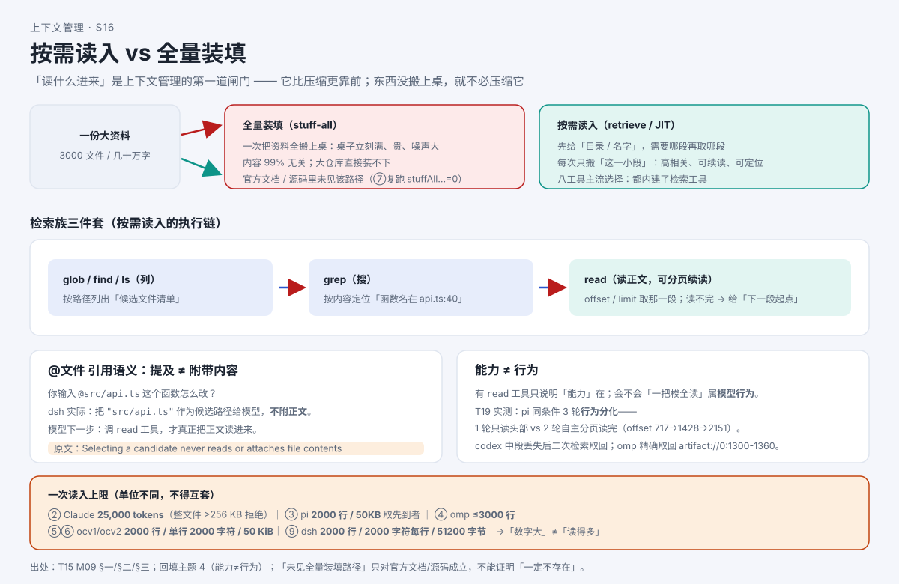

# AI 会自己去找资料，还是你全塞给它？

> 系列：AI 编程助手的上下文管理（第 12 篇 · 检索与按需读入）
> 本篇主问题：**一个 10 万字的代码库，为什么不整本塞进请求？模型怎么"先看目录、需要哪段再取哪段"？你 `@` 一个文件，内容真的带进来了吗？**

---

## 一、场景：10 万字的代码库，怎么不整本塞进去

小林让 AI 改一个函数。这个仓库有 **3,000 个文件、几十万字**。

**如果全量装填**：把整个仓库塞进请求——桌子当场撑爆（窗口根本装不下），而且 99% 的内容与这次改动**无关**，纯属浪费。

**真实发生的是"按需读入"**：AI 先列文件找到"改这个功能可能相关的 5 个文件"，再按内容搜到"这个函数名出现在第 2 个文件第 40 行"，最后**只读那一段**——**需要哪段、取哪段**。

**【当心】一个常见误解**：以为"上下文管理"就是"压缩"。其实**排在第一位的省法是"根本不读进来"**——这正是本篇的核心。

## 二、例子：第一道选择

面对一份大资料，程序只有两个选择：

```
全量装填（stuff-all）              按需读入（retrieve / JIT）
─────────────────────            ─────────────────────────
一次把资料全搬上桌               先给"目录/名字"，用时再搬
桌子立刻满、贵、噪声大            每次只搬"这一小段"
内容 99% 无关                   内容高相关、可续读、可定位
```

**关键直觉**：**"读什么进来"是上下文管理的第一道闸门，它比压缩更靠前**——压缩是"搬上桌之后减体积"，而检索是**一开始就决定搬不搬**。**东西没搬上桌，就不必压缩它。**

## 三、机制解释

### 检索族三件套：read / grep / glob

| 工具 | 管什么 | 关键动作 |
|---|---|---|
| **read**（读） | **取正文** | 支持 **offset/limit 分页续读**——读不完可以"接着读下一段" |
| **grep**（搜） | **按内容定位** | 搜到"这个函数名在第几行"，再定向读那一段 |
| **glob / find / ls**（列） | **按路径列文件** | 先拿到"候选文件清单"，再决定读哪个 |

**"分页续读"是"按需"的关键细节**：`read` 一次读不完（超上限），不是"丢了"，而是**告诉你"下一段从第 N 行开始"**。这跟第 7 篇的"落盘 + 预览 + 路径"是一对搭档：**一个管"进不来的先存着"，一个管"要用时怎么取回来"**。

### 渐进式披露：目录先给，正文再读

技能有成百上千条时，**不能把每条手册都塞进提示词**。做法是：**提示词里只放"技能名 + 一句描述"的目录**，模型**真要用某条技能时，才去读它的完整手册**。这就是**渐进式披露**。各家的"目录描述上限"不一样，**必须逐家看**——**不要用一家的数字去套另一家**。

### `@文件` 引用语义：提及 ≠ 附带内容

**【人话】** 你在输入里 `@某个文件`，直觉上"我把文件给它了"。**但多数实现里，`@` 只是"路径补全/候选"——内容并没有附进来。**

```
你输入： @src/api.ts 这个函数怎么改？
实际实现：把 "src/api.ts" 作为候选路径给模型
           ≠ 把 src/api.ts 的正文塞进请求
模型下一步：调 read 工具，才真正把正文读进来
```

**"提及"只是给了个"该读它"的信号**，读不读、读多少，仍走**按需读入**这条路。

### 跨会话引用：引用"别处的历史"要有上限

有时你想让 AI 参考**另一个会话**（比如上周那次排障）。做法是把**其他会话**作为**有界只读快照**注入，并**带固定"不可信背景"警告**。**关键在"有界"**：它是**可选开启**的，且**每源都有硬上限**（例如"一次最多引用 3 个其他会话"）。

**为什么要上限？** 因为"引用别处的历史"如果**不限量**，就等于**把别人的整张桌子搬过来**——直接违反"按需读入"的第一原则。**上限 = 把"跨会话引用"也纳入预算管理。**

## 四、图解



**图注（S16 · 按需 vs 全量）**：左侧是"全量装填"（整本上桌），右侧是"按需读入"（列文件 → 定位 → 分页读入）。**读图一句话：读什么进来，比压什么更重要——它是第一道闸门。**

> 交互教材（T17 ⑤）另配**静态替代**：每个复杂交互都有同数据的文字/表格版，无需运行脚本即可阅读。

## 五、自测

**① 判断题（陷阱）**：一个工具有 `read` 工具，说明它一定是"按需读入"、不会全量装填。（对 / 错）

**② 定位题**：用户在输入里 `@src/api.ts`。按 dsh（deepseek-harness 的命令行工具）的 `@` 实现，**模型"看到"了什么**？要看到正文，模型还得做什么？

**③ 上限题**：跨会话引用为什么要设上限（例如"一次最多 3 个会话"）？

<details>
<summary>参考答案</summary>

**① 错。** 有 `read` 工具只说明**能力**在；**"是否按需、而不是一把梭全读"属模型行为**。【T19 实测：**能力 ≠ 行为**——pi 同条件下 3 轮出现**行为分化**（1 轮只读头部，2 轮自主分页读完）；codex 在中段丢失后**二次检索取回**、oh-my-pi 用 `read` **精确取回**归档片段】。

**②** 模型**只看到路径候选**（"src/api.ts"），**没看到正文**——dsh 的实现明确"选择候选**从不读取或附带文件内容**"。要看到正文，模型**必须再调文件工具**（`read`）。**提及 ≠ 附带内容。**

**③** 因为"引用别处的历史"若不限量，等于**把别人的整张桌子搬过来**，违反"按需读入"的第一原则；**上限 = 把跨会话引用也纳入预算管理**。

</details>

## 六、来源

- 第一道选择、检索三件套、渐进式披露、`@` 引用语义、跨会话引用：课程第 9 单元（发布时替换为链接）。
- 结论 ID：`pi-retrieval-01`、`claude-retrieval-01`、`claude-toolout-03`、`ohmy-retrieval-01`、`ocv1-retrieval-01`、`ocv2-retrieval-01`、`dsh-retrieval-01/02`、`grok-retrieval-01`、`gemini-retrieval-01`（Gemini 仅历史存档）。
- 【T19 实测：**能力 ≠ 行为**——同条件 3 轮行为分化（分页续读 offset 依次推进）；中段丢失后可二次检索取回；`@` 提及仅路径补全、不附内容（须再调工具）】。

## 七、上下篇

- 上：**第 11 篇《AI 的"记忆""子代理""交接"：它到底记不记得住？》**
- 下：**第 13 篇（源码深挖①）《跟着真实代码走一遍——压缩在哪一行被触发？》**——前面十几篇讲"机制长什么样"，从下一篇起，我们直接进真实源码，看"哪一步做决定"。

## 八、边界提示

- **"有 read 工具 = 按需读入"不成立**——**能力 ≠ 行为**，模型实际策略随模型/轮次变化。
- **"`@文件` 会把文件内容带进来"不成立**——多数实现**只做路径补全、不附内容**；**"提及 ≠ 附带内容"**。
- **各家 `read` 上限单位不同**（token / 行 / 字符 / 字节），**不得直接比大小**——"数字大"不等于"读得多"。
- **"全量装填路径不存在"只对官方文档/源码成立**（复跑相关关键字命中 0）；**不能证明"一定不存在"**——**未知保留未知**。
