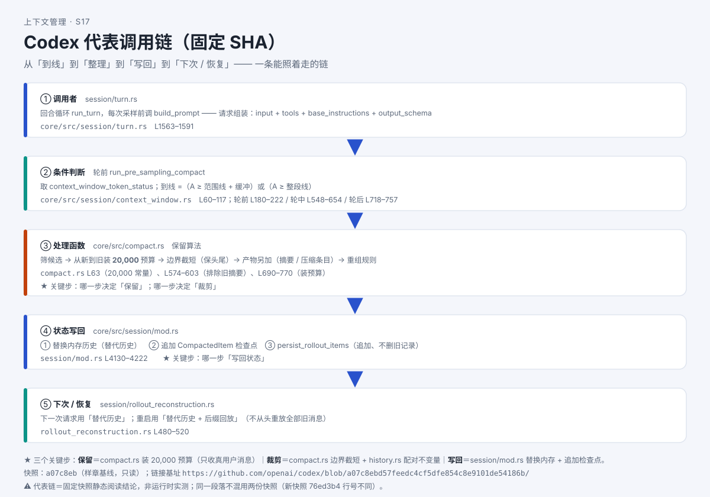

# 源码深挖①：跟着真实代码走一遍——压缩在哪一行被触发？

> 系列：AI 编程助手的上下文管理（第 13 篇 · 源码深挖①）
> 本篇主问题：**"到线就压缩"这句话，在真实代码里到底落在哪一步？哪一步决定"触发"、哪一步决定"保留"、哪一步"写回"？读别人源码，最少要会看哪几样东西？**

---

## 一、场景：从"机制"到"哪一行"

前面十几篇讲的都是"机制长什么样"：触发线、保留预算、裁剪、恢复、缓存。小林的疑问变成了：

> 这些说法**真在代码里吗**？还是作者编的比喻？

答案是：**它们都在**——只是散在几个函数里。本篇换一种读法：**拿一条真实消息，跟着代码走一遍**，把"哪一步做决定"标出来。工具选一个**源码可读**的 CLI（下称 Codex），口径固定在一份**快照**上。

## 二、例子：同一条消息，六件事是同一份数据的六个面

用一条最普通的消息（"安排郊游……下午 4 点前必须返校"），教学简化后的消息列表长这样：

```json
[
  {"role": "developer", "类型": "基础指令",     "内容": "你是……"},
  {"role": "developer", "类型": "当前工作状态", "内容": "工作目录 /project；已加载规则……"},
  {"role": "user",      "内容": "安排郊游……下午 4 点前必须返校"},
  {"role": "assistant", "类型": "工具调用",     "工具": "查公交", "call_id": "call_001"},
  {"role": "tool",      "类型": "工具结果",     "call_id": "call_001", "内容": "（300 行结果）"}
]
```

**【人话】** 这**不是六个知识点，是同一份数据的六个面**：它是一个**列表**、每条是一个**对象**、靠 `call_id` **配对**、被**函数**拼成请求、由**分支/循环**做取舍、一部分进**内存**、一部分进**文件**、还有**异步先后**。

> **【当心】** 这份教学 JSON 的字段名是**简化**，**不等于**源码字段名——真实结构以源码的类型定义为准。

## 三、机制解释

### 最小桥接六件套（不懂语言也能读骨架）

| 件 | 一句话 | 生活对照 |
|---|---|---|
| **① 列表 / 对象** | 列表是一排**有序**格子；对象是一组**带名字**字段 | 购物清单 / 药盒 |
| **② 角色 / ID** | 角色说"谁说的"；ID 是**配对编号** | 群聊发言人 / 快递单号 |
| **③ 函数** | 给输入、给输出（可能顺带改状态） | 榨汁机 |
| **④ 分支 / 循环** | "如果…就…" / "对每一个…重复做" | 路口看灯 / 逐个安检 |
| **⑤ 内存 / 文件** | 内存＝草稿（关掉就没）；文件＝存档（关掉还在） | 便签 / 笔记本 |
| **⑥ 异步先后** | "先发出、先干别的、等结果回来再接着做" | 点外卖 |

**记住一句**：**源码里 90% 的"决策"都藏在分支里**——这正是本篇要你标出来的东西。

### 代表链：六条，每条四个问题

| 链 | 进入条件 | 前后状态 | 已定义的"失败" |
|---|---|---|---|
| **① 触发到线** | 轮前/轮中/轮后任一检查点取用量 | 前：未到线；后：`token_limit_reached = 真` | 轮前检查**不含即将写入的新输入**（源码留 TODO）→ 巨型粘贴仍可一步超限 |
| **② 保留** | ① 为真且进入压缩 | 前：旧历史全在；后：选出的旧用户消息 + 摘要 | 边界处单条超预算 → **截短**；带图消息 → **文字回退** |
| **③ 裁剪 / 限长** | 工具输出进列表前；或活动历史写回时 | 前：完整原文；后：头+尾+标记 | 裁剪只作用**活动历史副本**；**存档仍留原载荷** |
| **④ 写回（检查点）** | 压缩成功（验收通过） | 前：旧内存历史；后：替代历史 + 追加检查点 | 失败须**同时保持**内存历史与已落盘存档**不变** |
| **⑤ 恢复** | 启动 / 续会话重建历史 | 前：磁盘存档；后：替代历史 + 后缀回放 | **不是"纯重放"**；旧记录仍在存档 |
| **⑥ 缓存键** | 每次请求构造处 | 前：无键；后：请求带缓存键 + 认 usage 明细 | **只发键、只认明细**；命中/TTL 源码读不出 |

**回答本篇主问题**：**"压缩在哪一行被触发"——在链①（触发到线）**。对应的位置是会话窗口状态与轮前检查两处（文件 + 行号范围见下）。而**"保留多少"在链②**、**"写回状态"在链④**——三个决定分在三处，**不是一个函数干完的**。

### 双快照纪律（本篇最容易踩的坑）

同一个工具，研究里固定了**两份快照**：

- **样章基线** `a07c8ebd57feedc4cf5dfe854c8e9101de54186b`：本系列代表链与代码片段的**统一口径**；
- **正文默认** `76ed3b484d62ccceb9fa512ff4dd139f421814c3`：另一份新快照，**行号会偏移**，且**新增了默认关闭的后台压缩支路**。

**纪律：同一段落不混用两份快照。** 把基线快照的行号直接贴到新快照的结论里——**不行**。跨快照必须**声明口径**、并**按新快照重查行号**。

## 四、图解



**图注（S17 · 代表调用链）**：六个节点从左到右——组装 → 触发 → 保留 → 裁剪 → 写回 → 恢复；每个节点标注"哪一步决定保留 / 裁剪 / 写回"，并标明本图口径为**样章基线快照**。

## 五、自测

**① 桥接题**：`if let Some(candidate) = take_ready() { … }` 里，`Some(...)` 和 `if let` 在说什么？用六件套的话解释。

**② 定位题**：压缩链里，"**哪一步决定保留**""**哪一步决定裁剪**""**哪一步写回状态**"？各给一个文件/函数名。

**③ 混用题（双快照）**：有同学把基线快照的行号直接贴到新快照的结论里。为什么不行？该怎么办？

<details>
<summary>参考答案</summary>

**①** `take_ready()` 是个**函数**（按钮），可能吐出东西、也可能什么都没吐；`Some(candidate)`＝"**这次有东西**"；`if let` 是**分支**——"**只有真有东西时**才走 `{…}`"。合起来："如果取到了候选，就处理它"。（函数 + 分支 + **"没有" ≠ 0** 的最小桥接。）

**②** **保留**＝保留算法（筛候选 → 从新到旧装预算）；**裁剪**＝边界截短（配合配对不变量清洗）；**写回**＝会话状态模块（替换内存历史 + 追加检查点）。

**③** 不行——**同一段落不混用两份快照证据**，且新快照相对基线有**实质变化**（新增后台压缩支路、裁剪模块重构），**行号会偏**。正确做法：① 声明本结论用哪份快照；② 若用新快照，**按新快照重查行号**；③ 跨快照对照查该文件的"新旧对照"行。

</details>

## 六、来源

- 六件套、代表链、双快照纪律：课程源码桥接件（发布时替换为链接）。
- 结论 ID：`codex-trigger-01/02`、`codex-retain-01`、`codex-trunc-01`、`codex-persist-01`、`codex-recover-01`、`codex-cache-01`、`codex-fail-01`；新快照分列 `codex-trigger-03`（后台压缩，默认关）、`codex-diff-01`。
- 源码锚点（样章基线快照，**文件 + 行号范围**）：组装 `core/src/session/turn.rs` L1563–1591；配对不变量 `core/src/context_manager/history.rs` L962–980；触发 `core/src/session/context_window.rs` L60–117；保留 `core/src/compact.rs` L690–770；写回 `core/src/session/mod.rs` L4130–4222；恢复 `core/src/session/rollout_reconstruction.rs` L480–520；缓存键 `core/src/client.rs` L641–653。
- **快照引用三行写法**：① 研究快照：Codex 仓库 @ `a07c8ebd57feedc4cf5dfe854c8e9101de54186b`；② 分发件/本地版本：与快照一致；③ 与官方最新关系：见发布时登记（核验日期 2026-10-15）。

## 七、上下篇

- 上：**第 12 篇《AI 会自己去找资料，还是你全塞给它？》**
- 下：**第 14 篇（源码深挖②）《换一个工具再走一遍——同一机制，不同实现》**——同一套六节点，换一个工具（TypeScript 实现）再走一遍，看差异在哪。

## 八、边界提示

- **双快照不混用**：同一段落只用**一份快照**的证据；跨快照差异**另起段落并注明**。
- **接口名 / 桩 ≠ 默认行为**：新快照里有个"后台压缩"支路，其**特性登记为"开发中、默认关"**——**不能写成"该工具默认会做后台压缩"**。
- **"未找到" ≠ "没有"**：只写"未发现"，**不写"没有做"**。
- **本文无实测**：代表链是**固定快照的静态阅读结论**，不是运行时实测；**不排名次**，只讲"哪一步做决定"。
