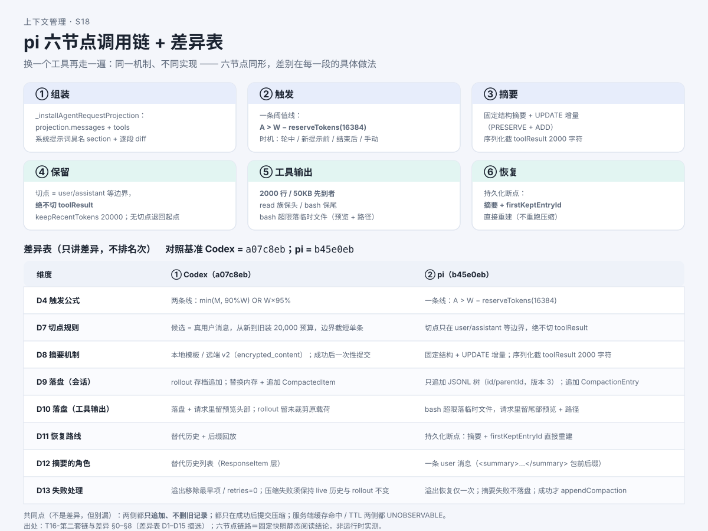

# 源码深挖②：换一个工具再走一遍——同一机制，不同实现

> 系列：AI 编程助手的上下文管理（第 14 篇 · 源码深挖②）
> 本篇主问题：**同一套"组装 → 触发 → 摘要 → 保留 → 工具输出 → 恢复"，换一个工具实现，差异落在哪几个节点上？没有源码的闭源工具，结论又该怎么写才不越界？**

---

## 一、场景：换一个工具再走一遍

上一篇我们跟着一个**Rust 实现**的 CLI 走完了六节点。小林问：

> 那别的工具呢？是不是都一个套路？**换个实现，哪些地方真的不一样？**

本篇换一个**TypeScript 实现**的 CLI（下称"pi"），按**同一套六节点**再走一遍，并把两侧**在同一节点上并排**——**只讲差异，不排名次**。最后给**闭源工具**一个"没有源码时怎么读"的统一示范。

## 二、例子：同形不同做

两套工具**同形**：都走"组装 → 触发 → 摘要 → 保留 → 工具输出 → 恢复"六个节点。**差别在每一段的具体做法**：

```
节点       Codex（基线快照）              pi（另一快照）
──────────────────────────────────────────────────────────────────
组装   请求 = 输入 + 工具 + 基础指令；      投影 = messages + tools；
       工作状态差分更新                     系统提示词具名分节 + 逐段 diff
触发   两条线：范围线 OR 整段线              一条线：用量 > 窗口 − 预留
摘要   本地模板 / 远端（加密条目）            固定结构摘要 + 增量更新
保留   候选=真用户消息，从新到旧装预算        切点只在 user/assistant 边界，
                                            绝不切在工具结果
工具   头尾裁剪 + 分片预算 + 落盘预览         行/字节双上限先到者；读保头 / 命令保尾
恢复   替代历史 + 后缀回放                   持久化断点：摘要 + 保留段起点重建
```

**一句话记忆**：**Codex 把"两条线 + 替代历史 + 后缀回放"当骨架；pi 把"一条线 + 可重建投影 + 持久化断点"当骨架。** 两者都在**磁盘上追加、不删旧记录**——差别在**模型看见什么、怎么重建**。

## 三、机制解释

### pi 的六节点关键做法

- **组装**：先算一份**投影**（`projection.messages`）——它**已经把压缩条目算进去了**；工具的可执行实现另存，**不进请求体**。系统提示词侧**具名分节 + 逐段 diff**，只把**变化段**作为补丁追加。
- **触发**：**唯一阈值线**——`用量 > 窗口 − 预留（16384）`；预留**不拆**，同时覆盖"模型回复空间 + 摘要输出空间"。用量优先取**最近一条有效响应的 usage**，其后才用字符估算。
- **摘要**：**固定结构模板**（目标 / 约束 / 进展 / 关键决定 / 下一步 / 关键上下文）；**有旧摘要时改用 UPDATE 提示词** → **增量摘要**。摘要失败**抛错、禁止半截摘要落盘**——**只有成功才追加**。
- **保留**：**切点绝不切在工具结果**——因为**工具结果必须跟随它的工具调用**（配对不变量）。无合法切点则**退回起点**；单条超长走"拆分再合并"。
- **工具输出**：**两条独立上限、先到者胜**（行数 / 字节）；**读族保头、命令族保尾**；超限落临时文件，请求里只留**尾部预览 + 路径**。
- **恢复**：**持久化断点**——直接用**摘要 + 保留段起点**重建，**不重跑压缩、不重算摘要**。

### 差异表（只讲差异，不排名次）

| 维度 | Codex | pi |
|---|---|---|
| 实现语言 | Rust + TS | TypeScript |
| 触发公式 | 两条线（范围线 OR 整段线） | 一条线（用量 > 窗口 − 预留） |
| 切点规则 | 候选=真用户消息，装预算、边界截短 | 只在 user/assistant 边界，**绝不切工具结果** |
| 摘要机制 | 本地模板 / 远端加密条目 | 固定结构 + **增量更新**（保留旧信息再新增） |
| 会话落盘 | 追加存档 + 追加检查点 | **只追加 JSONL 树** |
| 恢复路线 | 替代历史 + 后缀回放 | 持久化断点（摘要 + 起点直接重建） |
| 缓存（CLI 侧） | 发缓存键 + 认 usage 明细 | **摘要请求禁写缓存** + 预热动作 |

**共同点也写下来**：两侧**都只追加、不删旧记录**；**都只在成功后提交压缩**；**服务端缓存命中 / TTL 两侧都不可观测**。

### 闭源工具：可见边界怎么理解

有的工具**没有源码可读**。这时结论不能靠猜，走**三步**：

1. **证据分三级、逐句挂角标**：① 官方文档（**承诺行为**）② 分发件/本地可观测项（**标注观察方法**）③ 社区线索（**只是线索，不得独立证明**）。
2. **用"不可观测边界清单"显式登记**：每条写"不可观测项 / 原因 / 影响结论"。**"不可观测"是状态词，不是失败词**——它表示"本地源码读不出来"，与"机制不存在"**严格分开**。
3. **把"源码链"翻译成"可观测行为链"**：能证明的给角标，不能证明的进清单；**不补造源码**——**任何把二进制字符串当"源码"引用的做法，一律不采纳**。

## 四、图解



**图注（S18 · 六节点调用链 + 差异表）**：上半是 pi 的六节点链（标"哪一步决定保留/裁剪/写回"），下半是两工具并排的差异表——**只讲差异，不排名次**。

## 五、自测

**① 对照题**：两个工具的**触发公式**形态不同，各是什么？它们的**共同点**是什么？

**② 切点题**：pi 为什么**绝不切在工具结果**？无合法切点时怎么办？

**③ 闭源题**：能不能写"某闭源工具的自动压缩实现在 `compact.ts` 第 120 行"？

<details>
<summary>参考答案</summary>

**①** Codex 是**两条线**（范围线 `min(M, 90%W)` **OR** 整段线 `W×95%`）；pi 是**一条线**（`用量 > 窗口 − 预留`）。**共同点**：两者都在"给输出留地方"、都**只追加不删旧记录**、都**只在成功后提交压缩**——**做法不同，不是优劣**。

**②** 因为**工具结果必须跟随它的工具调用**——切在结果处会**破坏"调用↔结果配对"不变量**。**无合法切点时退回起点**。

**③ 不能。** 该工具为**闭源**（文档级 / 分发件观察，**无源码**）；给出"某文件某行"＝**补造源码**。正确写法：带角标的**可观测行为链**（如"自动压缩＝**文档承诺**"），并注明**无源码可核对**。

</details>

## 六、来源

- 六节点对照、差异表、闭源示范：课程第二套链与差异件（发布时替换为链接）。
- 结论 ID：`pi-assembly-01/02`、`pi-trigger-01/02`、`pi-summary-01/02`、`pi-trunc-01/02`、`pi-recover-01`、`pi-cache-01`、`pi-fail-01/02`；对照 `codex-trigger-01/02`、`codex-retain-01`、`codex-persist-01`、`codex-recover-01`；闭源 `claude-cache-01..05`、`grok-version-02`。
- 源码锚点（pi，**文件 + 行号范围**）：组装 `agent-session.ts` L788–845、`system-prompt.ts` L128–193；触发/摘要/保留 `compaction/compaction.ts` L126–130、L267–270、L351–364、L507–538、L802–870；工具输出 `tools/truncate.ts` L11–13、`tools/bash.ts` L333–355；恢复 `session-manager.ts` L476–512、L1261–1287。
- **快照引用三行写法**：① 研究快照：pi 仓库 @ `b45e0ebcc5ae2fc42a6f2f23104d10e656e6bedb`；② 分发件/本地版本：与快照一致；③ 与官方最新关系：见发布时登记（核验日期 2026-10-15）。**对照基准（Codex）用样章基线 `a07c8eb…`，两者不混用。**

## 七、上下篇

- 上：**第 13 篇（源码深挖①）《跟着真实代码走一遍——压缩在哪一行被触发？》**
- 下：**第 15 篇《如果换你来设计：一个 Agent 的上下文流程怎么排？》**——源码看够了，下一篇换你做设计：状态图、伪代码、失败处理、反例自检。

## 八、边界提示

- **只讲差异，不排名次**：并排是**设计差异**，不是"谁更好"的排序。
- **同一段落不混用两份快照**；对照基准与第二套链**各用各的快照**。
- **"刻意不含" ≠ "未找到"**：设计选择（有文档一级证据）是**事实**；检索结果是**推断**——两者引用时必须分开。
- **闭源不补造**：能证明的给角标，不能证明的进"不可观测清单"；**"不可观测" ≠ "机制不存在"**。
- **本文无实测**：全部为**固定快照的静态阅读结论**。
