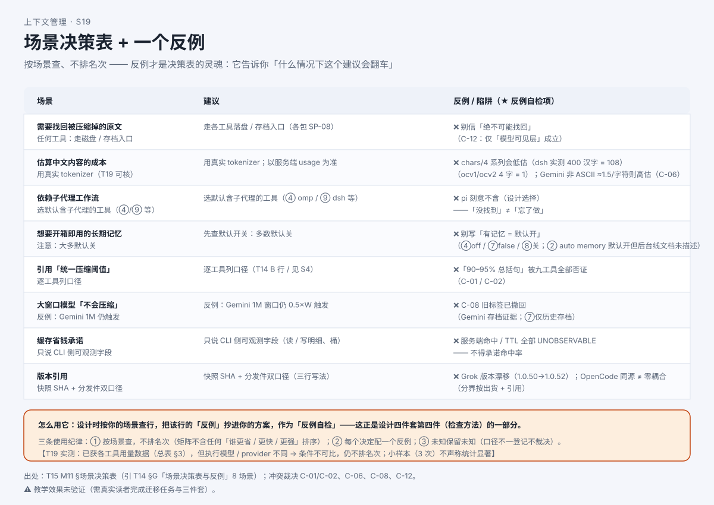

# 如果换你来设计：一个 Agent 的上下文流程怎么排？

> 系列：AI 编程助手的上下文管理（第 15 篇 · 设计与排障）
> 本篇主问题：**给定一个任务，你怎么画出状态图、写出伪代码、设计失败处理、留下检查方法？"恢复后会不会把同一条命令再跑一遍"？场景之间怎么"选"而不是"排名次"？**

---

## 一、场景：从"读懂别人"到"自己设计"

前面十四篇都在"**读懂别人**"：读场景、读流程、读机制、读源码。小林现在要给**班级郊游助手**做上下文管理设计。他不再问"别人是怎么做的"，而是问：

> **设计问**：我这个助手**有哪些状态**？一轮任务按什么顺序读写？关键约束（"下午 4 点前返校"）怎么保证**不丢**？
>
> **排障问**：整理失败了、恢复后约束丢了、工具结果被裁了，我**怎么发现、怎么修**？哪些动作**不能重复执行**？

**关键直觉**：**你要交的不是"抄一份现成实现"，而是一份能复核、能自洽、能迁移的方案**——它可以和别人不同，但必须**说得出理由、给得出反例、经得起检查**。

## 二、例子：两个真实教训

已知的两个靶子，正是设计要防的：

- 有个助手整理后**忘掉了"下午 4 点前返校"**；
- 也有助手把**"已否决的地点"复活了**。

**【人话】** 这两个教训指向同一个病根：**关键状态被交给了"有损摘要"**。摘要会概括、会漂移，把"不能选 X"这种状态**交给概括**，就无法验证它还在。

## 三、机制解释

### 设计四件套（L5 的最小交付）

做上下文管理设计，不必写代码，但要交**四样东西**，缺一不可：

| 件 | 回答什么 | 关键要求 |
|---|---|---|
| **① 状态图** | 有哪些状态对象（材料列表、约束表、用量计、检查点），各自**何时被读、被写** | 每个对象都要标"一轮里哪一刻读、哪一刻写" |
| **② 伪代码** | 一轮任务的流程（读输入 → 更新约束 → 组装 → 调模型 → 工具 → 用量检查 → 整理/恢复） | 必须写出**取舍理由**（为什么用户消息优先、为什么约束单独建表） |
| **③ 失败处理** | **失败分类 + 有界重试 + 副作用/幂等** | 给一张"失败 → 检查 → 行动"表；标出**不可重复执行**的动作 |
| **④ 检查方法** | **怎么发现它坏了**（排障清单 + 评估维度） | 排障按"症状 → 机制 → 单元"定位 |

**【当心】最常见的漏项是第④件**：很多人只交状态图与伪代码，**不写"怎么检查"**。但验收口径是"**可复核**"——没有检查方法，方案无法被独立验证。

### 失败分类与有界重试

整理失败时先别慌——看清**两件事**：失败发生在**哪一小步**；哪份状态**已经变了**。把"整理"拆成**四步**：

```
① 准备 → ② 请求 → ③ 验收 → ④ 安装
```

**只要能分清"③失败"与"④失败"，大多数恐慌就会消失**：③失败 → ④不执行 → **活动历史保持原样**（没被换坏）；④一旦执行 → 那就是**成功路径**了。

**两条设计原则**：**失败分类**（按原因分，各走各的出路，不是"一律重试"）；**有界重试**（重试必须有上限，且**不同循环用不同计数**）。

**【当心】看到 `retries = 0` 先别判"死循环"**：它是"**缩副本循环**"的计数归零，与"**普通错误退避**"是**两种循环语义**——缩副本每缩一次问题真的变小了（有进展），所以计数重置。

### 幂等与重复执行

关掉再打开，程序重建的是**对话历史/材料**，**不是重跑已完成的动作**。所以**已经产生的副作用不可回退**——整理前已写进磁盘的文件，压缩失败**不会撤回**。

**"恢复后是否重复执行工具"目前保留未决**：实测条件下**未见重复执行**，但**专门的副作用注入未做**。设计时你能做的是：**把"不可重复的动作"标出来、给它们加防护**（记录已完成动作、恢复后先核对），**而不能宣称**"恢复一定不会重跑"。

### 场景决策表：怎么"选"，而不是"排名次"

选择不是"谁更强"，而是"**在这个场景下，哪种做法更合适、它的反例是什么**"。**反例才是决策表的灵魂**——它告诉你"什么情况下这个建议会翻车"。三条使用纪律：**按场景查，不排名次**；**每个决定配一个反例**；**未知保留未知**。

## 四、图解



**图注（S19 · 场景决策表 + 一个反例）**：左列是场景，中列是建议，右列是**反例/陷阱**。读表方式：**按你的场景查行，把该行的反例抄进你的方案**，作为"我的方案在什么情况下会翻车"的自检项。

## 五、自测

**① 设计题（四件套）**：设计四件套是哪四件？哪一件最容易被漏掉，为什么它不能漏？

**② 失败题（双计数）**：Codex 本地压缩在超窗口时 `retries = 0`。这是"无限重试"吗？为什么？

**③ 幂等题**：恢复之后，程序会**把昨天已经跑过的命令再跑一遍**吗？本单元对此的**证据状态**是什么？

**④ 场景题**：用户想"开箱即用就有长期记忆"。按场景决策表，**建议**是什么？**反例**是什么？

<details>
<summary>参考答案</summary>

**①** 四件：**① 状态图 ② 伪代码 ③ 失败处理 ④ 检查方法**。**最易漏第④件**——验收口径是"**可复核**"，没有检查方法，方案无法被独立验证，也谈不上迁移。

**② 不是**无限重试。`retries = 0` 是**"缩副本循环"**的计数归零，与**"普通错误退避"**是**两种循环语义**；缩副本每次至少减一条（**有界**）。

**③** **恢复重建的是"材料"，不是"重跑已完成的动作"**；**副作用不可回退**。**证据状态**：**"恢复后是否重复执行工具"保留未决**——实测条件下**未见重复执行**（Codex 恢复轮 0 命令、pi 溢出恢复 0 工具动作），但**专门副作用注入未做**。设计时能标出不可重复动作并加防护，但**不能宣称**"一定不会重跑"。

**④ 建议**：注意**大多默认关**。**反例**：❌ 别写"有记忆 = 默认开"；Claude Code 的**后台机制文档未描述**——**"未发现" ≠ "没有"**。

</details>

## 六、来源

- 设计四件套、失败分类、幂等、场景决策表：课程第 11 单元（发布时替换为链接）。
- 结论 ID：`codex-fail-01/02`、`claude-error-01/02/03`、`pi-fail-01/02`、`ohmy-fail-01/02`、`ocv1-fail-01/02`、`ocv2-fail-01/02`、`grok-fail-01/02`、`dsh-fail-01/02/03`；场景决策表引 **T14 §G**（8 场景 + 反例）。
- 完整迁移任务（题组 C：**状态图 + 伪代码 + 失败处理 + 反例自检**，含"带否决决定的多子代理并行长任务"新场景）：课程**结业任务包**（发布时替换为链接）。
- 【T19 部分：恢复条件下**未见工具重复执行**（Codex 恢复轮 0 命令、pi 溢出恢复 0 工具动作）；**专门副作用注入未做 → 保留未决**】。

## 七、上下篇

- 上：**第 14 篇（源码深挖②）《换一个工具再走一遍——同一机制，不同实现》**
- 下：**第 16 篇（收官）《怎么判断一个上下文方案好不好？》**——方案交上去了，凭什么说它"行"？下一篇给四个维度。

## 八、边界提示

- **"恢复一定不会重跑"不成立**——证据状态是**保留未决**；只能标出不可重复动作并加防护。
- **`retries = 0` 不是死循环**——是两种循环语义，读代码先问"这是哪个计数"。
- **"验收" ≠ "拿到就算成功"**——是"**符合契约**才算成功"（如要求"恰好一个"压缩条目）。
- **排障第一原则**：**先分清"哪一层"**（磁盘 / 活动历史 / 请求）——"我看到" ≠ "模型看到"。
- **不排名次**：场景决策表**按场景查、不排序**；**压缩率漂亮 ≠ 任务质量好**。
