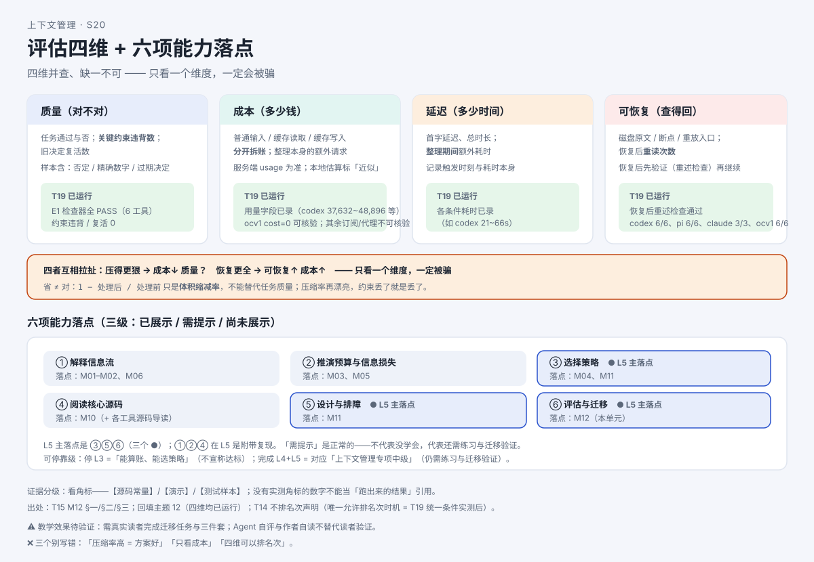

# 怎么判断一个上下文方案好不好？（收官）

> 系列：AI 编程助手的上下文管理（第 16 篇 · 收官）
> 本篇主问题：**一套上下文方案交上去了，凭什么说它"行"？只看"省了多少 token"够不够？换一个没讲过的任务，这套思路还能不能搬过去？**

---

## 一、场景：方案交上去了，领导问三句话

小周按上一篇的办法设计完"多轮选型助手"的上下文流程，交了上去。领导问了**三句话**：

> **第一句**："你怎么知道它**行**？"——小周想答"它省 token"。领导追问："**省 token 就等于好用吗？** 万一它把'已否决的方案'又复活了呢？"
>
> **第二句**："这个方案**换到别的任务**还灵吗？下周我们有个完全不同的活儿。"
>
> **第三句**："你这些结论，**哪些是真测出来的，哪些是推的**？"

三句话各对应一条主线：**评估四维并查**；**迁移**（对照表）；**证据分级**。

## 二、例子：省 token 不等于好用

**【人话】** 判断一套方案，要**同时**看四样东西——它们常常**互相拉扯**：压得更狠 → 成本降了，但质量可能掉了；恢复做得更全 → 更安全，但成本涨了。**只看一个维度，一定会被骗。**

最典型的误读："**压缩率漂亮 = 方案好**。"——**错**。`1 − 处理后 / 处理前` 只是**体积缩减率**，**不能替代任务质量**。压缩率再高，**约束丢了就是丢了**。

## 三、机制解释

### 评估四维并查

| 维度 | 一句话 | 要记录的指标 |
|---|---|---|
| **质量** | 任务**对不对**、关键约束**有没有丢** | 任务通过与否；**关键约束违背数**；旧决定复活数 |
| **成本** | 花了**多少钱** | 普通输入 / 缓存读取 / 缓存写入**分开拆账**；整理本身的额外请求 |
| **延迟** | 花了**多少时间** | 首字延迟、总时长；**整理期间**额外耗时 |
| **可恢复** | 出事了**能不能查回来** | 磁盘原文/断点/重放入口；恢复后**重读次数** |

**四维都要有"方法/口径"**。填不出"怎么观察"的方案，**不是可复核的方案**。

### 六项能力自评表

本课程定义的"**上下文管理专项中级**"，验收口径就是这**六项能力**（逐项打**已展示 / 需提示 / 尚未展示**）：

| 能力 | 判断依据（关键词） |
|---|---|
| **① 解释信息流** | 能说出三层差异，举出**自己的一个反例** |
| **② 推演预算与信息损失** | 算例**含单位与条件**；能指出一处"会丢约束"的环节 |
| **③ 选择策略** | 场景 **> 1 个**；每个选择给出**代价**与**一个反例** |
| **④ 阅读核心源码** | 能在**固定链接**里指出触发/保留/写回三个分支的**状态变化** |
| **⑤ 设计与排障** | 四份交付物完整；失败表含"**不可重复的副作用**" |
| **⑥ 评估与迁移** | 迁移任务完成；验证方案**区分实测 / 推断** |

**读表两件事**：**L5 的主落点是 ③⑤⑥**（选择、设计、评估迁移），别把六项平均用力；**"需提示"是正常的**——有两三项要提示，**不代表没学会**，代表还需要练习与迁移验证。

### 迁移 = 对照表

**迁移**不是"把答案抄一遍"，而是**把机制映射到新场景**。核心动作是**对照表**：

```
机制（本课程）  →  新场景里的对应物  →  你要做的动作
关键约束        →  "旧客户端必须兼容"  →  写进头尾 + 约束表标"有效"
长工具结果      →  测试日志（几百行）  →  保头尾 + 关键行单独复述
整理触发        →  会话到线自动压缩    →  算两条线 + 决定提前手动整理的时机
保存与恢复      →  隔天续会话继续      →  恢复后先验证约束还在
失败处理        →  整理/测试失败        →  本轮不动历史；副作用不重复
缓存            →  同一会话稳定前缀    →  别为凑缓存改写旧消息
```

### 那些"只有真实实验能回答"的问题

课程结论来自**源码常量、文档级证据或机制推演**，此前**没有一次真实模型实验**。有一批问题**只有真实实验能回答**——其中多数已经由一批**专设实验**给出实测：**质量**（检查器判据全部通过）、**成本 / 延迟**（用量与耗时已录）、**可恢复**（恢复后重述检查通过）。**服务端缓存命中 / TTL 仍不可观测**，**不得承诺命中率**。

## 四、图解



**图注（S20 · 评估四维 + 六项能力落点）**：上半是四维并查（互相拉扯，只看一个一定被骗）；下半是六项能力与各级落点，**L5 主落点为 ③⑤⑥**。

> 结业路径（文字版）：**题组 A 行程任务 → 题组 B 接口兼容 → 题组 C 迁移任务**；三题均为**纸面设计/推演**题，不调用真实模型；参考解答、允许的替代方案、六项能力三级评分见课程结业件（发布时替换为链接）。

## 五、自测

**① 四维题**：有人说"我这套方案压缩率 90%，所以特别好"。请用**四维并查**指出这句话的问题，并各补一个你还要看的维度。

**② 纪律题**：为什么本课程**不能**给出"哪个工具最省 token"的排名？什么条件下才可以？

**③ 迁移题**：把"关键约束（下午 4 点返校）"迁移到"改接口、保旧客户端兼容"的任务，对应物是什么？你要做的**动作**是什么？

**④ 收束题**：如果你只读到"能算账、能选策略"这一级就停下，你**获得了什么**、**不能宣称什么**？

<details>
<summary>参考答案</summary>

**①** "压缩率 90%"只是**体积缩减率**，**不能替代任务质量**。还要看：**质量**（关键约束违背数、旧决定复活数——压掉的可能是"不能选 X"）；**成本**（普通/缓存读/缓存写三项分开拆账，别把缓存 token 重复相加）；**延迟**（整理期间额外耗时）；**可恢复**（磁盘原文/断点在不在、恢复后重读次数）。**四维并查，缺一不可。**

**②** 因为**此前没有实测**：所有"省/快/强"结论都是源码常量、文档级证据或推演，**排序需要统一条件实测**。**唯一允许排名次的时机 = 统一条件实测后回填**；即便已获用量数据，**各工具执行模型/provider 不同 → 条件不可比，仍不排名次**。

**③** 对应物 = **"旧客户端必须兼容"（兼容性约束）**。动作：明确写进第一条消息的**头尾**；在**约束表**里标"有效"；恢复后**先验证**（问一遍"旧客户端兼容要求是什么"）再动手。

**④** 停下获得"**能算账、能选策略**"，但**不能宣称**达到专项目标；完成源码连接 + 独立判断两级，才对应"**上下文管理专项中级**"，**且仍需练习与迁移验证**。

</details>

## 六、来源

- 评估四维、六项能力、迁移、可停靠级：课程第 12 单元（发布时替换为链接）。
- 结论 ID：成本维 `codex-cache-01`、`claude-cache-01..05`、`grok-cache-01/02`、`dsh-cache-01/02`；可恢复维各工具落盘/存档入口；场景决策引 **T14 §G**。
- 【T19 实测：**评估四维均已运行**——质量=检查器判据全 PASS；成本/延迟=用量与耗时已录（费用口径逐工具）；可恢复=恢复后重述检查通过（Codex 6/6、pi 6/6 等）】。

## 七、上下篇

- 上：**第 15 篇《如果换你来设计：一个 Agent 的上下文流程怎么排？》**
- 下：**—（系列完）**。想继续深入，可进入**完整课程 / 博客入口**（发布时替换为链接）：全阶段目录、术语表、源码导读、实验与练习、交互教材双入口都在那里。

## 八、边界提示

- **"压缩率高 = 方案好"不成立**——省 ≠ 对；`1 − 处理后/处理前` 只是**体积缩减率**。
- **不排名次**：此前**没有实测不排名次**；即便已获用量数据，**条件不可比仍不排名次**。
- **课程数字分三类角标**（源码常量 / 演示 / 测试样本）——**看到数字先看角标**，没实测角标的数字**不能当"跑出来的结果"引用**。
- **服务端缓存命中 / TTL 全部不可观测**——**不得承诺命中率**。
- **教学效果待验证**：需真实读者完成迁移任务，才能验证"专项中级"达成；**自评不替代读者验证**。
