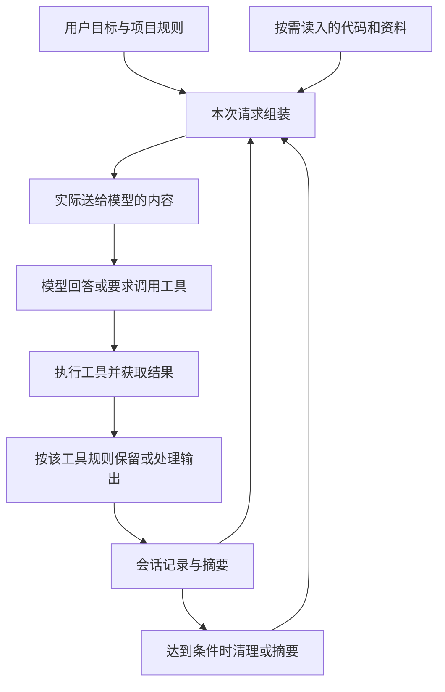

# Agent 上下文管理第二版研究方案与执行提示词

> [!abstract] 先读这一段
> 第二版定位为**面向对 AI 工作原理感兴趣的公众，从上下文管理零基础走向概念、原理、核心源码与设计判断的系列教程**。成果将用于微信公众号、小红书和作者博客，作者本人也是读者之一。
> 学习终点是：读者完成教程与练习后，在**上下文管理这一专项**达到本方案定义的中级 Agent 开发者能力要求，能够解释机制、判断取舍、读懂关键实现，并设计和验证一个小型方案。入门不要求编程基础；通往源码的必要知识要在课程中补齐。
> 保留现有 Codex CLI 教程作为教学素材，按新能力目标检查缺口，再逐批展开对比研究。主教程负责建立理解，源码导读负责连接实现，实验与练习分别验证机制效果和读者能力。
> 本文是执行方案，包含一个教学写法示范；**还不是第二版研究结论，也没有执行九工具源码下载或横向评测**。

返回：[[程序猿/ai/上下文管理/如何做好 Agent上下文管理|研究入口与第一版问题复盘]]。

> [!note] 2026-10-11 的范围确认与首稿记录（读者定位已于次日更新）
> 已确认 Codex 只研究 **Codex CLI**，先做样章，暂不展开九工具。10 月 11 日首稿采用开发场景；10 月 12 日按下文的新定位改成大众版交互 HTML。下文九工具安排仅为后续计划。
> 已交付：[[程序猿/ai/上下文管理/ai codiing 工具上下文对比报告/第二版/样章01-压缩后旧历史到底还在不在-Codex CLI|样章 01：压缩后，旧历史到底还在不在？]]。完成源码核查与证据附录；教学场景不是实测，官方测试仅阅读、未运行。

## 1. 读者、学习终点与递进路线

### 1.1 目标读者与起点

> [!important] 2026-10-12 公开分享与学习深度更新，以本节为准
> 主要读者是对 AI 工作原理感兴趣、尚不理解上下文管理的人，包括普通 AI 用户、产品与运营人员、学生、传统软件开发者和 Agent 初学者。既不假定读者认识九种工具，也不假定其知道 token、API、Agent 或会话是什么。
> “零基础”指起点；终点要覆盖原理、核心实现和工程取舍。语言保持清楚、理性，不把“12 岁也能懂”当作受众年龄定义，也不以生活科普的深度作为整套教程的终点。

先补每一步所需的最少知识，再进入下一步。专业术语首次出现时给中文解释与常用英文名，方便后续阅读官方文档和源码；不得始终绕开术语，导致读者换一篇文档就失去理解。

作者的 Java/Spring 经验可以提供经过脱敏的工程案例与进阶旁注，但公共主线不依赖作者履历、私有项目、账号或机器环境。资深开发者可以跳过已掌握的基础桥接；非开发者则沿完整路线学习。

### 1.2 “中级 Agent 开发者水平”具体指什么

这是本教程对**上下文管理专项能力**的工作定义，不是行业认证，也不等于完成全部 Agent 工程训练。学习效果通过练习与迁移任务验证，不能用“读完”直接宣布达标。

| 能力 | 学完应能完成的任务 | 验收依据 |
|---|---|---|
| 解释信息流 | 区分模型、Agent 与执行框架，画出一次用户任务中的多次模型请求和工具循环 | 标出保存的记录、选中的材料、实际请求、外部记忆各在哪里 |
| 推演预算与信息损失 | 在给定计量规则下计算剩余空间，预测裁剪、摘要和重读后的数据变化 | 计算有单位与条件；能找到丢失约束，而不只看到 token 减少 |
| 选择策略 | 面对长日志、重复资料、长期任务等场景，选择检索、限输出、摘要、外置记忆或交接 | 给出理由、代价、失败条件和至少一个不适用的反例 |
| 阅读核心源码 | 沿真实调用链找到触发、输入、转换、写回和恢复读取 | 用自己的话说明关键分支及前后状态，并指向固定版本证据 |
| 设计与排障 | 设计一个小型 Agent 的上下文流程，处理约束丢失、摘要失败和恢复后重复执行 | 提交状态图、伪代码、失败处理与检查方法，能解释修改理由 |
| 评估与迁移 | 比较同场景方案，并把学到的机制用于新任务 | 同时检查任务质量、成本、延迟与可恢复性，明确实测与推断 |

读懂源码要求理解关键数据结构和控制流程，不要求精通九套语言或通读整个仓库。非开发者可以通过状态图、数据样例和伪代码证明专项设计理解；如果没有运行程序，不能据此声称已具备独立编码和部署能力。

### 1.3 从零到实现的五级学习路线

教程按概念的先后依赖组织，工具比较穿插在对应机制之后。不能让读者先读完九份产品报告，再自己拼出共同原理。

| 阶段 | 要解决的问题与内容 | 读者要做出的东西 |
|---|---|---|
| 第一级：建立直觉 | AI 这次根据什么回答？补齐模型、消息、token、上下文窗口、一次请求与会话的最少概念 | 用一张图解释“记录还在，当前却没用上” |
| 第二级：理解流程 | Agent 如何读取资料、调用工具、继续任务？加入消息角色、工具调用与结果配对、请求组装、任务状态 | 单步追踪一次完整循环，预测下一次请求包含什么 |
| 第三级：掌握机制 | 为什么需要选择、裁剪、摘要、检索与记忆？加入预算、连续压缩、缓存、恢复和子 Agent 交接 | 对同一份材料做前后对照，说明几种策略的取舍 |
| 第四级：连接源码 | 程序在哪里做这些决定？先学最少代码阅读知识，再读 Codex CLI 的代表性链路，并对照其他工具 | 标注一条真实调用链，解释关键分支、配置门控与状态变化 |
| 第五级：独立判断 | 换一个任务如何设计、验证和修复？结合跨工具比较、失败案例和结业练习 | 提交可复核的小型方案与实验设计，迁移到未讲过的场景 |

进入第四级前安排“读源码的最小桥接”：用同一份消息样例说明列表与对象、字段与 ID、函数的输入输出、条件与循环、内存状态与文件保存、异步任务的先后关系。JSON、伪代码与原语言片段逐一对应；首次使用 Rust、TypeScript 等语法时只补该片段必要的知识。桥接内容属于完整学习路线，不作为读者自行补课的隐含前提。

每阶段提供前置知识、学完能做什么、一项练习、参考答案与返回补课的位置。读者可按需停在前三级；要达到完整专项目标，必须完成源码导读与第五级练习。不要承诺一篇短文或固定几小时就能完成全部能力迁移。

### 1.4 同一条主线，逐步从生活进入程序

保留现有教程的**班级郊游、下午 4 点前返校**故事，先解释材料的保存与使用，再转成“行程规划 Agent”的消息列表、工具结果、约束清单和恢复状态。同一条返校约束要贯穿前后，读者能看见类比如何落到真实的数据对象。

随后用统一的 AI coding 任务验证迁移：修改一个简单接口且保持旧客户端兼容，经过读文件、长日志、测试、压缩与隔天恢复。先解释任务目标和“兼容”是什么意思，再展示必要代码。Spring Boot/Maven 作为开发者扩展示例，核心机制不得依赖其知识。

生活演示、合成 Agent 和真实工具实验分别标明。生活比喻用于建立直觉；核心实现必须靠源码与数据流程说明，不能把“像整理书桌”当作算法解释。

### 1.5 已有材料与本次调整的边界

已登记交付：[[程序猿/ai/上下文管理/ai codiing 工具上下文对比报告/第二版/Codex CLI 上下文管理-交互教程.html|Codex CLI 上下文管理 · 十章交互教程]]，以及 [[程序猿/ai/上下文管理/ai codiing 工具上下文对比报告/第二版/证据/Codex CLI 压缩触发与失败源码证据|压缩触发与失败]]、[[程序猿/ai/上下文管理/ai codiing 工具上下文对比报告/第二版/证据/Codex CLI 保留与信息损失源码证据|保留与信息损失]]。2026-10-14 已在前次八章重做基础上扩为十章：补充实际定义、触发公式、保留与裁剪算法、官方缓存专题及机制索引，重新检查页面操作、手机显示及关键源码；真实模型保留率、时延与成本未测试。

2026-10-14 已完成四项真实CLI现象验证，实际使用0.152.0、gpt-5.6-sol、low、ChatGPT登录。运行条件、关键日志、压缩/裁剪前后对照与结果解读已补入第十章；复现脚本、合成资料和公开摘录见[[程序猿/ai/上下文管理/ai codiing 工具上下文对比报告/第二版/证据/Codex CLI真实实验-20261014/README|真实实验复现包]]。本次不推算普遍保留率、订阅或API账单、延迟因果；工具配置256的逐层精确钳制仍待补证。

新版教程已补充任务与模型请求、当前工作状态、真实阈值和触发条件、逐条保留与裁剪、官方缓存解读、机制索引、材料选择及迁移练习。 2026-10-14 再次按零基础读者通读修订：补齐术语铺垫、四个阈值演算预设、八个源码中文解读单元与13段新增真实Rust节选、请求JSON逐字段及usage拆账，源码依据移至章末；手机多列表格按字段展示。**完整的五级学习路线仍需逐项验收**；跨工具比较、完整源码学习路线、迁移结业任务与三平台改编稿属于后续交付，不能因十章修订完成而标记为全部完成。

## 2. 保留九个对象，分批研究

完整范围：Claude Code CLI、Codex CLI、pi、oh-my-pi、OpenCode v1、OpenCode v2、Grok Builder、deepseek-harness、Gemini CLI。

| 阶段 | 对象与工作 | 完成条件 |
|---|---|---|
| 身份核对 | 九个对象都登记官方主页、仓库、产品入口、主要语言、Stars 与采集时间 | 名称能唯一定位；无法定位的写“待确认”，不猜仓库 |
| 第一批深挖 | Claude Code CLI、Codex CLI、pi，先解决第一版冲突 | 三者用同一个问题模板，形成一个可读样章；当前仅完成 Codex CLI 十章交互教程，另外两者未启动 |
| 第二批扩展 | 其余六个对象 | 每个对象有独立证据与解释；不复制第一批结论充数 |
| 统一比较 | 九个对象的同维度矩阵，标明缺失证据 | 未知保留为未知，结论只覆盖实际验证范围 |

**几个必须先消除的歧义：**

- OpenCode v1/v2 是哪个仓库的哪些 tag、分支或代际？先核对，再决定两个独立目录如何命名。
- pi 的旧仓库名、当前仓库名与分支项目要映射清楚；oh-my-pi 单独研究。共享代码来源不等于默认行为相同。
- Codex 仅研究 CLI，固定其源码版本与运行入口；Desktop 与云端不在本研究范围。
- Grok Builder、deepseek-harness 先确认具体产品及官方仓库。找不到可验证来源时，保留缺口。
- Claude Code 可用官方文档和官方分发包做研究；不能把社区还原目录直接升级成“当前官方开源实现”。

“最新源码”的执行口径：**研究开始当天拉取并记录完整 commit SHA，正文围绕该快照分析**。不要研究到一半悄悄更新 main。最新稳定版本与开发分支有差异时，分别说明。Stars 只说明项目背景，不能推导方案优劣。

源码统一放到独立研究工作区 `/Users/junjielong/workspace/agent-context-research/sources/<tool>/`。此前研究记录只登记了 `codex/`，固定 SHA 为 `a07c8ebd57feedc4cf5dfe854c8e9101de54186b`；其他工具尚未展开。本次定位调整不把该快照视为最新版本，后续研究启动时重新核对。笔记中记录本地路径和固定 SHA 的远程链接，避免把九套仓库直接装进 iCloud 笔记库。

## 3. 先建立一张所有章节共用的数据地图

想象你在整理做计划的材料：哪些放进资料柜，哪些摊在工作桌上，哪些被缩短了？先画清楚去向，再讲术语。教学中逐步从这张直觉图过渡到消息列表、状态图和真实调用链。



这是教学总图，不代表任何一家工具的具体执行顺序。各工具章节必须把自己的真实触发位置、保存位置、调用路径画出来。

先讲清四个东西：

| 对象 | 用生活经验理解 | 容易误解的地方 |
|---|---|---|
| 保存的记录 | 资料柜里的纸张 | 是否保存完整，要检查实际写入过程 |
| 当前选中的材料 | 从柜里挑出来的纸张 | 挑出来不代表最终全部交给 AI |
| 本次提供给 AI 的信息 | 实际摆上工作桌的材料 | 柜里存着，不代表桌上也有 |
| 另外保存的笔记 | 柜里的目录和任务清单 | 必须找得到并重新提供，保存笔记不等于用上笔记 |

“资料柜与工作桌”的类比只解释**保存与当前使用的区别**；AI 没有真正的桌子。压缩后的内容可能遗漏细节，也不等于 ZIP 文件那样能完整解开。不得把教学模拟中的卡片数当作真实容量。

缓存另讲：它可以复用相同前缀的处理结果，降低重复计算。不要把缓存当作摘要、外部记忆或容量扩展；也不要说删掉最旧消息就必然保护前缀。OpenAI 当前官方说明明确要求匹配的前缀保持一致，压缩或截断可能改变前缀并降低复用。来源：[Prompt caching](https://developers.openai.com/api/docs/guides/prompt-caching)。

## 4. 每种机制都回答同一组问题

不要要求每个子 Agent 自由写“深度报告”。给它们相同的问题，回来才能比较。

| 必答问题 | 必须交付的内容 |
|---|---|
| 解决什么麻烦？ | 一个具体失败场景，不写“提升效率”这种泛泛目的 |
| 什么时候运行？ | 自动/手动，轮前/工具循环中/轮后/超限后；谁调用它 |
| 输入是什么？ | 一个小的消息样本，包含角色、关键内容、工具调用关联 |
| 怎么处理？ | 哪些保留、摘要、裁剪、落盘；前后数据对照 |
| 怎样决定预算？ | 单位、公式、变量来源、配置覆盖、演算条件 |
| 成功以后做什么？ | 状态写回、重新注入、下一次模型请求 |
| 失败以后怎么办？ | 重试次数、回退、是否保留原状态、是否可能重复副作用 |
| 以后能否找回？ | 哪份原文、哪个路径/记录 ID、保留期、读取入口 |
| 代价是什么？ | 信息损失、摘要成本、缓存变化、延迟、重复读取 |
| 适用于什么情况？ | 适用条件、一个反例、用户能采取的动作 |

研究覆盖的不只是自动压缩：输入选择、代码检索、工具输出限制、摘要、指令与技能的按需加载、记忆、子 Agent 上下文交接、持久化与恢复、计量和缓存都要在这张地图上找到位置。每个小节只深入一个问题。

基础章节还要专门区分：训练得到的知识与本次输入的资料、上下文窗口与长期记忆、检索补资料与摘要减体积、缓存复用与信息保留、模型生成与框架执行。讲清上下文足够长为什么仍可能用错或漏用信息；比较不仅关注“装得下”，还要检查相关性、约束是否有效、资料是否过期以及来源能否追溯。具体行为仍须逐产品核验。

工程进阶补充信息的可信边界：用户指令、外部资料和工具结果要能辨认来源；把外部文本存进摘要或记忆后，不能因此当成用户的新指令。用一个小例子解释规则冲突、过期记忆与提示注入怎样影响上下文选择，不扩展成完整安全课程。

## 5. 证据怎么记录，冲突怎么解决

每条关键结论都要区分三种标签：**事实**（直接证据）、**推断**（解释或外推）、**建议**（读者可采取的动作）。另记实现状态：默认启用、配置后启用、实验路径、空实现、未证实。

证据没有一个能包办所有问题的简单等级：官方文档说明对外行为；源码说明特定版本如何实现；运行记录说明特定配置下发生了什么。社区材料用来找线索，不能独自证明当前默认行为。

每张证据卡使用以下字段，正文只链接到卡片，避免堆满元数据：

```yaml
结论ID: 工具名-主题-序号
结论: 一句话，只表达一个判断
性质: 事实 / 推断 / 建议
适用范围: 产品入口、版本或完整SHA、模型、provider、配置
实现状态: 默认启用 / 条件启用 / 实验 / 空实现 / 未证实
证据: 官方URL或固定SHA链接、文件路径、函数、行号
运行证据: 实验ID或未运行
不能证明的事: 例如不能从CLI源码推出Desktop账号的实际阈值
冲突及裁决: 哪个旧结论被支持、限制或撤回，以及原因
核验日期: 实际核验时间
```

复核源码时，从**调用者 → 条件判断 → 处理函数 → 状态写回 → 下一次请求/恢复读取**走完整条链。短片段先用中文说明，再解释关键分支；关键代码保留原语言并进入源码导读，完整索引放证据区。生活比喻与真实实现明确区分，不能把伪代码伪装成源码。

源码学习层必须把“读者刚学的概念 → 简化数据样例/伪代码 → 真实源码 → 下一步状态”连起来。每条代表性链路给出阅读顺序、进入条件、输入输出、一个失败分支和自测题。先引导读者判断，再展开解释；大段源码和完整证据索引仍放附录。核心实现导读属于第四级必学内容，附录只承担扩展查证。

以首个可验证实现讲透方法，再让读者追踪第二个工具的对应路径，并解释至少一处设计差异。后续对象可复用已学概念，重点讲不同取舍。闭源或不可观测的部分使用文档与运行证据说明边界，不能为满足“源码导读”而补写不存在的实现。

遇到“报告 A 说有、B 说没有”，先对齐版本、入口和配置，再查证据；不能靠多个 AI 投票，也不能挑写得最自信的一篇。无法消除的冲突进入待核验表，正文不用确定语气。

社区还原包如被采用，应记录可核验的来源、包版本、哈希与还原方式，并限定它能证明的范围。埋点字符串仍在、函数名仍在，都不足以证明完整逻辑和默认开关未变化。

## 6. 先做小实验，再决定值不值得学

先验证“处理后还能不能完成任务”，然后才看省了多少。

### 6.1 六个场景

| 实验 | 设置 | 核心检查 |
|---|---|---|
| 关键约束保留 | 教学版保留 4 点前返校约束；coding 实验要求兼容旧接口，经过多轮工作再压缩 | 最终行程或 patch 与测试是否仍遵守约束，不只看口头复述 |
| 大工具输出 | 合成长查询结果或构建日志，关键事实分别放在头、中、尾；Maven 日志作为扩展示例 | 是否找到真实错误或限制；裁剪后能否取回中间原文 |
| 连续三次压缩 | 记录一个决策从“待定”到“已否决”的变化 | 是否把过期决策复活，是否把未完成写成完成 |
| 重启恢复 | 保存会话，退出，再恢复继续 | 恢复了什么、丢了什么，能否完成下一个既定步骤 |
| 单轮长工具循环 | 一次用户请求触发多次读文件、测试 | 能否中途处理预算；工具调用与结果能否正确配对 |
| 错误恢复 | 在本地可控条件下模拟摘要失败或超限 | 是否有界重试、状态是否一致、是否重复写入 |

涉及失败注入时使用合成项目与临时文件。不可控的服务端分支标为未测，不为补齐表格假造结果。

### 6.2 比较规则和记录字段

- **机制实验**尽量固定同一模型、provider、窗口、任务数据和工具输入，只改变待比较策略；这样才便于归因。
- **产品实验**可以保留各产品原生配置，但须记录差异；结果说明“这套组合的表现”，不能归因于 harness 单一因素。
- 初轮每个可运行条件重复 3 次，用于发现明显问题；记录全部结果、中位数和范围，不宣称统计显著。出现摇摆再增加次数。
- 不可关闭某机制时，不强行声称存在“未启用基线”。改为比较可控制的配置，或只报告过程观察。

记录：任务是否通过、关键约束违背数、输入/输出 token、摘要和后台记忆的额外 token、缓存命中、重读次数、总耗时、失败与重试、实际可核验费用。不同 provider 的 usage 字段先说明口径，别把缓存 token 重复相加；费用或服务端压缩内容不可见就写“不可观测”。

每次记录关联：任务数据版本、工具版本/SHA、模型与配置、运行命令、原始记录路径、结果和失败原因。用 `1 - 处理后token / 处理前token` 表示的只是体积缩减率，不能替代任务质量。

厂商发布的结果放在“外部评测”栏。例如第一版引用的 29%、39%、84% 来自 Anthropic 特定搜索评测，不能填入我们的 coding 对照表。来源：[官方文章](https://claude.com/resources/articles/context-management)。

### 6.3 结业练习：为一个小型 Agent 设计上下文管理

课程将提供一份可独立使用的行程规划任务包：用户目标、返校时间、预算限制、已否决方案、多轮消息、长工具结果、材料 ID，以及一个故意漏掉关键约束的摘要。给出明确的教学预算和计量规则，避免把演示用字符数冒充真实 token。

读者完成五件事：

1. 画出原始记录、当前选材、实际请求、任务状态和长期记忆的位置，并组装下一次模型请求。
2. 选择保留、裁剪、摘要或重新检索的内容，说明预算、信息损失及理由。
3. 用状态图或伪代码说明触发条件、摘要生成、检查后写回、失败回退和恢复读取；发现坏摘要后指出如何修复。
4. 追踪给定源码中的对应路径，并说明合成方案与真实实现的一处差异。
5. 设计连续三次压缩、重启恢复和摘要失败的检查，再迁移到未讲过的任务，如整理多份研究资料或处理兼容性修改。

评阅按第 1.2 节的六项能力分别给出“已展示 / 需要提示 / 尚未展示”，附具体理由与补学位置，不用一个总分掩盖关键能力缺口。参考答案允许不同方案，但必须交代取舍；区分读者推演结果、教学程序运行结果和真实模型实验。

愿意编码的读者可以补交一个最小可运行版本及测试记录；不写代码的读者完成相同的数据追踪与设计任务。只有运行过的部分才能标为“实现并验证”。结业任务包、参考解答与评价规则均为待制作内容。

## 7. 怎样写，才能真正读懂

沿用 [[学习方法/HeadFirst式写作规范|Head First 式写作规范]] 的混搭原则：概念解释使用场景、图与自测；结论表、证据与配置参考保持简洁。参照 [[学习方法/Karpathy四级输出阶梯-速查|四级输出阶梯笔记]] 选择文字、图、交互，但不把所有内容都做一遍，也不要求中文机械套用受控英语规则。这两篇作为本地写作偏好使用，本次未核验其外部归因。

每节采用：**具体疑问 → 直白解释与术语 → 图或小数据样例 → 改变条件并预测结果 → 原理与取舍 → 对应实现 → 自测与迁移**。初级章节先建立直觉，后续逐步增加数据结构和代码；不要求第一篇承载全部深度，也不让后续永远停在比喻上。每节标明所在阶段、先修内容与下一步入口。

一句话只承担一个意思。正文先用常用中文解释，必要术语及英文名就近释义，详细证据元数据放到附录。生活比喻应连贯，并说明它不能代表什么。解释复杂机制时，先让读者根据样例预测“下一次请求会带什么”，再展示实际转换，最后追问“换个条件还成立吗”。

### 一个写法示范：压缩后，旧历史到底还在不在？

你早上告诉 AI：“下午 4 点前回学校。”讨论许多地点和路线后，它却建议玩到 5 点。不能直接断定旧聊天被删了：可能是资料柜里的旧记录仍在，但工作桌上整理后的新材料漏了这条要求。

交互图让读者依次切换压缩前、压缩后、重新打开、找回要求，始终同时看见资料柜与工作桌。再切换“整理时保留要求”，说明压缩不等于必然忘记。三种状态卡解释“存着、能取回、已放进当前材料”的区别。

> [!warning] 简单不能换来失真
> 不能说所有原文永久保存，也不能说恢复会话必然重新读取全部旧话。实际压缩材料可能含加密内容；教学小抄不代表真实文件格式。源码只能支撑核验版本和路径下的结论。

自测先让读者判断，再即时解释为什么。初级章节可折叠代码；到源码学习阶段，核心片段及分支解释直接进入必学流程，固定版本和完整证据仍按需展开。独立 HTML 服务于观察变化，Markdown 与静态图保证没有交互环境的读者也能完成学习。

### 交互 HTML 优先解决值得动手的问题

| 演示 | 读者操作 | 应看到的变化 |
|---|---|---|
| 预算实验台 | 拖动窗口、当前占用、预留和新工具输出 | 哪一条条件触发；明确哪些是演示参数，哪些来自哪个版本 |
| 压缩前后检查器 | 单步执行裁剪、摘要、重新读取 | 每条消息的去向，关键约束是否留下，不能只显示 token 变少 |
| 多次压缩与恢复 | 压缩三次、模拟重启、取回旧记录 | 原始记录、当前摘要、模型输入分别怎样变化 |

每个演示提供默认案例、重置、可核对的数据表和文字结论；没有运行真实工具时必须标“教学模拟”。按演示功能验证正常、遗漏、保留、恢复、重读等状态；涉及容量时再验证边界与超限，确保交互真的改变内容。静态关系用 Mermaid 即可，不为排版多做网页。

## 8. 交付结构与多 Agent 分工

避免再产生四份互相覆盖的总报告。围绕一份主教程组织材料：

| 交付物 | 负责解决什么 | 建议体量 |
|---|---|---|
| 学习路线与主教程 | 按五个阶段从零基础带到原理、源码阅读和独立设计判断 | 一份完整母稿与章节目录；按问题拆篇，写清前置与学习出口 |
| 源码桥接与每工具导读 | 补齐最少代码知识，讲清调用链、输入输出、失败与恢复 | 代表性链路进入必学路线；每工具独立详解供进一步阅读 |
| 证据与实验附件 | 版本清单、结论卡、勘误、原始运行记录、比较表 | 按需查证，正文不重复搬运 |
| 交互材料与静态替代 | 解释变量变化和状态变化 | 上面三个主题，附相同示例的静态前后图与数据表 |
| 练习与结业任务包 | 判断读者是否能解释、推演、读源码和迁移 | 分阶段自测、独立任务、参考解答、评价规则与补学入口 |
| 三平台改编稿 | 将同一研究结果转成不同入口的公开内容 | 公众号系列、小红书图文、博客完整教程，统一标注版本 |

### 8.1 微信公众号、小红书与博客怎样分工

先维护一份可核验的母稿，再按载体改编，不为三个平台各自研究一套结论。

| 载体 | 内容定位 | 每篇或每组内容的要求 |
|---|---|---|
| 微信公众号 | 按问题展开的系列文章，从入门逐渐深入 | 一篇围绕一个主问题，包含例子、机制解释、图解、自测、来源和上下篇入口；源码深挖可独立成篇 |
| 小红书 | 一个概念、误区或实验的图文入口 | 用“问题—前后对照—原因—边界—小测试”组织，给出完整学习路径；保留证据来源和适用条件 |
| 作者博客 | 完整、可持续更新的学习与查证入口 | 保存全阶段目录、术语表、源码导读、实验与练习；适合时承载交互 HTML，并保留静态阅读版本 |

小红书单篇只负责讲清一个点，完整系列指向同一套学习终点；公众号连载与博客承担连续学习。公开标题可突出问题，但不能使用“几分钟成为中级开发者”一类未经验证的承诺。

三平台共用术语、图中数据、结论 ID 与证据版本。平台稿保留必要的限制条件；详细来源通过可访问的公开链接或来源说明追溯。勘误先更新母稿，再列出受影响的平台稿。作者自行发布；本方案调整不包含发帖操作。

交互内容另配静态图和文字，不把脚本运行能力作为公众号或小红书读者的学习前提。发布前按实际平台检查手机阅读、图片、代码排版和链接可达性；平台不便直接跳转时，提供可识别的文章标题与出处。公开稿清理私人情况、本机绝对路径、内部项目和凭据，Obsidian 内链改成公开可访问的引用。

### 8.2 研究执行时的多 Agent 分工

按“主 Agent 协调、子 Agent 分工”的要求推进：

- **主 Agent**：维护统一问题、术语、版本和结论表；解决冲突，写主教程。
- **工具研究子 Agent**：每人一次负责一个工具，提交结论卡、调用链和小例子；不要各写一篇全景报告。
- **事实审查子 Agent**：独立复核阈值、是否实际启用、持久化、多次摘要、效果数据等高风险结论。
- **教学审查子 Agent**：从上下文零基础读者视角检查概念跳步、源码桥接和练习反馈，再从开发者视角检查机制深度。不能为“容易看懂”删去达成目标必需的原理；代理检查不等于真实读者测试。

按可用并发分批，例如主 Agent 加最多三个子 Agent；不为角色名称一次启动所有人。共享持久化的版本表与结论卡，交接只带所需材料，不转发全部研究历史。审查者回到一手证据，不能只改另一个 AI 的措辞。

### 8.3 推进顺序与完成标准

1. **对齐现有材料**：把已登记的 Codex CLI 十章教程、样章和证据映射到五级路线，列出基础、源码桥接与练习缺口。已有交付不重复当作从零开始，也不据此宣称全目标完成。
2. **补出完整教学样本**：围绕“压缩后旧历史还在不在”，展示从生活场景、消息变化、伪代码到真实调用链及迁移题的全过程，检验浅入深出的衔接。
3. **第一批研究与实验**：核对身份并固定 Claude Code CLI、Codex CLI、pi 的版本，裁决旧冲突，开展可运行的小实验。新旧快照分开登记。
4. **扩展与整合**：覆盖其余六个对象，完成同维度比较、完整教程、结业任务包与缺口说明。
5. **学习与发布准备验收**：检查内容和练习后，再制作三平台改编稿，核验静态与交互版本、公开来源及手机阅读效果。

验收时不能只问“详细不详细”。至少满足：

- 能用自己的话说明“保存在哪里、现在模型看到什么、以后怎么读回”；
- 能判断给定场景该补资料、截输出、摘要、交接还是开新会话，并说出代价；
- 能沿固定版本源码说明触发条件、输入输出、状态写回与失败恢复，并在另一个工具中找到对应机制；
- 能完成结业任务与一个未讲过场景的迁移题；只会复述术语或照抄方案不算达标；
- 每个关键数字、默认行为和性能判断都有适用范围与证据；
- 第一版冲突逐条有裁决或明确的未决状态，摘要与表格不再互相矛盾；
- 有真实任务结果支持效果结论；未运行、不可观测、教学模拟分别标清；
- 图、链接与 HTML 已实际检查，源码附录能从主文对应段落进入。

“材料交付完成”与“读者学习效果已验证”分别记录。学习效果验证应包含未参与写作的上下文初学者，并在条件允许时覆盖无编程经验者和传统开发者：先做小型前测，再独立完成阶段任务与迁移题，记录错误和提示依赖。未做真实读者试读时写“教学效果待验证”，不得以 Agent 自评或作者自己看懂替代。

## 9. 可直接交给 AI 的执行提示词

下面可以复制使用，也可以把本文件和研究入口一起交给执行 Agent。提示词不是越长越好：它要约定读者、问题、证据、格式和完成标准。

```text
请按《第二版研究方案与执行提示词》执行 Agent 上下文管理研究。

这是面向对 AI 工作原理感兴趣的公众的系列教程与对比研究，计划用于
微信公众号、小红书和作者博客。作者本人也是读者，但不是唯一目标用户。
读者可能完全不懂上下文管理、不了解这些工具，也可能没有编程经验。
中文为主，先解释再命名，首次出现专业术语时给出中文含义与常用英文名。
不依赖作者履历、私有项目或本机环境，不把“12 岁能懂”当作受众年龄定位。

学习终点：读者完成教程与练习后，在上下文管理这一专项达到方案第 1.2 节
定义的中级 Agent 开发者能力要求，能解释信息流、推演预算与信息损失、
选择策略、读懂核心源码、设计与排障、评估并迁移。不要把读完等同于掌握，
也不要把专项学习目标扩成已经具备完整 Agent 编码、部署和生产运维能力。
按五级路线组织：建立直觉→理解流程→掌握机制→连接源码→独立判断。
每级有前置知识、明确产出、自测和参考解答。入门不要求会编程；进入源码前
补齐列表与对象、函数、条件与循环、状态、保存及异步顺序的最少知识。

先读：
1. 程序猿/ai/上下文管理/如何做好 Agent上下文管理.md
2. 程序猿/ai/上下文管理/AI 上下文管理 学习笔记.md
3. 学习方法/HeadFirst式写作规范.md
4. 本第二版方案。
第一版报告只作为待核验线索，不能直接作为事实来源。

完整范围：Claude Code CLI、Codex CLI、pi、oh-my-pi、OpenCode v1、
OpenCode v2、Grok Builder、deepseek-harness、Gemini CLI。
先核对产品身份、官方来源与版本，再分批推进；身份不明不能猜测。
先从官方文档了解承诺的行为，再研究固定版本源码与运行证据。
源码统一下载到独立研究工作区，每工具一个目录，记录完整 SHA、日期、
语言、Stars、实际入口与配置。对闭源部分诚实标明证据边界。

请用主 Agent 协调、子 Agent 分工。每个研究者使用方案第 4 节同一组问题，
交付证据卡、关键调用链、处理前后例子与未决问题，不要各写独立总报告。
主 Agent 维护唯一术语表、版本表、结论表和勘误表；安排事实审查与教学审查。
冲突回到原始来源解决，不能靠多个 Agent 的多数意见。

先用“请 AI 安排班级郊游，下午 4 点前返校”建立直觉，再将同一约束映射到
行程规划 Agent 的消息、工具结果、任务状态与恢复流程。用简单接口兼容性
修改作为 coding 迁移案例，Spring Boot/Maven 只作开发者扩展。
资料柜与工作桌的比喻只解释保存与使用，不承担全部算法解释。
主教程按概念依赖和读者问题组织；先讲机制，再在对应环节比较各工具。
每个核心机制按：具体问题→直白解释与术语→小例子/图→输入输出变化→
原理与取舍→对应实现→自测及迁移来讲，逐级增加深度。
源码学习按“概念→简化数据/伪代码→真实源码→状态变化”连接，带读者走完
调用者、条件判断、处理函数、状态写回、下一次请求或恢复读取的链路。
核心源码导读是完整学习路线的必修部分，长代码和完整索引可放附录。
保留原语言，解释必要语法与关键分支，不逐行翻译普通代码。
先深入一套实现，再用第二个工具验证读者能否迁移；闭源未知部分如实说明。

关键结论标为事实、推断或建议；实现状态区分默认启用、条件启用、
实验、空实现、未证实。数字说明单位、分母、模型、版本和配置。
特别核验：阈值混用、历史是否保留、增量摘要是否有损、桩函数、
中文 token 估算、后台记忆的总成本、缓存前缀与恢复语义。
API 能力不能直接当 CLI 行为，CLI 源码不能直接当 Desktop 运行事实。

比较方案时先看任务和关键约束是否完成，再看 token、耗时、额外调用、
重读与成本。模型能统一时控制变量，不能统一就说明归因限制。
外部评测和本地实测分开；没测就写没测，不能编造指标。
也要讲清信息来源、过期状态和指令与外部资料的边界，避免仅围绕压缩率。
交互 HTML 演示参数和状态变化，模拟数据与实测数据标清，提供静态替代。
HTML 应可独立离线打开、适配手机，操作确实改变内容，并有自测答案反馈。

先审阅已有 Codex CLI 十章教程、样章和证据，产出“五级路线覆盖与缺口表”，
不要重新宣布启动已经完成的样章，也不要把现有十章当作新能力目标已达成。
下一小批围绕“压缩以后，旧历史到底还在不在”，补齐概念、数据、伪代码、
真实调用链与迁移题的完整学习样本，再按方案逐批开展其他工具研究和实验。
本段是后续研究执行指令；若当前请求只是调整方案，不据此启动全量研究。

准备分阶段练习与第 6.3 节结业任务包。让读者独立组装下一次请求、选择策略、
识别坏摘要、设计失败与恢复流程、追踪源码，并完成一个未讲过场景的迁移。
按六项能力逐项评价，给出参考答案、允许的替代方案和补学入口。
无编程者可交状态图、数据追踪和伪代码；运行与编码能力另凭实际记录验证。
将材料检查、Agent 教学审查和真实读者试读分开。未试读就写教学效果待验证。

维护一份母稿，按第 8.1 节分别改编公众号系列、小红书单点图文和博客完整教程。
三个平台共用术语、证据与勘误，简短内容保留适用边界并指向完整学习路径。
清理私人信息与本机路径，把笔记内链转成公开引用；准备静态图与手机阅读版。
不承诺几分钟达到中级，发布由作者手动完成。
```

> [!note] 历史复盘与本次调整的核验边界
> 前次复盘记录：已对照第一版四份报告的关键章节、学习笔记和两份本地写作规范，并抽查 OpenAI 缓存、Gemini CLI 压缩配置、Anthropic 评测原文。未重新验证全部源码、实际账号配置或历史版本。对第一版的批评分为可见文本矛盾、证据不足和当时官方资料不支持沿用三类。
> 2026-10-12 先依据公开读者与学习深度要求调整方案、交付结构、验收与提示词；随后根据阅读反馈重做 Codex CLI 八章教程，并于 2026-10-14 增补真实机制和缓存专题为十章，复核相关固定版本源码并完成页面交互检查。第十章已追加真实Codex CLI运行：自动压缩、真实手动/compact、显式工具裁剪和缓存命中，并附可复现包。配置256在Code Mode各层的精确钳制尚未验证；其他工具的产品事实、三平台成稿与完整能力验收仍未展开。
