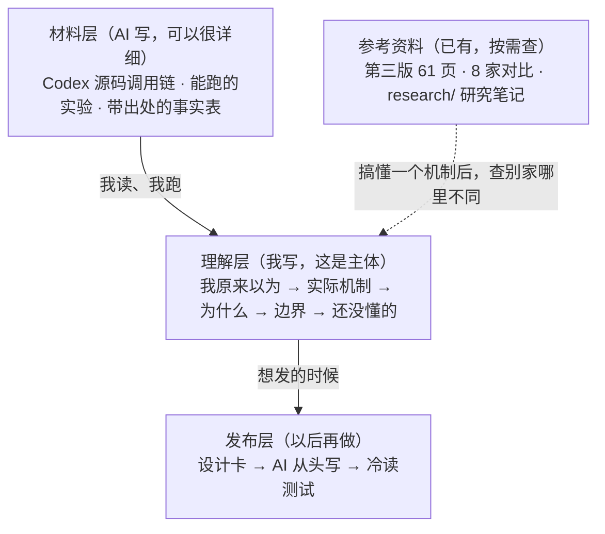

# 上下文管理自学方案

> [!abstract] 速览
> - **目标**：自己从了解到精通 agent 上下文管理。公众号文章以后想发时再单独写。
> - **做法**：分 11 个学习单元，每个单元回答一个问题，以 Codex 为主例，一直追到源码和实验。
> - **分工**：AI 准备材料、核对事实、出追问题；结论和「为什么」由我自己写进笔记。
> - **第三版**：逐批修订冻结，现有内容当参考资料查。
> - **起点**：U01「一次请求里装了什么，各占多少 token」，起步清单见[[#6. 第一个单元的起步清单]]。

---

## 1. 目标和读者

读者是我自己。目标沿用 [[程序猿/ai/上下文管理/如何做好 Agent上下文管理|如何做好 Agent上下文管理]] 定的六项能力：能解释、能推演、能选策略、能读源码、能设计排障、能评估迁移。怎么判断每一项算不算学会，见[[#8. 怎么算学会]]。

公众号文章放到后面。想发某一篇时，用 [[程序猿/ai/上下文管理/docs/技术科普写作方案研究-2026-10-27|写作方案研究]] 第 4–5 节的流程，从这里的笔记和材料重新写。

这份方案沿用了写作方案研究的两个结论：按读者的问题组织内容，8 家对比放进参考资料。改了两处：读者从公众换成我自己；正文从 AI 写换成我自己写。

## 2. 为什么换成自己写

三个版本、约 32.7 万字读下来，问题清单里仍记着「作者目前还没法自己判断内容对不对」。AI 写的稿子再详细，读完也只能做到「看懂了」，做不到「能判断」。

一个例子：[[程序猿/ai/上下文管理/AI 上下文管理 学习笔记|学习笔记]]第 10 题写「压掉的细节绝不可能找回」，这句是从第一版报告里原样带进来的错误。Codex 的磁盘记录里其实还留着旧内容，第二版实验也观察到了。当时我没法发现它错了。

那份学习笔记反倒是整个项目里离「学会」最近的东西：按问题组织，用自己的话写，没懂的地方直接写「还是不明白，要看源码」。这份方案就是把这种写法做成固定流程。

## 3. 三层结构：谁写什么

这张图说明三层各由谁写、谁读：



「详细」指的是往深里写：一个问题以 Codex 为主例，追到源码和实验数据。不往宽里铺。8 家 × 16 类的铺法，正是第三版膨胀成一本书的原因。第三版现有内容和 8 家对比都留着，搞懂一个机制以后再去查「别家哪里不一样」。

## 4. 一个单元怎么走

| 步骤 | 谁做 | 产出 | 练哪项能力 |
|---|---|---|---|
| 1. 先写猜测：不查资料，用几句话写下我现在的答案 | 我 | 笔记「我原来以为」 | 暴露误解 |
| 2. 准备材料：源码调用链、实验、事实表 | AI（提示词 A） | 材料文件 | — |
| 3. 跑实验，对照源码走一遍调用链 | 我（AI 陪着答疑） | 实验记录 | 能读源码 |
| 4. 写笔记：机制、为什么、边界 | 我 | 笔记主体 | 能解释 |
| 5. 核对和追问：新会话核对笔记里的事实，再出 5 道改条件的题 | AI（提示词 B） | 考问记录 | 能推演 |
| 6. （可选）在一个最小 agent 里自己实现一遍 | 我 | 代码 | 能设计排障 |

第 5 步答错的题，回到第 3 步再看，弄懂后补进笔记。第 5 步一定要开新会话，这样出题的 AI 不会被它自己准备的材料带偏。

一个单元做完的标志：AI 核对后，笔记里没有遗留的事实错误；5 道追问至少答对 4 道，答错的已经弄懂并写进笔记。

### 4.1 提示词 A：准备材料（第 2 步）

把 `{}` 换成实际内容。Codex 固定提交见 [[程序猿/ai/上下文管理/ai codiing 工具上下文对比报告/第三版/research/versions|第三版版本表]]（当前是 `76ed3b4`）。

```text
我在自学 agent 上下文管理。这个单元的问题是：「{问题}」。
我的猜测写在 {笔记路径} 的「我原来以为」一节，先读它，材料要能检验我的猜测。

请准备三样材料，写到 {材料路径}：

1. 源码调用链：以 Codex（提交 76ed3b4，codex-rs/）为主例，从入口函数一路走到这个问题的核心逻辑。
   每一步写文件路径和行号，先用一两句话说这一步做什么，再贴关键代码（每段不超过 40 行）。

2. 实验：一个我能自己跑的实验，能直接看到这个机制的效果。
   写清楚怎么跑、预期看到什么、去哪个文件或字段里看。
   优先在第二版实验包（第二版/证据/Codex CLI真实实验-20261014/）的基础上改。

3. 事实表：这个单元用到的每条事实一行，列出处（源码位置 / 官方文档 / 实验）和可信度。
   推测单独列，写成「推测：……，理由：……」。

材料只给事实、代码和实验，结论留给我自己写。
其他 agent 只在做法明显不同时列一行对照，放在材料末尾。
可以参考的已有研究：第三版/research/codex.md、第三版/research/source-map/codex.md，
以及第三版教程的 {第三版对应章节}。这些资料里有已知错误，用之前对照源码核实。
```

### 4.2 提示词 B：核对和追问（第 5 步，新会话）

```text
我在自学 agent 上下文管理。这是我这个单元的学习笔记：{笔记路径}。
材料在 {材料路径}，Codex 源码在 {源码路径}（提交 76ed3b4）。

请做两件事：

1. 核对：逐条检查笔记里的事实说法，对照源码或材料。
   只列有问题的地方：原句、问题、依据（文件:行号）。没问题的不用列。
   我写成「我的理解是……」的推测，判断理由站不站得住，不要求它有出处。

2. 追问：出 5 道题，考我能不能把这个机制用到没见过的情况上。
   每道题改一个条件（比如阈值、工具输出大小、第二次压缩、换一个 agent），
   问我会发生什么、为什么。先只出题，等我答完再批改。
```

## 5. 学习大纲：11 个单元

顺序按前后依赖排：先看清一次请求的组成，后面每个单元都在讲这个请求的某一部分怎么变。U01–U10 来自写作方案研究 4.2 节的问题清单（其中第 1、2 题合并），U11 是结业单元。

| 单元 | 问题 | 第三版可参考 | 学习笔记里的旧题 | 状态 |
|---|---|---|---|---|
| U01 | 我只说了一句话，请求里装了什么，各占多少 token？ | intro-01、intro-02、main-01、main-02、main-04、main-05、src-codex-02、src-codex-03 | — | 下一个 |
| U02 | 一条命令输出几万行，agent 怎么没被撑爆？ | intro-03、main-06、main-07、src-codex-04 | 第 2、2.1、3、4 题 | 未开始 |
| U03 | 压缩之后，它还记得我的哪句话？ | main-08、main-09、src-codex-01、adv-02 | 第 5、5.1、6、7、8、9 题 | 未开始 |
| U04 | 对话越长越贵吗？缓存省的是什么？ | intro-05、main-13、src-claude-code-02 | — | 未开始 |
| U05 | 工具接得越多，agent 为什么越容易用错？ | main-03 | — | 未开始 |
| U06 | 子代理替主会话省了什么？ | main-10 | — | 未开始 |
| U07 | 回退、分叉、恢复，各能撤销什么？ | main-11、src-pi-02、src-grok-build-03 | 第 10 题（要纠错） | 未开始 |
| U08 | 新开一个会话，它怎么还记得我？ | main-12 | — | 未开始 |
| U09 | 窗口真满了会怎样？ | main-14 | — | 未开始 |
| U10 | 怎么判断一种做法更好？ | main-15、main-16、adv-05 | — | 未开始 |
| U11 | 结业：给一个具体场景（比如面试助手）设计上下文策略 | adv-01、adv-03、adv-04 | — | 未开始 |

章节编号对应 [[程序猿/ai/上下文管理/ai codiing 工具上下文对比报告/第三版/outline|第三版大纲]]。学习笔记第 8 题问的「会话记忆」是 Claude Code 压缩流程里的一条支线，所以放在 U03，到时和 Codex 的做法对照着看。

每个单元的文件放在 `自学单元/` 目录下：

```text
自学单元/
├── U01-一次请求里装了什么.md        ← 我的笔记
├── U01-材料.md                      ← AI 准备的材料
└── ……
```

## 6. 第一个单元的起步清单

- [ ] 冻结第三版逐批修订：在 [[程序猿/ai/上下文管理/ai codiing 工具上下文对比报告/第三版/review/修订方案-2026-10-24|修订方案]] §6 进度日志里记一笔，注明改用本方案
- [ ] 建 `自学单元/U01-一次请求里装了什么.md`，从[[#7. 笔记模板]]复制
- [ ] 不查资料，写「我原来以为」：在 Codex 里发一句「帮我看下这个报错」，请求里有哪几块，各大概多少 token
- [ ] 用提示词 A 让 AI 准备材料。实验部分在 [[程序猿/ai/上下文管理/ai codiing 工具上下文对比报告/第二版/证据/Codex CLI真实实验-20261014/README|第二版实验包]]的基础上加一个抓请求的功能，按块拆出 token 数
- [ ] 跑实验，拿到各块的实际 token 数；对照 Codex 组装请求的源码调用链走一遍
- [ ] 写笔记的其余部分
- [ ] 开新会话，用提示词 B 核对和追问，答题，把错题弄懂后补进笔记
- [ ] 填笔记末尾的「公众号素材」
- [ ] 更新[[#5. 学习大纲：11 个单元]]的状态，在[[#11. 进度日志]]记一行

## 7. 笔记模板

```markdown
---
unit: U01
question: 我只说了一句话，请求里装了什么，各占多少 token？
status: 进行中
started: 2026-10-29
tags:
  - AI/上下文管理
  - 自学单元
---

# U01 我只说了一句话，请求里装了什么，各占多少 token？

## 我原来以为
（动手之前写，写完不再改。）

## 实际机制
（跟着源码和实验写。引用源码写「文件:行号」。）

## 为什么这样设计
（能推导的写算式；有公开证据的写出处；推测写成「我的理解是……，理由是……」。）

## 实验记录
- 条件：CLI 版本、模型、关键配置
- 结果：
- 和我的猜测差在哪：

## 边界
（这个结论在什么情况下不成立。一两条就够。）

## 考问记录
| 题目 | 我的回答 | 对错 | 错在哪 |
|---|---|---|---|

## 还没懂的

## 公众号素材
- 我原来以为：
- 让我想通的那一步：
- 最管用的例子：
```

## 8. 怎么算学会

| 能力 | 在哪练 | 过关标准 |
|---|---|---|
| 能解释 | 每个单元第 4 步 | 合上材料，能用两三句话说清结论和原因 |
| 能推演 | 每个单元第 5 步 | 5 道改条件的追问至少答对 4 道 |
| 能读源码 | 每个单元第 3 步 | 不看材料，能在 Codex 源码里找到这个机制的入口，讲出调用链 |
| 能选策略 | U11 | 给一个场景，能说出选哪种做法、代价是什么、什么时候换 |
| 能设计排障 | 第 6 步、U09 | 能按症状定位到出问题的环节；做了第 6 步的单元，自己实现能跑通 |
| 能评估迁移 | U10、U11 | 能设计一个对照实验，证明一种做法比另一种好 |

## 9. 两件要顺手做的事

**公众号素材在学的时候留。** 每个单元结束时，花 10 分钟填笔记末尾的三条：我原来以为什么，哪一步让我想通了，哪个例子最管用。这三条就是将来公众号文章设计卡里的「读者误解」和「贯穿例子」。学会以后再回头，很难想起自己当初卡在哪里，写作方案研究 2.1 节说的「知识的诅咒」就是这个意思。

**引用 Claude Code 源码时标出来。** spec 写明这份非官方源码只用于个人学习。笔记里可以用，但凡是引用它的地方都标「来源：Claude Code 非官方源码 v2.1.88」，以后改写成公众号文章时好剔除。

## 10. 什么时候换方案

> [!tip] 以动手搭建为主线
> 如果「精通」的目标变成在自己的项目里（比如面试助手）把上下文管理做出来，就把第 6 步升成主线：先搭一个最小 agent，每个单元先在它身上撞到问题，再看 Codex 怎么处理，最后自己实现。学得最扎实，每个单元花的时间大约翻倍。

> [!note] AI 写详细讲解，我读完复述
> 某段时间特别忙时可以临时换成这种：最省力，但基本只能练到「能解释」，和前三个版本的体验差不多。忙完再回到主方案。

## 11. 进度日志

- 2026-10-29：确定方案，冻结第三版逐批修订。下一步：U01 起步清单。

## 相关文档

- [[程序猿/ai/上下文管理/docs/技术科普写作方案研究-2026-10-27|写作方案研究]]：本方案的出发点；以后写公众号用它第 4–5 节的流程
- [[程序猿/ai/上下文管理/如何做好 Agent上下文管理|如何做好 Agent上下文管理]]：最初的目标和前两版复盘
- [[程序猿/ai/上下文管理/AI 上下文管理 学习笔记|AI 上下文管理 学习笔记]]：旧问题按第 5 节分进各单元
- [[程序猿/ai/上下文管理/ai codiing 工具上下文对比报告/第三版/outline|第三版大纲]]：参考资料索引
- [[程序猿/ai/上下文管理/ai codiing 工具上下文对比报告/第二版/证据/Codex CLI真实实验-20261014/实验报告|第二版 Codex 实验报告]]：U01 实验的起点
