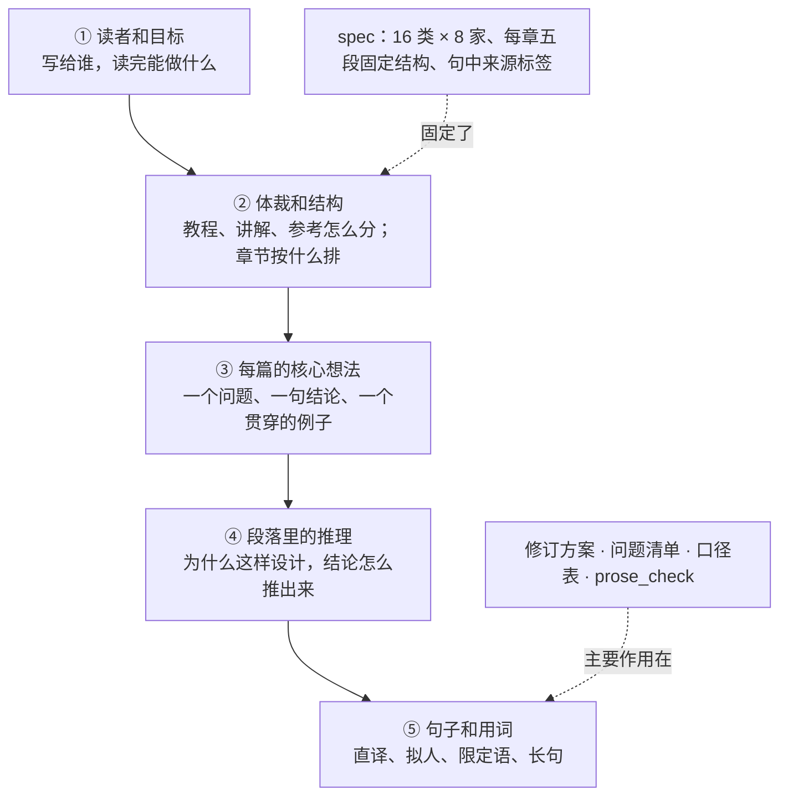
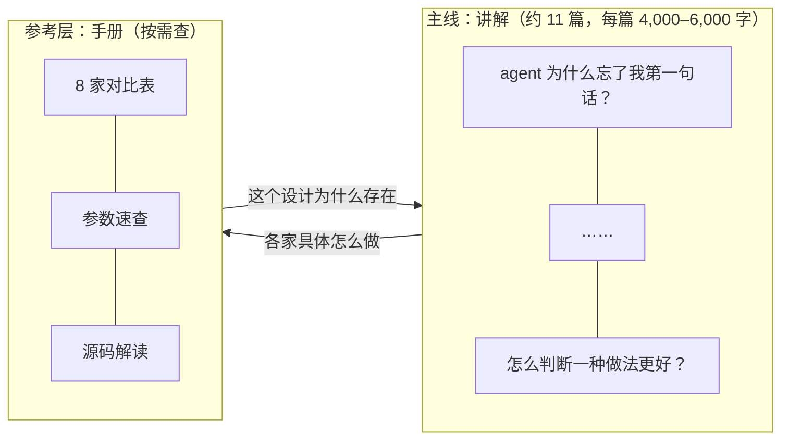
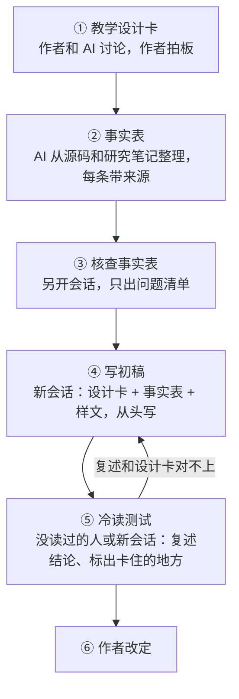

# 技术科普怎么写：研究结论与本项目的写作方案

> 2026-10-27。起因：第三版按批修订后，读起来仍不理想。这份文档不在现有写法上继续修补，从「什么是好的技术写作」重新出发，给出本项目的写作方案和配套的 AI 工作流。

## 速览

- **改写不理想，主要原因在句子之上。** 第三版每一章同时是教程、对比报告和参考手册，章节按「16 类能力 × 8 个 agent」的调研矩阵排，而读者是带着问题来的。修订方案、问题清单和检查脚本都在改句子，碰不到这一层。
- **规则越加越多，问题换个样子出现。** 口径表两批内从 16KB 涨到 32KB；限定语被脚本拦下后，又变成了「先查……再查……」的排查清单。维基百科编辑整理 AI 文本特征时也提醒过：只把这些特征当成要修的问题，结果是它们更难被发现。
- **好的技术科普有几条共同做法**：一篇只回答一个读者关心的问题；一个具体例子贯穿全篇；冲着读者的误解写；讲清「为什么」；删掉不服务于核心想法的内容；中文用动词说话、句子短。
- **推荐方案：问题驱动的讲解主线 + 独立的参考层。** 主线约 11 篇，每篇回答一个问题，以一个 agent 为主例，配一个复现开头场景的演示。8 家对比、参数和源码解读放进参考层，按手册的写法写。第二版的「样章 02 · 压缩之后，它还记得你的哪句话？」已经接近这种写法，可以直接当样板。
- **AI 工作流跟着改**：先定每篇的「教学设计卡」（一个问题、一句结论、读者的误解、贯穿例子、不讲什么），事实另列一张表单独核查；AI 依据设计卡从头写，不在旧稿上改；文风靠一两段样文定，不靠禁令清单；验收时让没读过的人复述核心结论。
- **建议先试一篇**：按新方法重写第 10 章（按需加载），和现稿对着读，再决定要不要整体切换。

前提假设：读者以 `如何做好 Agent上下文管理.md` 里写的为准，即对 AI 工作原理感兴趣的公众和开发者，计划发在公众号、小红书和博客。读者定位变了，第 4 节的推荐要跟着调整。

---

## 1. 改写为什么不理想

### 1.1 三个现象

**事实改对了，「为什么」没了。** 第 10 章（main-03）改写前，§2.2 有一段解释 Codex 为什么把「MCP 工具要不要延迟加载」交给模型元数据，而不让用户配置：延迟加载要求模型会用检索工具，没训练过的模型拿到检索入口反而容易误用；代价是用户没法强制开启。读者读完知道这样设计图什么。改写后这段删了，那一节的结尾变成「这里要查的是模型配置与实际暴露策略」。改写前的事实确实有错（技能怎么被选中就写错了），但改写的做法是把判断删掉，而没有把它标成推测留下来。

**规则管住一处，问题跑到另一处。** 第 20 章第一轮改写后，限定语从每千字 0.9 处涨到 7.9 处，于是加了 `hedge` 检查。下一批的 Codex 通过了检查，判断又改成了「先查……要验证……」，第 10 章这类句子每千字从 2.3 处涨到 7.8 处。口径表里「不能写 X」的禁止句从 12 条涨到 27 条，有被下一批原样搬进正文的风险。

**体量本身就是门槛。** 第三版 61 页，约 32.7 万汉字（含弹窗），相当于一本书。主线章的篇幅基准是 8,000–13,000 字，低于 8,000 算「展开不足」，这条规则在鼓励写长。公众号一篇通常三五千字，一章主线要拆成两三篇才发得出去。

### 1.2 问题出在哪一层

写作质量可以拆成五层。上层没定好，下层改得再细，也只能让句子更顺，没法让读者「读完懂了」。

这张图要看的是：现有的修订工具几乎都作用在第 ⑤ 层，第 ② 层被 spec 固定住了，没人去动。具体有四个原因。

**1. 体裁混在一起。** Diátaxis 文档框架把技术文档分成四类：教程（带人学会）、操作指南（帮人完成具体任务）、参考（准确、中立地列事实）、讲解（说清为什么）。它的作者认为，大量文档问题都出在这几类的边界被混淆。第三版每一章主线同时承担了四种任务：Codex 主线讲解是讲解，7 个弹窗和对比表是参考，失败排查是操作指南，小测验属于教程。这几种写法的要求互相拉扯：参考要全面、中立、句句有出处，讲解要取舍、有观点、敢下判断。AI 想在同一页里两边都满足，结果就是每句都对，读完不知道重点。

**2. 章节结构来自调研矩阵。** 16 类能力和 8 个 agent 是研究的组织方式，适合做表，不适合当讲解顺序。读者的问题是「agent 为什么忘了我第一句话」，答案分散在窗口、组装、压缩、记忆四章里；反过来，每一章又必须把 8 家都讲到。

**3. 准确性要求和讲解目标在正文里正面冲突。** spec 要求每条工具行为都带来源和可信度标签。教程里最有价值的是「为什么这样设计」，偏偏设计意图最难从源码里核实。第一稿让 AI 自由发挥，它编出一些看似合理的理由；修订稿让 AI 核查，它就把这些理由删掉或层层加限定。两种结果都不是读者要的。

**4. 风格被当成外加的一层皮。** Head First 规范列的是形式：场景开头、人话直给、动动脑、没有傻问题、要点小结。AI 很容易把这些格子填满，可格子填满了，不代表每章先想清楚了「读者读完该记住哪一句」。Julia Evans 总结的十三种让人困惑的讲解里，「漏掉关键信息」和「只讲是什么、不讲为什么」，都不是形式检查能发现的。另外，spec 给进阶部分定的「受控中文」参照 ASD-STE100。这套规范原本是为航空维修手册设计的，适合写操作步骤，不适合写讲解。正文越改越像排查清单，和它也有关系。

AI 修订本身也有天花板。Chakrabarty 等人（CHI 2025）请职业作者标注并修改 LLM 写的段落，归纳出七类毛病，再让 LLM 按这些类别去改。结果是模型有时把一个套话换成另一个套话；最改不好的一类是「缺乏具体细节」，模型往往补不出有意思的细节。作者认为部分原因在于对齐训练让模型偏向笼统、「保险」的写法。本项目的经验一样：问题清单能让 AI 删掉「杠杆」「形状」，却没法让它补上一个读者一看就懂的例子。

---

## 2. 好的技术写作：研究里反复出现的七条

每条写三件事：它说什么，出处，对本项目意味着什么。

### 2.1 先想清楚，写出来才清楚

Distill 的《Research Debt》（Olah & Carter, 2017）把「把一个想法讲明白」叫作解释的劳动（interpretive labor）。文章认为好的讲解常会改变想法本身：作者为了讲清楚，会找到更好的抽象、记号和图；讲不清楚，往往说明自己还没想清楚。Pinker 在《The Sense of Style》里把晦涩文字的头号原因归为「知识的诅咒」：作者忘了读者不知道自己知道的东西。

对本项目：每篇动笔前，作者自己要能用两句话说出结论。说不出来，说明还在研究阶段，不该开始写。

### 2.2 从具体例子开始，用到结尾

「具体渐隐」（concreteness fading）的研究综述（Fyfe 等, 2014）建议先给具体材料，再一步步过渡到抽象表示。Julia Evans 的清单里也有「一上来就抽象」「没有例子」「例子不真实」三条。3Blue1Brown、Bartosz Ciechanowski 的讲解都是先让你看到一个具体现象，再给名字和公式。

对本项目：一篇一个例子，从开头用到结尾，演示复现的也是这个例子。样章 02 里「小周说过不许改方法签名」从开场一直用到模拟器，是很好的示范。第三版主线开头的场景，往往两三段之后就让位给配置项了。

### 2.3 冲着读者的误解写

Derek Muller（Veritasium 的作者）的博士研究比较过两种物理教学视频。一种讲解清楚，学生评价高，看完测验成绩却没有提升，学生对自己原来的错误想法反而更有把握了。另一种先让扮演学生的演员说出常见误解，再由老师纠正，学生觉得它更「乱」，测验成绩却大约翻了一倍。

对本项目：每篇先找出读者最可能带着的一两个误解，让读者先猜，再揭晓答案。「不是……而是」这个句式本身没有问题，前提是被否定的说法读者真会那样想。问题清单 C8 已经这样判断，这项研究给了它依据。

### 2.4 讲「为什么」，并让读者能自己验证

Julia Evans 的第 13 条是「只讲是什么、不讲为什么」：只列功能，读者没法判断它适不适合自己。Diátaxis 里「讲解」这一类的任务就是回答为什么。Bret Victor 在「可探索的讲解」（Explorable Explanations, 2011）里主张让读者能动手检验作者的说法，不必只靠相信。

对本项目：「为什么」有几种来源，可信度不同，写法也该不同（见 4.4）。能从约束推出来的，比如窗口大小、token 数、请求次数，就把推导写出来，读者可以自己算一遍。

### 2.5 删掉不服务于核心想法的内容

Mayer 的多媒体学习原则里，一致性原则说的是：去掉无关的文字、图片和声音，学得更好。Rey（2012）对「诱人细节」（seductive details）的元分析发现，有趣但无关的内容会降低回忆和迁移成绩。Julia Evans 也把「一次引入太多概念」列为困惑的来源。

对本项目：8 家的预算算法、默认值、配置项，对理解「为什么要渐进披露」几乎没有帮助，放进主线只会分散注意力，它们属于参考层。Head First 式的玩笑和插图也是一样，帮助理解的才留。

### 2.6 不同读者要不同的文本

认知负荷理论里的专长反转效应（expertise reversal effect，Kalyuga, 2007）发现：对新手有帮助的详细引导，对已经懂的人会变成负担，甚至降低学习效果。

对本项目：spec 想用同一套文本把读者从 L1 带到 L5，一份文本做不到。主线写给「对 AI 感兴趣、用过 agent、不懂上下文管理」的读者；想深挖的读者去参考层和源码解读。

### 2.7 中文用动词说话

余光中在《中文的常态与变态》等文章里批评过西化中文的几种毛病：用「进行」「作出」这类弱动词加抽象名词，代替一个本来就够用的动词；抽象名词做主语；「的的不休」；被动句滥用。AI 写的中文这几种毛病都常见，再加上直译的比喻（杠杆、形状、复利）和对仗式标题。

对本项目：句子的主语用具体的东西（agent、模型、这条消息），动词说清它做了什么，一句只说一件事。阮一峰的网络日志、吴军的《数学之美》可以当文风参照：用词平实，一段讲一个点，例子取自读者熟悉的事物。

### 附：项目里已有、应该保留的两条

- **类比只说明一件事，并交代它在哪里不成立。** Julia Evans 列了「牵强的类比」；Glynn 的类比教学模型第五步就是「指出类比在哪里失效」。口径表 §1 已经这样要求。
- **确定的话直接说，不确定性集中放。** Pinker 推崇的「经典文体」要求作者对读者说话时有把握，他批评过强迫性的限定，主张只在有具体理由时才加。CONVENTIONS §4「限定语」一节已经是这个思路，问题在执行方式，见第 5 节。

---

## 3. 几种写法的比较

| 写法 | 代表作品 | 核心做法 | 擅长 | 代价 | 在本项目的位置 |
|---|---|---|---|---|---|
| 问题驱动的讲解文 | Julia Evans 的博客、Anthropic 工程博客、阮一峰网络日志、样章 02 | 一篇回答一个问题，一个贯穿例子，讲清机制和原因 | 让读者懂，适合连载 | 作者要有取舍和判断 | **主线的主体** |
| 可探索的交互讲解 | Bartosz Ciechanowski、Distill、Bret Victor | 文字围绕一个可操作的模型展开，读者调参数验证 | 有参数、有过程的机制 | 开发成本高 | 每篇一个演示，复现开头的例子 |
| 从零搭一个 | Karpathy《Neural Networks: Zero to Hero》、李沐等《动手学深度学习》 | 跟着写代码，每个机制都为解决刚撞上的问题而加 | 培养「能实现」（L3） | 要维护可运行代码，读者要会编程 | 替代方案 A，适合做一条独立的开发者路线 |
| 图解 | Jay Alammar《The Illustrated Transformer》、小林 coding 图解系列 | 一张图讲一个点，文字配合图 | 传播、单点理解 | 讲不了取舍和推导 | 小红书单点图解 |
| Head First 式 | Head First 系列 | 场景、多种复述、动动脑、问答、小结 | 零基础入门 | 篇幅膨胀，中文里容易显得造作 | 只借用「先猜再揭晓」「你可能会问」，不当固定模板 |
| 对比报告、参考手册 | 现在的 8 家对比表、附录 | 统一维度，中立、全面、带出处 | 查阅、横向比较 | 没法从头读到尾 | **参考层** |
| 事故复盘 | 工程团队的 postmortem | 从一次失败倒推原因链 | 讲取舍和失败模式 | 场景要真实、前后一致 | 进阶部分 |

---

## 4. 本项目的写作方案

### 4.1 推荐：问题驱动的讲解主线 + 独立的参考层

这张图要看的是两层各管什么，以及它们怎样互相链接：

两层的写法不同：

| | 主线 | 参考层 |
|---|---|---|
| 回答 | 为什么会这样，我该怎么做 | 某家具体怎么做，参数是多少 |
| 主角 | 一个 agent（通常是 Codex），其他家只在分歧有意思时出场 | 8 家并列 |
| 语气 | 有观点，敢下判断，推测明说是推测 | 中立，不评价 |
| 来源 | 放段尾或脚注，不打断句子 | 每条都带来源和可信度标签 |
| 篇幅 | 有上限，没有下限 | 按覆盖面定 |

现有的内容不会浪费：对比表、弹窗、源码解读直接成为参考层，主线从现有章节里取事实，按问题重新组织。7 个交互演示也都用得上，只是要改成复现所在篇的开头场景。

### 4.2 主线按读者的问题重排

第一版问题清单。标题就是读者会问的话：

| # | 读者的问题 | 覆盖的类（spec §4） |
|---|---|---|
| 1 | agent 为什么忘了我第一句话？ | 窗口、token 计量（5） |
| 2 | 我只说了一句话，请求里怎么有 2.8 万 token？ | 请求组装、规则文件、动态注入（1、2、4） |
| 3 | 工具接得越多，agent 为什么越容易用错？ | 按需加载（3） |
| 4 | 一条命令输出几万行，agent 怎么没被撑爆？ | 工具输出控制、历史裁剪（6、7） |
| 5 | 压缩之后，它还记得我的哪句话？ | 压缩、多模态（8、9） |
| 6 | 对话越长越贵吗？缓存省的是什么 | 缓存（13） |
| 7 | 子代理替主会话省了什么？ | 子代理（10） |
| 8 | 回退、分叉、恢复，各能撤销什么？ | 会话时间线（11） |
| 9 | 新开一个会话，它怎么还记得我？ | 跨会话记忆（12） |
| 10 | 窗口真满了会怎样？ | 失败恢复（14） |
| 11 | 怎么判断一种做法更好？ | 扩展点、评估（15、16） |

全书还需要一个贯穿的核心想法。你在学习笔记里写过「把历史变成可重建的东西，把当前窗口变成它的投影」。换成读者能懂的话：完整的历史存在磁盘上，每次请求只从里面挑一部分发给模型；上下文管理就是决定挑哪些、怎么挑。这 11 篇都在讲「挑」的某一个方面，读者读完每篇，都能把它放回这句话里。

### 4.3 一篇主线怎么写

下面是一个写作顺序，供参考，不必每一步都有：

1. **标题是读者的问题。**
2. **开头是具体场景**，后果写实：第几轮、改了什么、多花了多少。
3. **让读者先猜**：抛出一个读者最可能猜错的问题。
4. **一句话给出核心想法**，配一张图。
5. **跟着例子走一遍机制**，以一个 agent 为主例。
6. **讲为什么**：能推导的写推导，有公开证据的引证据，推测就说是推测。
7. **读者能做什么**：两三条具体做法。
8. **一个演示**，复现开头的场景，让读者改条件看结果。
9. **边界**：这个结论在什么情况下不成立，一两条就够。

样章 02 基本就是这个顺序。

### 4.4 「为什么」按来源分四类写

教程里最有价值的是「为什么」，最容易出错的也是它。按来源分开写，就不用在「编」和「删」之间二选一：

| 类型 | 例子（取自第 10 章） | 写法 |
|---|---|---|
| 机制事实 | Codex 在模型元数据 `supports_search_tool` 为 true 时，把 MCP 工具设为延迟加载，模型用 `tool_search` 检索 | 直接陈述，来源放段尾 |
| 可推导的理由 | 60 个工具 × 每个约 200 token = 1.2 万 token，全量发送时每次请求都带上 | 写出算式，读者能自己验算 |
| 有公开证据的判断 | 工具多了更容易选错 | 引证据：Anthropic 2025 年 11 月的工程博客写到，工具多时最常见的错误是选错工具和填错参数，名字相近的尤其如此；开启工具检索后，他们内部的 MCP 评测里 Opus 4 的准确率从 49% 升到 74% |
| 作者的推测 | Codex 为什么把这个开关放在模型元数据里，而不交给用户配置 | 写成「我的理解是……，理由是……」，说一次，不拆成散在各处的限定语 |

第三类正是现稿里写成「减少候选是一个排查方向，效果要用同一任务对照验证」的那句。找到证据，它可以直接说；找不到，就归到第四类，明说是推测。第四类也正是改写前被删掉的那段「为什么交给模型元数据」。

### 4.5 中文怎么定

- **用样文定文风。** 选两三段样文：样章 02 的开头、第 1 章试点修订后的段落，再加一篇你读着舒服的中文技术文章。写作提示词里附上样文，比附三十条禁令管用。
- **规则写成正面做法，控制在十条以内。** 比如「主语用具体的东西」「一句只说一件事」「每轮、每次写清是哪一种」。禁止句不再增加；要提醒的坑，用「原句 → 改句」的对照来示范。
- **口径表只放事实和术语。** 跨章统一的说法（缓存成本怎么算、五个动作是哪五个）是事实的唯一来源，要保留；文风禁令从里面移出去。

### 4.6 替代方案

**A. 从零搭一个 agent。** 用几百行代码写一个最小 agent，模型用假的，读者跟着一步步加计数、截断、压缩、子代理。每个机制都在读者刚撞上问题时出现，「为什么」自然就有了。如果目标定为「开发者能自己实现」（L3），选这个。代价是要写和维护可运行的代码，读者也得会编程。它更适合在主线之后做成一条独立路线，不适合替代主线。

**B. 保留现有结构，继续逐批修订。** 只想把第三版收尾、不打算动结构时选这个。按目前的经验，句子会更顺，但 1.2 节说的结构问题还在，读者读完一章仍然难说出重点。

---

## 5. 怎么让 AI 写出来

这张图要看的是作者在哪一步把关，以及核查放在写作之前：

几个做法和理由：

1. **作者把关设计卡，不逐句把关正文。** 问题清单里写过，作者目前没法自己判断内容对不对。但「这个问题我关不关心」「这句结论我看没看懂」，作者完全能判断。设计卡把作者的判断放在最省力、影响最大的位置。
2. **核查和写作分开，核查对象是事实表。** 事实在动笔前核好，AI 写的时候就不必一边写一边自保，限定语自然少。这是把第 20 章两步法再往前挪一步：先核后写，而不是写完再核。
3. **从头写，不在旧稿上改。** 旧稿只作为素材进入事实表。在旧稿上改，结构就被旧稿锁住了。
4. **验收看理解，不看计数。** 冷读测试的提示词可以很简单：「读这一篇，用两句话说出它的核心结论；列出你读到哪里停下来想过；回答开头的预测题。」复述和设计卡里的结论对不上，这篇就没写成。`prose_check` 继续用，但只当报警器，不当目标。最好再找一两个真人来读。Julia Evans 的第一条讲的就是作者对读者知识的假设会过时，她的办法是拿真正的新手来测。
5. **一次写一篇。** 一篇 4,000–6,000 字，一个会话写完，作者也读得过来。

### 5.1 示例：第 10 章的教学设计卡

> **题目**：工具接得越多，agent 为什么越容易用错？
>
> **读者**：用过 Claude Code 或 Codex、接过几个 MCP 服务器的人；知道 MCP 是接外部工具的协议，不知道工具定义怎么进上下文。
>
> **读者最可能的误解**：① 工具接上了只是多了几个选项，不用就不占地方；② 按需加载是 Claude Code 独有的功能。
>
> **核心结论（两句话）**：工具定义和聊天记录一样，要随请求发给模型，工具越多，占的窗口越大，模型要比较的候选也越多。渐进披露先只给一份目录，模型选中了再给完整定义。
>
> **贯穿例子**：6 个 MCP 服务器、60 多个工具、每个约 200 token，合计 1.2 万 token。
>
> **主例**：Codex 的 `tool_search`。其他家只出场一次：Grok Build 的 MCP 工具不进模型的工具列表，模型先用 `search_tool` 检索，再用 `use_tool` 调用，和 Codex 形成对照。
>
> **为什么**：算式（4.4 表第二行）；公开证据（4.4 表第三行）。
>
> **读者能做什么**：用不到的服务器别常驻；技能描述写清「什么时候用」，比如写「生成、读取或编辑 PDF」，别只写「处理文档」。
>
> **演示**：滑块调工具数，对比「全量发送」和「目录 + 检索」每次请求带多少 token。
>
> **边界**：工具只有十几个时，全量发送更简单，检索还要多一次工具调用；缓存能让重复发送更便宜，但不会让它少占窗口。
>
> **不讲**：8 家的目录预算算法、四种延迟机制的完整对比（放参考层）；@ 文件引用（并入第 2 篇）。

### 5.2 按这张卡写出的开头

> 你给 agent 接了 6 个 MCP 服务器：GitHub、Jira、Sentry、数据库、Figma、内部知识库。每个服务器带 8 到 15 个工具，加起来 60 多个。接完以后它开始出错：查 issue 时调了数据库工具，两个名字相近的工具，参数也会填混。
>
> 先算一笔账。每个工具都有名称、说明和参数格式，平均算 200 token，60 个工具就是 1.2 万 token。如果这些定义全部直接发给模型，不管这次用不用得上，它们都要跟着每次请求发过去。agent 每调一次工具就要再发一次请求，一个任务做下来，这 1.2 万 token 会被重复发送很多遍。
>
> 候选多了，也更容易挑错。模型每次选工具，都要在 60 多份说明里比一遍。Anthropic 在 2025 年 11 月的一篇工程博客里写到，工具多的时候，最常见的错误就是选错工具和填错参数，名字相近的尤其容易混。
>
> 办法很直接：先给模型一份目录，只写有哪些工具、各自干什么；模型选中了，再把完整定义发过去。这种做法叫渐进披露（progressive disclosure）。Codex 在模型支持工具检索时就这样处理 MCP 工具，下面跟着那 60 个工具走一遍。

可以和现稿第 10 章 §01 对着读。用到的事实几乎没变，读者在第三段就知道了为什么要这样做，每一步也都能自己验证。

---

## 6. 动手之前要先想清楚的三件事

1. **体量和渠道对不上。** 32.7 万字是一本书的量，不适合公众号连载。建议先只做主线 11 篇，参考层按需补。主线篇幅设上限，不设下限。
2. **Claude Code 源码不宜进公开版本。** spec 写明这份泄露源码「只用于个人学习和分析」，而教程计划发到公众号、小红书和博客。公开版本里，Claude Code 部分建议只用官方文档和能观察到的行为；源码分析留在私人笔记里，或者只对开源的 Codex、opencode、pi 等做。
3. **事实按可信度分级使用。** 作者没法自己判断事实对错，主线就优先用高可信的事实：官方文档写明的、源码里能直接读到的、能自己做实验复现的（第二版的 Codex 真实实验就属于这类）。只在研究笔记里出现过一次的细节，留在参考层，带上标签。

## 7. 建议的下一步

1. 确认读者定位和发布渠道（第 6 节第 1 条）。
2. 按第 5 节的流程试写一篇：把第 10 章改成「工具接得越多，agent 为什么越容易用错？」，和现稿对着读，再找一个没读过的人读一遍。
3. 试写效果好，再决定是否把修订方案切换到新结构；效果不好，退回 4.6 节的方案 B。

---

## 参考资料

写作与讲解

- Julia Evans, [Patterns in confusing explanations](https://jvns.ca/blog/confusing-explanations/)（2021）：十三种让人困惑的讲解
- [Diátaxis](https://diataxis.fr/start-here/)：文档四分法（教程、操作指南、参考、讲解）
- Chris Olah & Shan Carter, [Research Debt](https://distill.pub/2017/research-debt/)（Distill, 2017）
- Bret Victor, [Explorable Explanations](https://worrydream.com/ExplorableExplanations/)（2011）
- Steven Pinker 谈知识的诅咒：[APS Observer 文章](https://www.psychologicalscience.org/observer/the-curse-of-knowledge-pinker-describes-a-key-cause-of-bad-writing)；原书《The Sense of Style》（2014）第 2、3 章
- 余光中《中和西》中的《中文的常态与变态》《论的的不休》；香港教育局的[导读材料](https://www.edb.gov.hk/attachment/tc/curriculum-development/kla/chi-edu/resources/secondary-edu/lang/S19.pdf)

学习科学

- Derek Muller & Manjula Sharma, [Tackling misconceptions in introductory physics using multimedia presentations](https://openjournals.library.sydney.edu.au/IISME/article/view/6345)；[THE Journal 的报道](https://thejournal.com/Articles/2015/05/05/Watching-Videos-Does-Not-Necessarily-Lead-to-Learning.aspx)
- Kalyuga, [Expertise Reversal Effect and Its Implications for Learner-Tailored Instruction](https://www.uky.edu/~gmswan3/EDC608/Kalyuga2007_Article_ExpertiseReversalEffectAndItsI.pdf)（2007）
- Rey, A review of research and a meta-analysis of the seductive detail effect, *Educational Research Review* 7(3), 2012, doi:10.1016/j.edurev.2012.05.003
- Mayer, [Multimedia Principles](https://ugc.futurelearn.com/uploads/files/7d/d6/7dd6188d-c343-4311-b064-ac98d2c95abc/Multimedia_Principles._R._E._Mayer__2020.pdf)（2020）
- Fyfe, McNeil, Son & Goldstone, [Concreteness fading in mathematics and science instruction](https://doi.org/10.1007/s10648-014-9249-3)（2014）
- Glynn 的类比教学模型（TWA）：[CSUN 的整理](https://csun.edu/science/ref/analogy/analogy.htm)

AI 写作

- Chakrabarty, Laban & Wu, [Can AI writing be salvaged?](https://arxiv.org/abs/2409.14509)（CHI 2025），改写结果见全文 §6.4、§7.2
- Wikipedia, [Signs of AI writing](https://en.wikipedia.org/wiki/Wikipedia:Signs_of_AI_writing)，尤其是「不要只把这些特征当成要修的问题」的提醒
- 防御性写作的论文（arXiv 2610.11355）：见 `第三版/review/问题清单.md` C11

领域样板

- Anthropic, [Introducing advanced tool use](https://www.anthropic.com/engineering/advanced-tool-use)（2025-11-24）：工具检索与选错工具的数据
- Anthropic, [Effective context engineering for AI agents](https://www.anthropic.com/engineering/effective-context-engineering-for-ai-agents)：同一主题的英文讲解样板
- 李沐等，[《动手学深度学习》](https://zh.d2l.ai)：中文「边讲边做」的样板
- 本仓库 `ai codiing 工具上下文对比报告/第三版/refs/CodexCLI上下文管理-交互教程_Notion版.html`（样章 02）：问题驱动写法的现成样板
